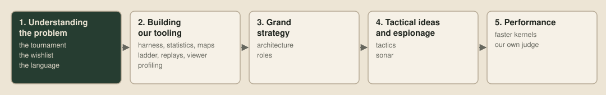
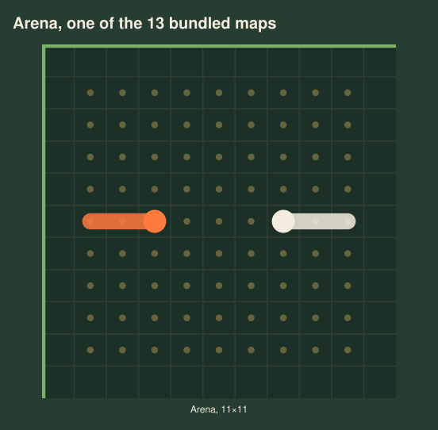
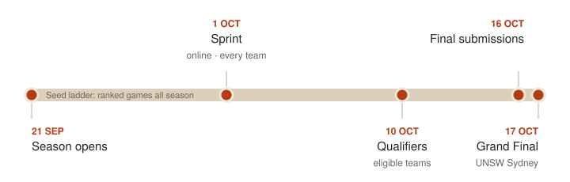
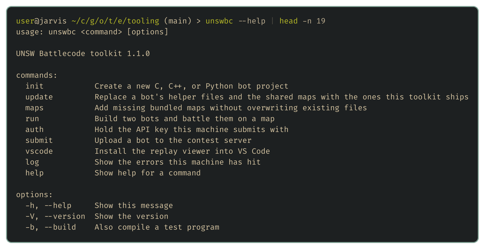
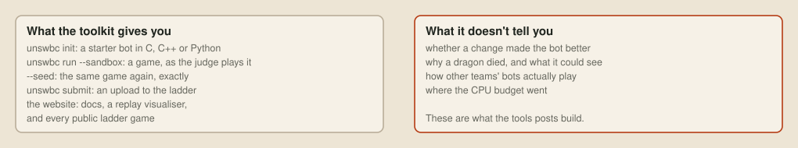

# Introducing The Loong Game

Hi all! The Loong Game is a little open source series running alongside UNSW Battlecode 2026. I'll be building tools for `unswbc`, trying out odd bot ideas and writing up what I learn along the way.

## Who I am

I'm Kieran Hannigan, and I run [over|yonder](https://over-yonder.tech), a performance engineering practice. Before that I spent about ten years as an electrical engineer on critical power and integrated control systems, finishing up as a Principal Engineer leading a national renewable energy team.

## The series

- I'll try weird bot ideas, most of which won't work, and post the failures as well as the successes. One I'm keen on is testing ~~my-name-is~~-jev to see how smart this highly hyped 'System 1' model is.
- Beginner topics include getting a first bot running and reading the 7×7 window properly, with sprinting into our own tails as a rite of passage.
- For unswbc, I'll build round-robin harnesses, offline Elo ladders, replay analysis and whatever else I end up wanting at 2am.
- I'll also examine the WebAssembly from the judge's toolchain, to see where the points go and how to fit more search into the same budget.

The top teams will turn up with advanced strategies and plenty of tooling, and most teams won't have either. This series is meant to raise the tide a little, sharing the tools, techniques and mistakes so more teams can give the top of the ladder a proper game. Everything's open source, and each post links to the code and results behind it.

And if I lose, will I retire as a performance engineer? No. I've got a get out of jail free card: the online judge only accepts C, C++ and Python source, so nobody gets to submit micro-optimised WASM kernels. We'll still dig into that later :)

## The tournament

UNSW Battlecode is a bot programming competition. You write one program, every dragon on your team runs its own copy, and each dragon sees only the 7×7 square around its head. Dragons eat pearls, split, and talk only through sonar. The [official site](https://battlecode.au) and [game docs](https://game.battlecode.au/docs/) have the full rules.

The ladder runs all season and sets the seeding. The Sprint is open to every team, and the Qualifiers and in-person Grand Final are for teams whose members all study in the Asia-Pacific or are Asia-Pacific citizens studying overseas. The organisers have also said on Discord that **tournament maps are unseen**, so don't tune your bot to the ladder's maps, and that **each new submission resets your rating's K factor**, so a fresh upload swings your rating harder.

The organisers' `unswbc` toolkit gives you a starter bot and runs matches in the judge's own sandbox, compiled with the judge's clang, so a game on your machine plays out as it would on the ladder. The website adds the documentation, a replay visualiser and the public replays of every ladder battle.

## Missing pieces

The toolkit gets you as far as playing a game and watching it. It won't tell you whether a change is helping, and that's essential if we want to improve a bot. We'll also want to know why our dragons die and what they could see at the time, how other teams play, and where the CPU budget goes.

Building those tools is the next stage of the series, and the [next post](02-the-wishlist.md) works out which ones we need.
