# The wishlist

Most of us start the same way: we run `unswbc init`, get a starter bot going, and immediately have a list of ideas for making it better. Before trying any of them, we need a way to tell whether a change actually helped. This post tries to answer that using only the official toolkit and its starter bots, and every time we get stuck, we'll write down the tool that would have got us unstuck. That list is the wishlist, and building it is the next stage of the series.

## Two starter bots and one game

`unswbc init` makes a starter bot in C, C++ or Python. We'll make one in C and one in Python and play them against each other in the judge's sandbox:

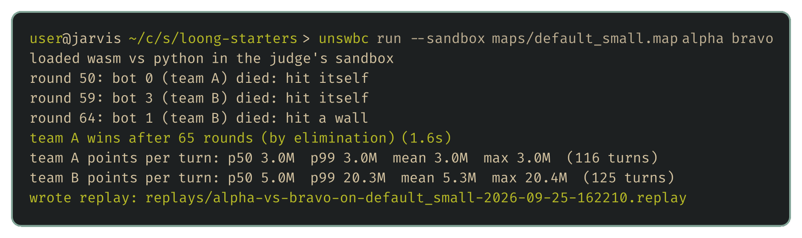

The game saves a replay for the [visualiser](https://game.battlecode.au/visualiser) and prints how many CPU points each team spent. One game obviously isn't statistically significant, though. Each run picks a random seed, which decides where pearls appear and what both bots' random numbers come out as, so running the match again gives a different game, and passing a seed back with `--seed` replays one exactly:

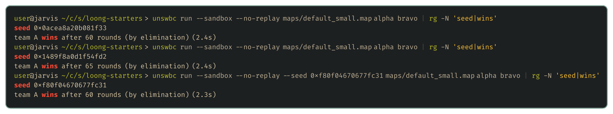

## Every map, both sides

A bot can be strong on one map and hopeless on another, and the starting side matters too. A few lines of [fish](https://fishshell.com) play every one of the 13 bundled maps, with each bot taking each side:

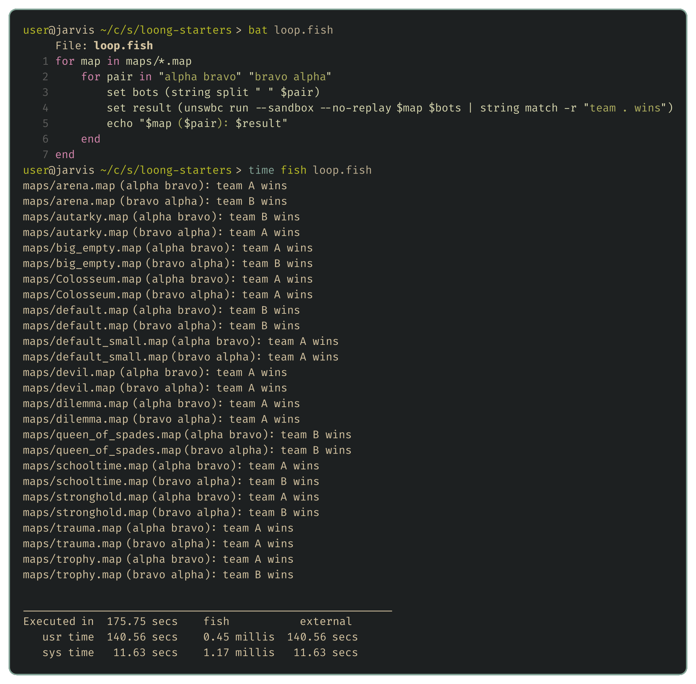

That's already slow for bots that barely think, and a bot that searches takes far longer: in one of my test runs, 600 games between stronger bots took 14 hours played one after another. We'll be improving our bot for weeks, and every change needs this kind of test. We'll want to pit a pool of bots against each other, keep a tidy record of every result and play independent games side by side on every core. That brings the usual chores: capping how many games run at once, giving up on a game that hangs, cleaning up after crashes, and not mistaking a crash for a loss.

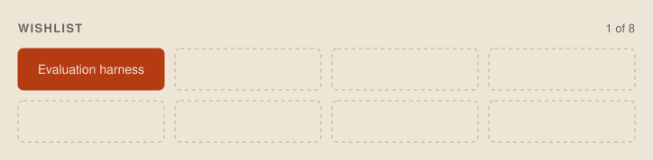

## Seventeen wins out of twenty-six

`alpha` won 17 of the 26 games, but both starters step in a random unblocked direction every turn, so neither can really be better. Two equally good bots still produce a split at least that lopsided about 8% of the time. A handful of wins feels like proof, but telling a better bot from an even match takes far more games than intuition suggests:

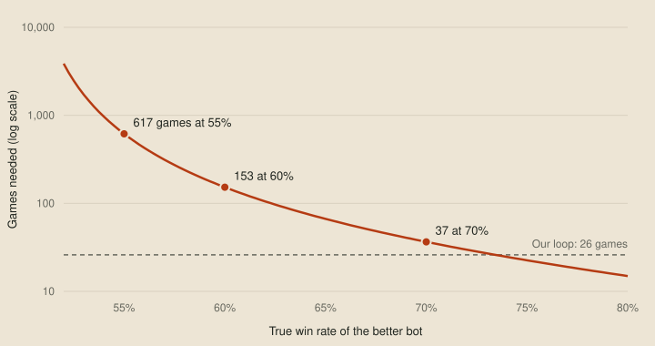

The games, especially upset losses, are how we find what's wrong with a bot. To say one version scores better than another, though, we need a tool that says how far the difference can be trusted and how many more games it would take to be sure.

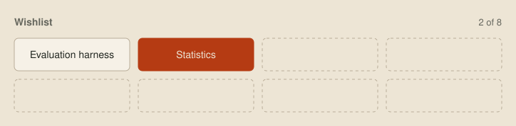

## A ladder of our own

The online ladder is too slow and noisy for this. The site draws each team one five-game battle an hour and allows 12 uploads an hour, so a modest improvement would take days to show up. A team's first new bot in any 12 hours also starts its rating's K factor at 96, four times the settled value, so the rating swings hardest right after an upload. Even a settled rating only compares you with this week's opponents, who are changing their bots too.

We want to know whether this version beats the last one. Our own ladder rates the current bot against frozen copies of our older versions, so a new version only counts as progress if it beats them.

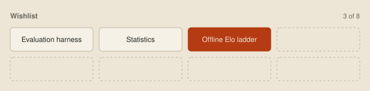

## Unseen maps

The organisers have said every Sprint, Qualifier and Grand Final map will be new, so a bot tested only on the bundled maps can be quietly relying on something about them. That's already caught me out once. The docs say maps are at least 10 tiles on a side, so my bot refused to play on anything smaller, and when the ladder served a 16×8 map called Small, every one of my dragons died in round 0. We can't tune for unseen maps, but we can generate lots of plausible ones and test on those.

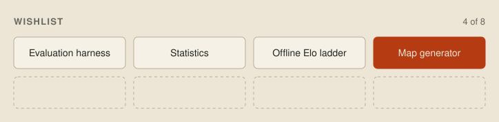

## Everyone else's games

The real opponents are the other teams, and every ladder battle is public, with game IDs already past 88,000. That record of what the best bots do is how we'll spot ideas worth borrowing and weaknesses worth exploiting. Nobody can watch that many games, so we need a tool that downloads a useful sample, slowly enough not to load the organisers' server.

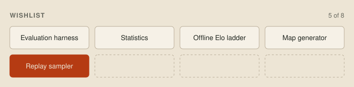

## Reading a replay

A replay file is packed binary, and a hex viewer shows only the bot labels and scraps of the map text:

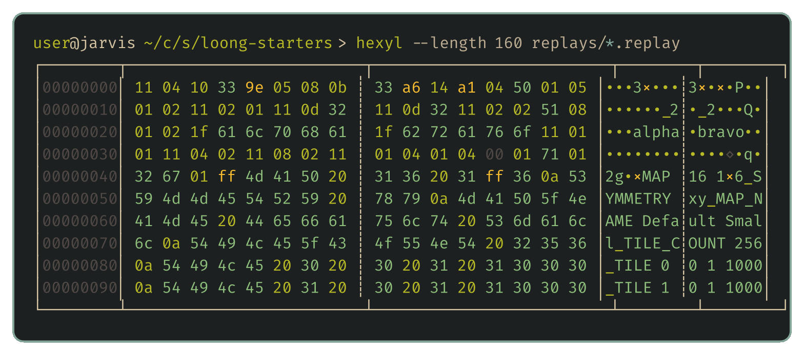

To ask questions of thousands of games, like how often top bots split early, we first need to decode the format and rebuild each game turn by turn.

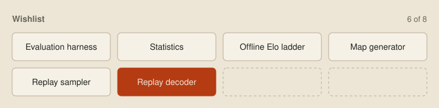

## Through one dragon's eyes

When one of our dragons does something stupid, the visualiser shows the whole board, but the dragon only saw the 7×7 square around its head, plus whatever it chose to remember:

Debugging needs a viewer that shows exactly what one dragon saw and decided, turn by turn. I'm writing it in Odin, and the next post explains why.

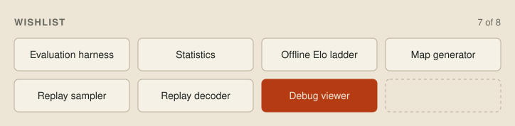

## Profiling CPU points

Each dragon gets 100 million points per turn, and a smart bot will want to spend as much of that as possible thinking. The game summary shows how much a bot spent, but not on what. Most of the C starter's points go on the one stdout write that sends its move, and finding that out took guesses and experiments. Once our bot runs a real search, every wasted point costs it search depth, so we'll want a profiler to show where the points go.

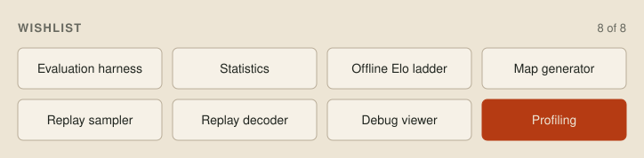

## The full wishlist

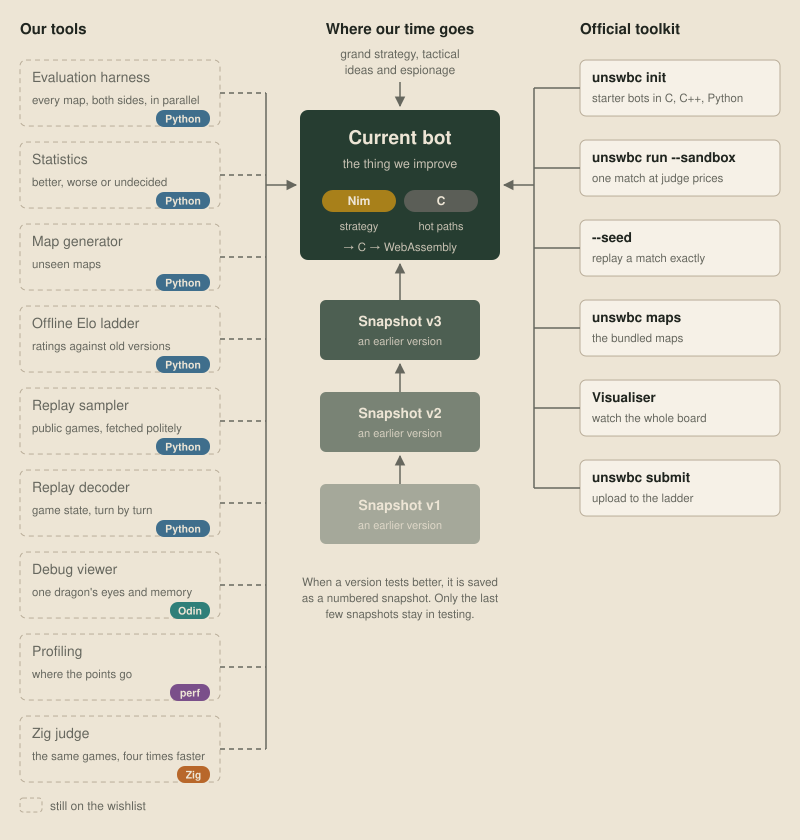

I already have most of these working in some form, so the tools posts walk through real code, and every later post uses them to test its ideas.

## Next up

[Choosing a language](03-the-choice.md), which settles how much of the CPU budget is left for thinking.
