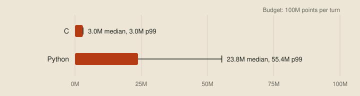
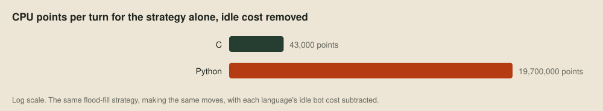
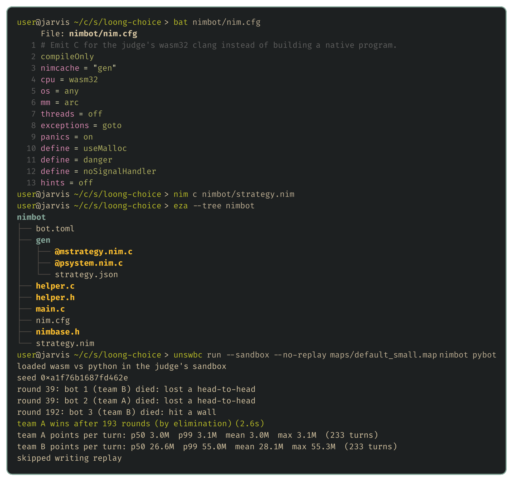
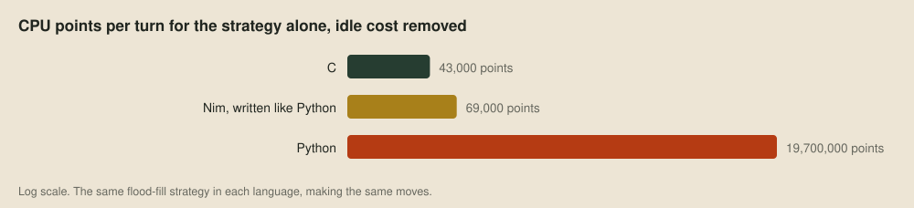
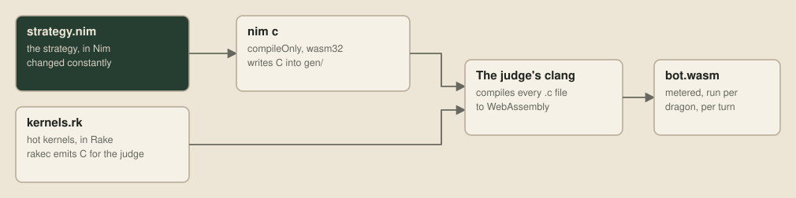
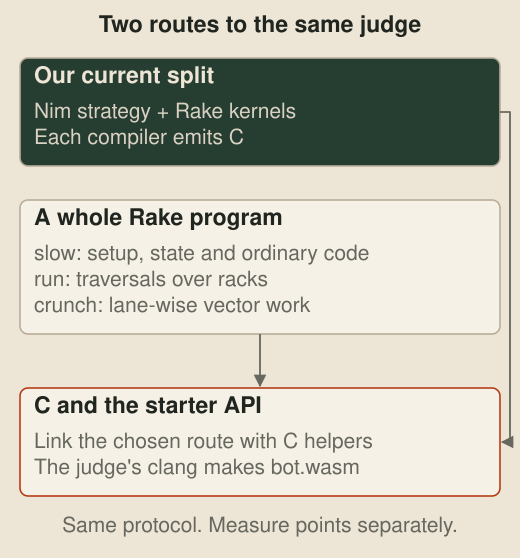

# The choice

Before writing any strategy, every team has to pick a language, and it's the hardest decision to undo, since every line of the bot is written in it. The online judge accepts Python, C and C++ and runs all three inside WebAssembly. It charges each dragon for its work in CPU points, with a budget of 100 million per turn, so the language decides how much of that budget is left for thinking about the next move.

## The cost of a language

To measure the difference, I wrote the same small strategy in Python and in C. A dragon usually dies by running out of room, so each turn it tries every move and every follow-up move, flood-fills the visible 7×7 window from where it would end up, and takes the move that leaves the most reachable tiles. That's up to 16 flood fills a turn, a graph search of the kind in chapter 20 of Cormen, Leiserson, Rivest and Stein's *Introduction to Algorithms* (4th edition, 2022). Here's the flood fill in Python:

```python
def reachable(window, start, first):
    visited = {HEAD, first, start}
    queue = [start]
    for index in queue:
        for side in range(4):
            nxt = step(window, index, side)
            if nxt >= 0 and nxt not in visited:
                visited.add(nxt)
                queue.append(nxt)
    return len(queue)
```

And in C:

```c
static int CountReachableTiles(LocalWindow const* window, int start, int first_step)
{
    bool visited[UNSWBC_VISION_TILES] = { false };
    int  queue[UNSWBC_VISION_TILES];
    int  queue_length = 0;
    visited[HEAD_INDEX] = visited[first_step] = visited[start] = true;
    queue[queue_length++] = start;
    for (int cursor = 0; cursor < queue_length; cursor++)
    {
        for (int side = 0; side < 4; side++)
        {
            int const next = StepWithinWindow(window, queue[cursor], side);
            if (next >= 0 && !visited[next])
            {
                visited[next]         = true;
                queue[queue_length++] = next;
            }
        }
    }
    return queue_length;
}
```

The two bots make identical moves, so any difference in cost comes from the language. Each played itself on all 13 bundled maps, and the bots and the measuring script are in [examples/the-choice](../examples/the-choice/README.md).



Most of what C spends isn't the strategy at all. A C bot that only repeats its last move costs almost as much, because nearly all of it goes on the single write to stdout that sends each move. Subtracting each language's idle cost leaves the strategy on its own:



A stronger bot will search much further ahead, and a search that uses a tiny fraction of C's budget would use up all of Python's. C++ goes through the same clang to the same WebAssembly, so it lands where C does. Python is quick to write and slow to run, whereas C and C++ are fast but verbose and unforgiving while you're still trying ideas.

## Four less familiar languages

### Nim for strategies

[Nim](https://nim-lang.org) reads a lot like Python, with indentation for blocks, inferred types and short loops, but it compiles to C. With the right settings, `nim c` stops once it has written the C files, and the judge accepts C source. Here's the same flood fill, written as a Python programmer would write it:

```nim
proc reachable(w: Window, start, first: int): int =
  var visited: set[0 .. 48] = {Head, first, start}
  var queue = @[start]
  var cursor = 0
  while cursor < queue.len:
    for side in 0 .. 3:
      let next = w.step(queue[cursor], side)
      if next >= 0 and next notin visited:
        visited.incl next
        queue.add next
    inc cursor
  queue.len
```

The rest of the bot calls the starter's C helper directly through Nim's foreign function interface, and with the settings in `nim.cfg`, the build is one command:



The Nim bot makes the same moves as the other two, and written like Python, it lands almost exactly where C does:



The remaining gap comes from the growable list. Nim allocates it on the heap for every flood fill, whereas the C uses a fixed array on the stack, and a fixed array in Nim brings it level with C. Nim's memory management is configurable too:

```nim nim.cfg
mm = arc    # reference counting: memory is freed as soon as its last reference goes
# mm = orc  # the Nim 2 default: ARC plus a collector for data that points back at itself
```

[ARC](https://nim-lang.org/docs/mm.html) frees each object the moment nothing refers to it, so no garbage collector pauses to scan memory mid-turn. ORC adds a collector for reference cycles, which never occur in our bots. Nim's [standard library](https://nim-lang.org/docs/lib.html) works under ARC too, and saves precious time writing collections and algorithms, from hash tables and priority queues to sorting and binary search.

Nim's generated C is correct and fast, but nobody tuned it, and the hottest parts of a serious bot, like the inner loop of a search, still want vector code written for the job. So our competition bot uses Nim for strategy, which changes constantly, and [Rake](#rake-for-vector-kernels) for the kernels where every point counts. Rake emits C for WebAssembly, and Nim calls it like any other C:



### Odin for tools

The debug viewer from the [wishlist](02-the-wishlist.md) is written in [Odin](https://odin-lang.org), which is *very* good at graphics programming. Graphics tools allocate a lot of short-lived data, and freeing it all correctly is a common source of bugs. Odin passes an implicit `context` carrying the allocator into every procedure, so setting it once makes everything called afterwards, library code included, allocate from wherever you chose:

```odin
arena: virtual.Arena
_ = virtual.arena_init_growing(&arena)
context.allocator = virtual.arena_allocator(&arena)

frames := make([dynamic]Frame)   // allocated from the arena, through the context
tiles := make([]Tile, 64 * 64)   // this too, and anything the procedures we call allocate

virtual.arena_destroy(&arena)    // one call frees the lot
```

The viewer loads each game into an arena like this and throws the whole arena away when you open the next one. Odin's `vendor` collection, maintained alongside the compiler, covers windowing, the major graphics APIs, raylib, stb and miniaudio, so the viewer's raylib is one `import "vendor:raylib"` away with no package manager.

### Zig for the judge

We wrote [our own judge](19-the-machine-inside-the-judge.md) later, to play games faster. It's glue between C APIs, hosting the organisers' engine and every dragon's bot inside wasmtime, a WebAssembly runtime with a C API. [Zig](https://ziglang.org) is very good at that kind of program, because it reads C headers directly. The judge imports wasmtime's whole API in three lines, with no bindings to keep in step with its releases:

```zig
pub const c = @cImport({
    @cInclude("wasmtime.h");
});
```

Zig also has no runtime and no hidden allocations. Every function that allocates takes an allocator explicitly, so it's always visible where a turn's memory comes from and when it's freed. The judge's `build.zig` links wasmtime statically in a few lines, so the result is one binary with nothing to install beside it.

### Rake for vector kernels

The fourth language is my own. [Rake](https://rake-lang.org) is for vector kernels, the small hot loops that do the same arithmetic to many values at once with SIMD instructions. I'm building it because the usual ways of getting SIMD code leave you checking it by hand. The compiler can leave a plain loop scalar, or turn a vectorised loop scalar after the next edit. Intrinsics tie the code to one vector width, and the compiler can still quietly spill vectors to memory or call a helper. Either way, the only way to know is to read the assembly.

Rake makes vector code a condition of compiling. A kernel works on racks, with one element in each lane. On native x86 and Arm targets a rack occupies a physical vector register, and verification rejects spills and hidden helper calls. On WebAssembly, racks are virtual 128-bit values, so Rake checks the emitted SIMD operations while the runtime picks the physical registers. Here's a kernel that turns sixteen tiles into a bitmask of the ones holding a dragon:

```rake
crunch occupied_bits(tiles: u8s) -> u32:
  bitmask(tiles != <0>)
```

A `crunch` does the same thing to every lane. `u8s` is a rack of bytes, sixteen of them in one of WebAssembly's 128-bit registers, where `u8` would be a single byte. Angle brackets mark a value that's the same in every lane, so `<0>` is zero broadcast across the rack. Longer kernels give their intermediate values names in a fused chain:

```rake
crunch advance(positions: f32s, velocities: f32s) -> f32s:
  | scaled: f32s <| velocities * <0.5>
  | result: f32s <| positions + scaled
  result
```

Each `| name <| expression` line reads right to left, with the value flowing into its binding. The native AVX2 target can fuse this chain into a multiply-add, while WebAssembly emits a separate multiply and add.

The room count suits Rake, because it does the same few operations to every tile in the window, and the judge's WebAssembly has 128-bit SIMD. [Counting room faster](18-counting-room-faster.md) writes its masks in Rake.

### Rake for the rest of the bot

Rake's [0.4.0 beta](https://rake-lang.org/) also compiles whole programs. Ordinary code goes in `slow` functions, which handle input, memory and the turn loop with records, arrays, slices, loops and module state, and call kernels through explicitly marked calls. The emitted C can call the starter's C API, so a whole Rake bot needs no Rake runtime inside the judge, although our textbook line keeps the Nim-and-Rake split:



## Next up

The next stage builds the tools on the wishlist, starting with [the evaluation harness](04-the-evaluation-harness.md).
