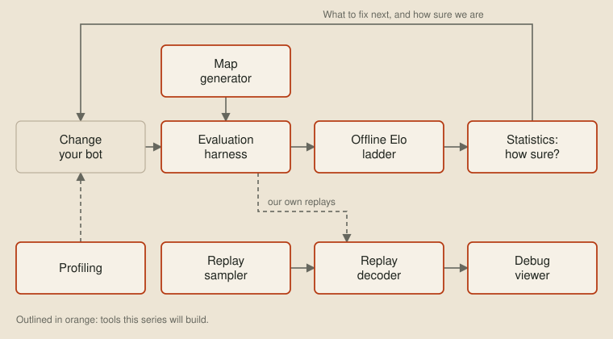
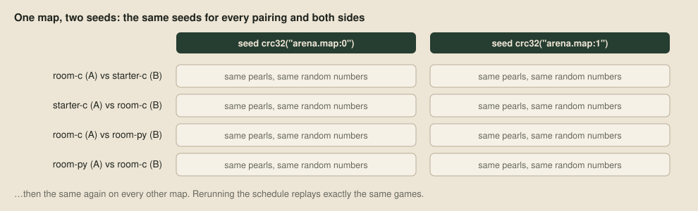
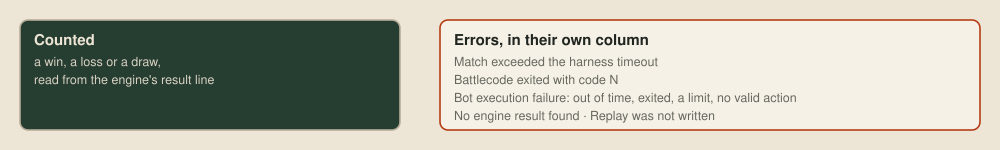
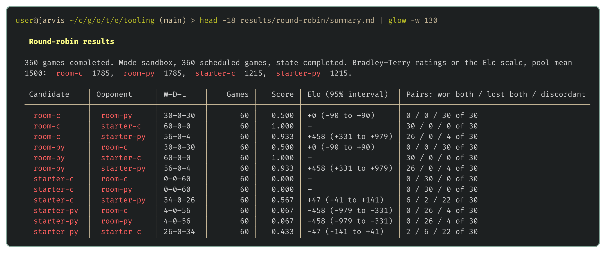

# The evaluation harness

The [wishlist](02-the-wishlist.md) ended with eight tools, and most of them lean on the first one, the tool that produces games. The statistics need results to judge, the map generator needs something playing on its maps, and the ladder rates versions from their past games.



We'll be testing ideas for weeks, each against a pool of bots that includes our own older versions, so running games by hand gets old fast. The harness, `just round-robin` with the runner in [harness/tournament.py](https://github.com/overyonder/the-loong-game/blob/ca25234/harness/tournament.py), takes a list of bots and leaves a complete record of every game to trust and look back through later. [just](https://just.systems) is a command runner, and every tool in this series is one of its recipes.

## Pairings, sides and seeds

The harness plays every pair of bots against each other on every map, from both sides, once for each seed. Both sides matter because dragons take their turns in ID order, so one team's dragons always move first, and a bot that always started on that side could look stronger than it is.



Each seed decides where pearls appear and how both bots' random choices fall. The harness derives it from the map's name and an index, so every pairing and both side orders meet the same pearls, and rerunning a schedule replays exactly the same games:

```python
schedule = [
    (map_path, team_a, team_b, seed)
    for map_path in maps
    for seed in (
        [
            zlib.crc32(f"{map_path.name}:{i}".encode())
            for i in range(args.seed_start, args.seed_start + args.seeds)
        ]
        or [None]
    )
    for team_a, team_b in (
        [(selected[0], selected[0])]
        if self_play
        else [
            pair
            for left, right in itertools.combinations(bots, 2)
            for pair in ((left, right), (right, left))
        ]
    )
]
```

A seeded game in the judge's sandbox always plays out the same way, so the harness caches each result, keyed by the contents of both bots, the map, the seed and the toolkit version. Rerunning a big comparison after changing one bot only replays that bot's games.

## Running games side by side

Games don't depend on each other, so the harness compiles each bot once and plays as many games at once as there are cores. Sandboxed games between compiled bots play in our own Zig judge, which plays exactly the same games as the toolkit in a fraction of the time ([the machine inside the judge](19-the-machine-inside-the-judge.md) covers it). Other games go through the official `unswbc run`, which starts a separate process for every dragon, so stopping only the main process of a hung game would leave its dragons running. Each game therefore starts in its own process group, and the harness kills the whole group when the game finishes or times out:

```python
process = subprocess.Popen(sys.argv[3:], stdout=output, stderr=subprocess.STDOUT,
                           env={**os.environ, "NO_COLOR": "1"}, start_new_session=True)
timed_out = False
try:
    code = process.wait(timeout=timeout)
except subprocess.TimeoutExpired:
    code, timed_out = -1, True
finally:
    try:
        os.killpg(process.pid, signal.SIGKILL)
    except ProcessLookupError:
        pass
    process.wait()
```

## Errors

If crashes counted as losses, a change that makes our bot crash on one map in ten would only dip the win rate, and we'd conclude the change was slightly bad when it's really a fixable bug. So anything other than a clean win, loss or draw goes into a separate errors column, checked in order of how badly the game went wrong:



```python
if timed_out:
    error = "Match exceeded the harness timeout"
elif returncode:
    error = f"Battlecode exited with code {returncode}"
elif failure:
    error = f"Bot execution failure: {failure.group(0)}"
elif outcome is None:
    error = "No engine result found"
```

Every game keeps its full log and replay, so an error leads straight to the game that caused it.

## A first run

Our four existing bots are the C and Python starters, and the flood-fill bot from [The choice](03-the-choice.md) in C and in Python. They play two seeds on each of toolkit 1.2.2's 15 bundled maps:

```sh
just round-robin --bots starter-c starter-py room-c room-py --maps maps/*.map --sandbox --seeds 2
```

Alongside every game's log, replay and result, the harness writes a summary, and an interrupted run resumes with only the unfinished games:



Each row gives a pairing's record and the Elo difference with its 95% interval, which says how far to trust the gap. The last column counts side-swapped pairs of games. The two flood-fill bots make the same move in every position, so every pair is discordant, with the starting side winning both times. Bots that play almost alike mostly win on which side they start, so [the next post](05-better-worse-or-undecided.md) compares close versions another way.

## Next up

[Better, worse or undecided](05-better-worse-or-undecided.md): turning a pile of wins and losses into a clear answer on whether a change made the bot better.
