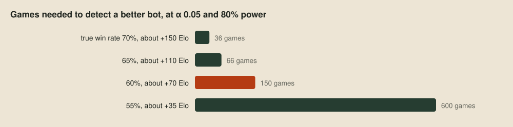
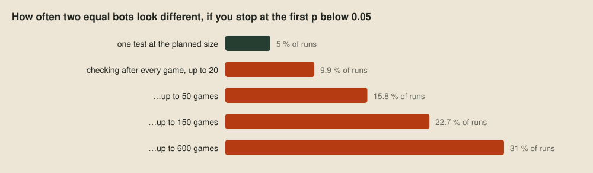
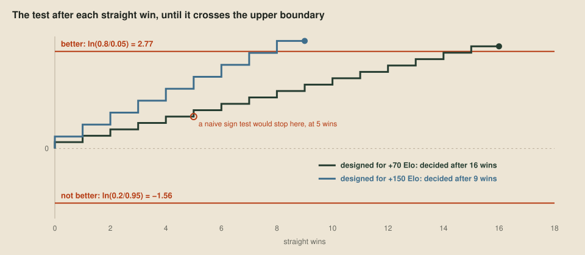
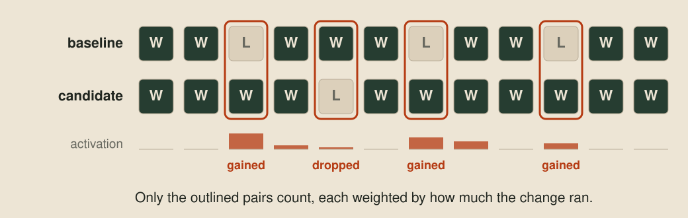
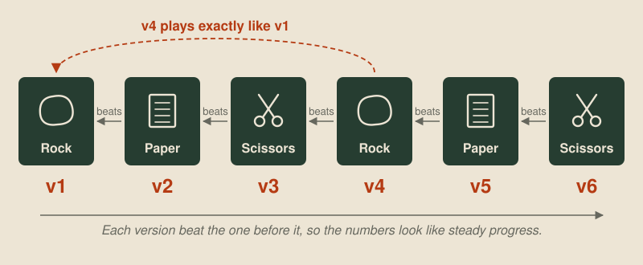

# Better, worse or undecided

With the [harness](04-the-evaluation-harness.md) we can play as many games as we like, but a pile of results tempts us to read meaning into small gaps. The verdict tells us how far to trust a difference, so we don't talk ourselves into a gain that isn't there or explain away a loss that is, and it plays as few games as it can. The statistics are in [harness/report/verdict.nim](https://github.com/overyonder/the-loong-game/blob/ca25234/harness/report/verdict.nim).

## The question

A verdict compares a candidate bot with its opponents, or with its baseline, the version before the change, and asks: if the candidate played those opponents forever, would it score more than half its games?

We can never play forever, so every answer is a bet with two ways to lose. We can call a difference real when it's luck, or miss one that's there. Statisticians call the chance of the first mistake α, and one minus the chance of the second the test's power. We use the usual α of 5% and power of 80%.

The third choice is the smallest improvement worth detecting, which sets how many games the test needs:



We size our verdicts for +70 Elo, about 60% of games against the baseline. A test for smaller gains would cost four times as many games, and on unseen tournament maps a change that small might not survive anyway.

## Checking after every game

If a candidate wins its first 20 games in a row, playing the rest of a fixed test feels silly. But stopping at the first significant result breaks the test, because the 5% error rate assumes you look once, and every extra look gives luck another chance to cross the line:



Abraham Wald's sequential probability ratio test ([Sequential Tests of Statistical Hypotheses](https://doi.org/10.1214/aoms/1177731118), 1945) is built for checking every game. It keeps one running number, the log-likelihood ratio: how much more likely the results so far are if the candidate wins 60% of games than if it wins 50%. Each win adds ln(0.6 / 0.5), about +0.18, each loss adds ln(0.4 / 0.5), about −0.22, and a draw counts as half of each.

Wald showed where the stopping lines go to keep our error rates however often we look. Above ln(0.8 / 0.05), about 2.77, the candidate is better. Below ln(0.2 / 0.95), about −1.56, it's not better: the change isn't worth +70 Elo, although it isn't necessarily worse. A candidate that wins every game climbs in a straight line to the upper boundary, and a test designed for a bigger improvement takes bigger steps:



A naive sign test stops sooner, since five straight wins happen by chance only about 3% of the time, but that's only true if you look once.

## The cap

Some changes are too small for either line. The verdict caps every test at 155 games, the size of a fixed test at +70 Elo, and reports no material difference if it gets there. Measuring a difference that small takes the [ladder](07-a-ladder-of-our-own.md), which plays every pair many times.

| True improvement | Better | Not better | No material difference at the cap | Average games |
| --- | ---: | ---: | ---: | ---: |
| None | 3.8% | 86.4% | 9.8% | 65 |
| +35 Elo | 24% | 50% | 26% | 91 |
| +70 Elo | 65% | 17% | 18% | 90 |
| +120 Elo | 97.0% | 1.8% | 1.2% | 59 |
| +150 Elo | 99.5% | 0.5% | 0.1% | 46 |

The cap costs some power at +70 Elo, where a fixed test of the same length would have reached 80%.

## Paired games

The map, the seed that decides where pearls appear and the starting side are noise, and noise means more games. So when the verdict compares two close versions of a bot, the candidate and the baseline each play the same opponent on the same map, seed and side. Seeded games are deterministic, so if the change never comes into play the two games are identical and cancel out:



A pair counts as a win for the candidate if it scored more, a loss if the baseline did, and carries no evidence if they tie. Close versions don't play each other directly, because they mostly win by which side they start on. A candidate that isn't a close relative plays each opponent directly instead.

## The schedule

An early stop only judges the candidate fairly if the games so far are a fair sample. The verdict shuffles the maps into a fixed order, plays every opponent that still needs games from both sides on each map, and reads each test only from the longest unbroken run of finished games, so a slow map can't be skipped. It keeps about as many games in flight as it expects to need, and cancels the rest once every opponent's test has decided.

Ten games against a bot that moves at random are mixed into the first few maps. They stay out of the statistics, and if the candidate fails to win any of them, that game is flagged as a bug.

## A first verdict

The flood-fill bot keeps room to move and ignores food. The longest dragon decides the game at round 500, so a bot that heads for food ought to do better. The candidate, `room-pearls`, adds one rule: when several moves all leave plenty of room, take the one nearest a visible pearl. It plays the flood-fill bot directly on the 15 bundled maps and the 20 generated ones:

```sh
just batch --bots room-pearls --output results/verdict-pearls
just verdict --output results/verdict-pearls --candidate room-pearls
```

The first row of `verdict.md`, trimmed:

| Candidate | Opponent | W–D–L | Elo (95% interval) | Decision | LLR (lower, upper) | Games used |
| --- | --- | --- | --- | --- | --- | --- |
| `room-pearls` | `room-c` | 2–0–9 | −261 (… to −63) | not better | −1.632 (−1.558, +2.773) | 11, decided at 11 (cap 155) |

The Elo interval goes further than the decision and says worse. Chasing the nearest pearl whenever there's room loses games. The random-bot check also flagged the pearl chaser's failure to win a game against `starter-c`, on Colosseum, with the `just viewer` command to watch it. The replay tools later in this stage show why its dragons die, and the answer lies in how long they grow.

## Version cycles

It's tempting to read each snapshot beating the one before as progress, but strategies can go round in circles like rock, paper and scissors:



The [ladder](07-a-ladder-of-our-own.md) rates every snapshot against every other, so a version that has gone round the circle shows up losing to one of its ancestors.

## Next up

[Unseen maps](06-maps-nobody-has-seen.md): generating plausible new maps, and what the flood-fill bot does on them.
