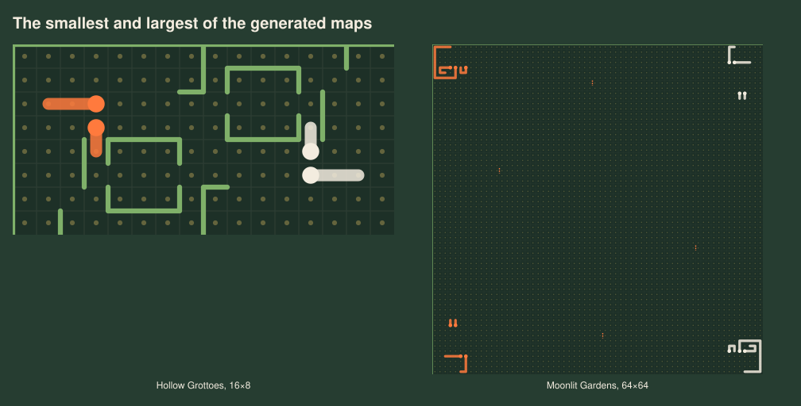
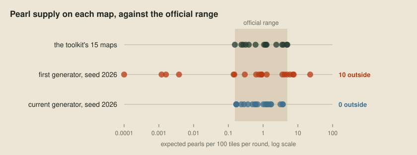
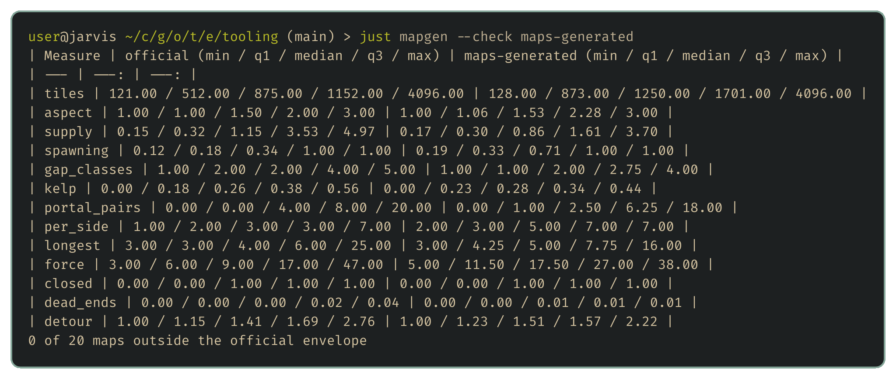
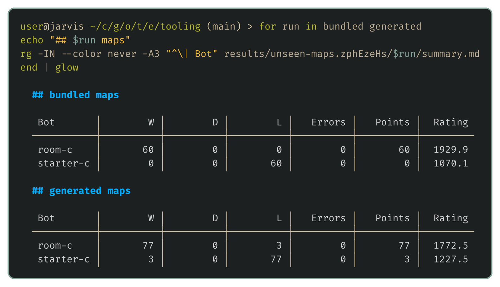
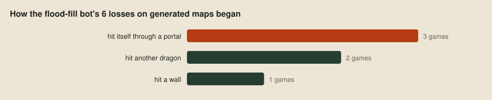
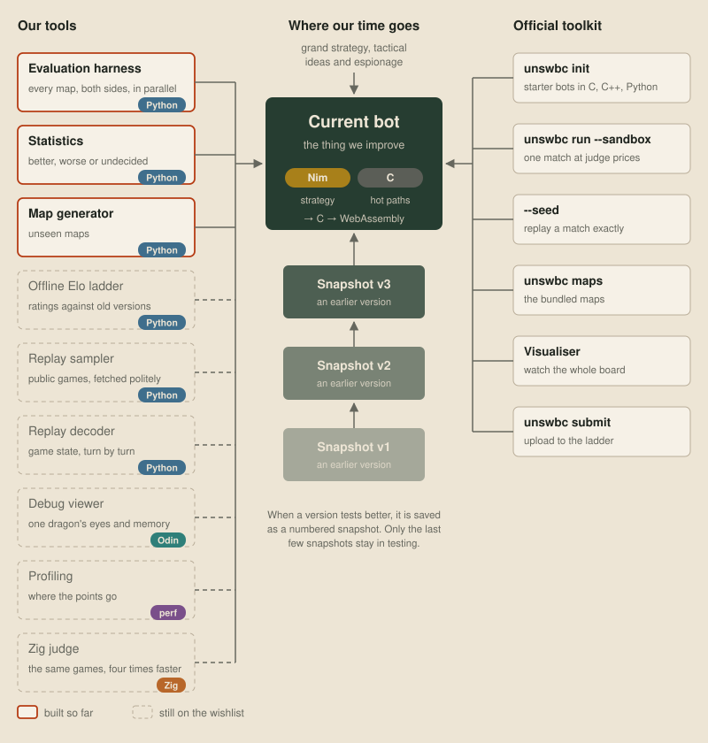

# Unseen maps

The organisers have said that every Sprint, Qualifier and Grand Final map will be brand new. That's a problem for anyone who only tests on the maps bundled with the toolkit, because a bot can quietly come to depend on a feature common to those maps, and look strong right up until the tournament puts it on a map without it. We can't test on the tournament's maps, but we can make lots of new ones that look like the real thing. That's the map generator from the wishlist, and this post uses it straight away to find a blind spot hidden by the bundled maps.

## Plausible maps

The generator, `just mapgen`, writes maps in the official format. The hard part is making them plausible: varied enough to find surprises, but still recognisably the same game. It's built on xCirno's layered world generator, shared in the competition Discord as [a gist](https://gist.github.com/xCirno1/ffdaac4236c1f1085c351af4fdfc1600). It builds each map in stages, and each stage reads what the earlier ones decided:

1. The generator picks the map's size, symmetry and closed or wrapping border from the shapes of official maps.
2. Two symmetric noise fields describe elevation and fertility.
3. Starting camps and a heart on the symmetry axis seed districts, and every other tile joins its nearest seed.
4. Each district's role and climate decide its biome, such as open sea, reef, ruins, caves or maze.
5. A map-sized landmark, such as a citadel of concentric walls, a labyrinth or a lattice of portals, supplies the main structure, with gated walls between districts.
6. The heart gets a vault and the starting dragons get nests, while each biome gets suitable buildings, shrines, wormholes and pearl groves.
7. Every sealed pocket gets a door, so no dragon starts trapped and no pearl is out of reach.
8. Pearl spawn rates come from a few classes, as on the official maps, scaled to the number of dragons.
9. Dragons start coiled out of each camp, facing the enemy, with their exits checked and opposing heads kept apart.
10. Several candidates are scored on contested food, how soon the teams meet, detours, dead ends and portal use, and the best is written.

Every map is mirrored or rotated so both teams start in equivalent positions. The generator guarantees this by sending every change to the board through one setter, which writes the edge and its mirror image together:

```python
def put(self, e, k, force=False):
    me = self.me(e)
    for x in (e,) if me == e else (e, me):  # ordered: a set of str tuples is not
        if self.kind.get(x, 0) == 2:
            continue  # never overwrite a portal
        if not force and self.is_border(x):
            continue  # the border stays shut
        if k:
            self.kind[x] = k
        else:
            self.kind.pop(x, None)
```

We widened it to the official maps' full range of sizes, from 11 by 11 and 16 by 8 up to 64 by 64, because a bot that only ever plays medium-sized maps picks up habits that fall apart on cramped or very open boards:



We also added open maps with no buildings, worlds where every tile can spawn pearls, palettes of only one or two spawn classes, and flagships up to 25 segments long. Then we bounded the whole thing by the official maps. The generator measures every candidate the way it measures the toolkit's own maps, and keeps a candidate only if every measure lies within their range:

```python
ENVELOPE_MEASURES = (
    "tiles", "aspect", "supply", "kelp", "portal_pairs",
    "per_side", "longest", "force", "dead_ends",
)
```

Supply is pearls spawned per tile each round, force is the total starting length, and the rest are the board's size and shape, kelp, portals, dragons per side, the longest dragon and dead ends. My first generator mixed random layouts with no such bound, and pearl supply is where it strayed furthest:



`just mapgen --check` measures a directory of maps against the official range, and it passes all 20 maps in this post:




## The flood-fill bot on new maps

To see whether the new maps tell us anything, we'll play the flood-fill bot from [The choice](03-the-choice.md) against the C starter twice, first on the bundled maps and then on the generated ones, with two seeds per map and side. If the generated maps were just more of the same, both runs would look alike:



They don't. On the bundled maps the flood-fill bot never loses to a bot that moves at random, but on new maps it does, so the bundled maps flatter it. The more useful part is how its dragons died in those losses:



A dragon running into its own body is strange, because the flood fill never moves onto a tile holding a segment, ours included. The replays showed why. The flood fill treats a portal like any other open edge, as if the dragon would step onto the tile next door, but a portal carries it to its partner edge, which can be anywhere on the map, including right where the dragon's own body is. Eleven of the bundled maps have portals too, and the bot never lost on any of them, so we'd never have spotted this without the new maps.

The replays show a second blind spot as well. Each dragon picks its move on its own, and although the flood fill avoids its teammates' bodies, it never considers where they're about to move. So two of the bot's dragons can choose the same empty tile in the same round, and both die. Teaching the bot how portals work, and to keep out of its teammates' way, are the first jobs for the strategy posts.

## The tools so far

That's three of the eight tools. The harness plays the games, the statistics say how far the results can be trusted, and the generator checks that they hold on new maps. The other five show whether the bot is improving overall, what the other teams are doing, why one of our dragons did what it did, and where its CPU budget went.



## Next up

[A ladder of our own](07-a-ladder-of-our-own.md): rating every saved version against every other, so we can see whether the bot is improving overall.
