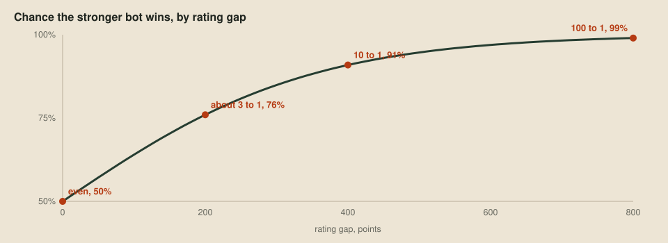

# A ladder of our own

> **Editor's note, 28 September 2026.** Ratings are now fitted to all the games at once with the Bradley–Terry model. The ladder below uses toolkit 1.2.2 and the new generated maps.

The [verdict tool](05-better-worse-or-undecided.md) compares one candidate with one opponent. A candidate can beat its parent and still lose to an older version, the way paper beats rock and loses to scissors, so we also need a ladder that plays every version against every other and gives each one a rating.

## Ratings

We use Elo ratings, from Arpad Elo's *The Rating of Chessplayers, Past and Present* (1978), like the online ladder. The gap between two ratings predicts how often the stronger bot wins, so a rating only means something relative to its own pool:



## Fitting all the games at once

The online ladder updates ratings after each game by a step of size K. That makes ratings depend on game order and favour recent games, and a fixed K caps how far a lopsided record can push a rating. One bot on our private ladders scored 98 of 100 against its pool:

| Method | Rating |
| --- | ---: |
| Game-by-game Elo | 1916 |
| Fitted to all its games at once | 2270 |

Offline, the harness has every result before it rates anything, so it finds the one set of ratings that best explains them all, with every game counting equally. The model is the one already assumed by Elo, Bradley and Terry's paired comparisons ([Rank Analysis of Incomplete Block Designs](https://doi.org/10.2307/2334029), 1952): each bot has a hidden strength, and A beats B with probability A's strength divided by the sum of both. The likelihood has a single peak, so [the fit](https://github.com/overyonder/the-loong-game/blob/ca25234/harness/report/rating.nim) uses Newton's method to reach it in a handful of steps, each using the slope and curvature for every bot at once:

```nim
for i in 0 ..< size:
  var expected = 1 / (1 + exp(-theta[i]))
  gradient[i] -= expected
  hessian[i][i] += expected * (1 - expected)
  for j in 0 ..< size:
    if played[i][j] != 0:
      expected = 1 / (1 + exp(theta[j] - theta[i]))
      gradient[i] -= played[i][j] * expected
      let curvature = played[i][j] * expected * (1 - expected)
      hessian[i][i] += curvature
      hessian[i][j] -= curvature
let step = solve(hessian, gradient)
```

`theta` is each bot's log strength, `played[i][j]` counts games between two bots, and the gradient starts from each bot's actual score. The first three lines in the loop add one imaginary draw against an average bot, so a bot that won every game still gets a finite rating. Draws count half, and games that ended in an error are left out. Each strength becomes a rating of 1500 plus 400 times its base-10 logarithm, centred on 1500, which is what makes 400 points mean ten-to-one.

## Playing a ladder in rounds

The [ladder](https://github.com/overyonder/the-loong-game/blob/ca25234/harness/ladder.py) plays in rounds where each bot plays at most one game, and refits after each round. Sides alternate and maps rotate, so every pair meets on every map from both sides. Seeds come from the map and round, so a stopped ladder resumes with exactly the same games.

## The first ladder

Our six bots so far are the two starters, the flood-fill bot from [The choice](03-the-choice.md) in C, Python and Nim, and the losing pearl-chaser. On toolkit 1.2.2's 15 bundled maps and 20 generated ones, they played 1,050 games, 70 per pair:

| Bot | Rating | Won | Drawn | Lost | vs room-c | vs room-py | vs room-nim | vs room-pearls | vs starter-py | vs starter-c |
| --- | ---: | ---: | ---: | ---: | ---: | ---: | ---: | ---: | ---: | ---: |
| room-c | 1723 | 264 | 2 | 84 | | 34.5 | 42.5 | 51 | 67 | 70 |
| room-py | 1713 | 257 | 8 | 85 | 35.5 | | 37 | 54 | 67 | 67.5 |
| room-nim | 1683 | 246 | 5 | 99 | 27.5 | 33 | | 52 | 68 | 68 |
| room-pearls | 1477 | 157 | 7 | 186 | 19 | 16 | 18 | | 49.5 | 58 |
| starter-py | 1211 | 60 | 1 | 289 | 3 | 3 | 2 | 20.5 | | 32 |
| starter-c | 1192 | 54 | 1 | 295 | 0 | 2.5 | 2 | 12 | 38 | |

The three flood-fill bots make identical moves, so the gaps between them are luck from different pearl draws. Equal bots split as unevenly as room-c and room-nim about one time in eleven, so a ladder this size can't separate bots that close. The pearl-chaser's rating predicts it scores about one game in five against them, and it scored about one in four.

## Looking for circles

A single rating assumes that if A beats B and B beats C, A beats C. A rock-paper-scissors circle would show in the head-to-head columns as a lower-rated bot with a winning record against a higher one. The only such upsets here are between bots that play alike, so there's no circle. The check matters more once the pool fills with saved versions of our own bot.

## Next up

The next two tools look outward, starting with [a sampler](08-everyone-elses-games.md) that downloads the public ladder's replays without loading the organisers' site.
