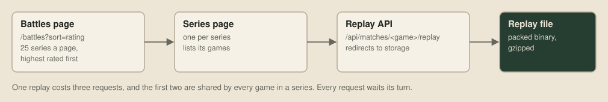
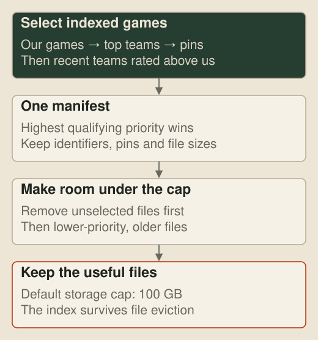
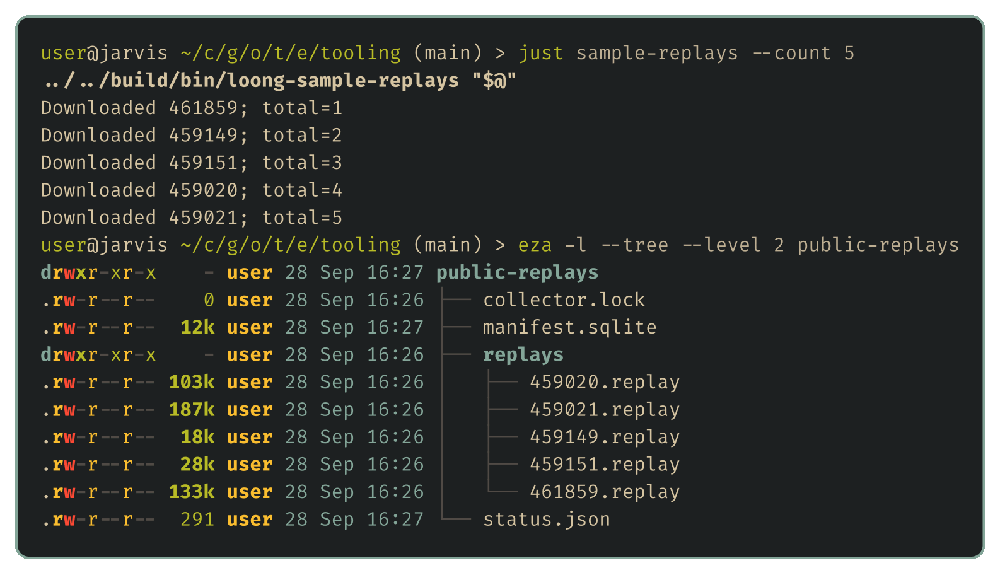

# Everyone else's games

The opponents that matter are the other teams, and every game on the public ladder can be downloaded, which makes its history our best record of what strong bots do. This post builds the fifth tool on the wishlist, a collector that keeps a useful slice of those replays without adding noticeable load to the organisers' site.

## The public archive

The documented API only lists your own team's games, so the collector reads the public web pages. The [Battles page](https://game.battlecode.au/battles) lists every ladder series, 25 to a page, and `?sort=at&dir=desc` puts the newest first. Each series page lists its games, and `/api/matches/<game>/replay` redirects to each replay file. The collector starts from the newest series, because teams upload new bots all the time:



## Being a good guest

All requests go through one small client in [replays/collection.nim](https://github.com/overyonder/the-loong-game/blob/ca25234/replays/collection.nim). It checks robots.txt, makes one request at a time at least two seconds apart, and only follows redirects over HTTPS. If the site answers with a 429 or a server error, the client doubles its interval up to a minute, honours `Retry-After`, and stops after repeated rejections:

```nim
proc slowDown(client: var Client, status: int, retryAfter: string) =
  inc client.rejections
  if client.rejections > MaxConsecutiveRejections: raise rejected(status, retryAfter)
  client.interval = min(MaxInterval, max(client.interval * 2, 1.0))
  let pause = max(client.interval, retryDelay(retryAfter))
  say "HTTP " & $status & "; interval now " & formatFloat(client.interval, ffDecimal, 2) &
    "s, pausing " & $int(round(pause)) & "s"
  pause(pause)
```

After giving up, it saves the site's requested wait, and a rerun sends nothing until that time has passed. A SQLite manifest records every series and download, so a later run carries on without fetching anything twice.

## Retention

The archive ran to more than 9,000 pages of series by 28 September, so the collector keeps a capped selection. Each run takes a leaderboard snapshot and selects games by priority:

| Priority, highest first | Games selected |
| --- | --- |
| Our team | Its indexed games |
| Top-rated teams | The newest 500 per team at or above 1,950 Elo |
| Pinned games | Games selected for a particular review or experiment |
| Teams above us | The newest 40 per team above our current rating |

When the store passes its 100 GB default cap, the collector removes unselected files first, then the least protected, oldest games. A pin records who needs a game and why, so it can be released after the review. The [README](https://github.com/overyonder/the-loong-game/blob/ca25234/replays/README.md) covers pins, deletion and the API key.



## A first sample

Five replays are enough to try the decoder on in the next post:

```sh
just sample-replays --own-team YOUR_TEAM_ID --count 5 --output public-replays
```



The newest series were still being played, so the sampler skipped their unfinished games. File sizes vary widely, because a replay records every event and a long game with a hundred dragons has a great many.

## Next up

Downloading a replay is the easy part. The file itself is packed binary, so [the next post](09-reading-a-replay.md) works out how to read it and rebuild the game turn by turn.
