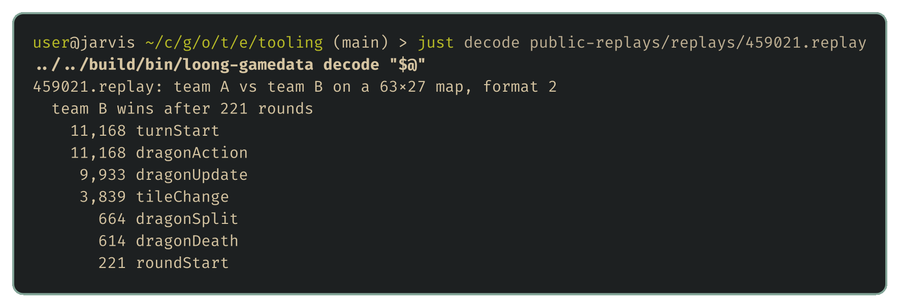
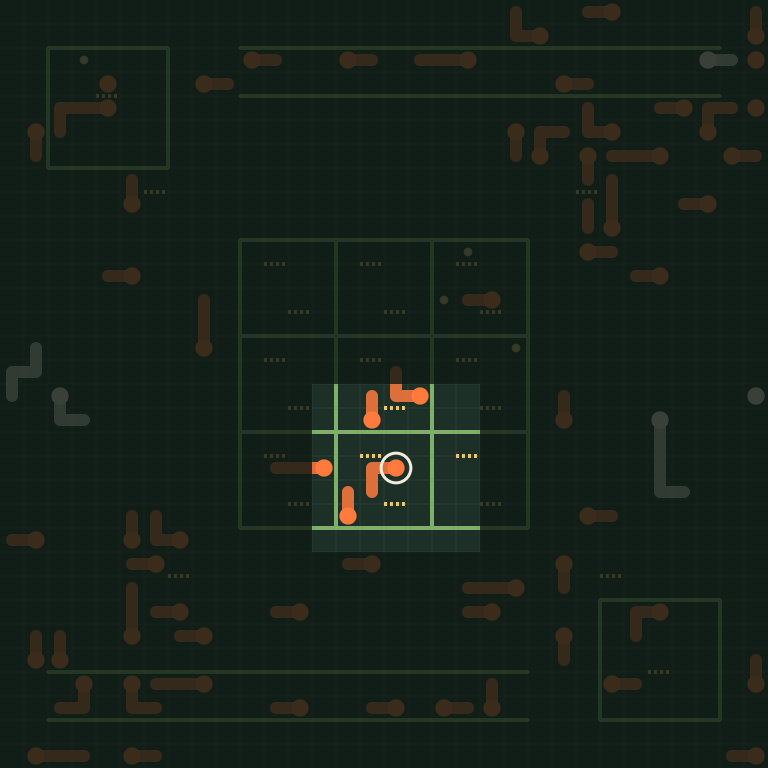
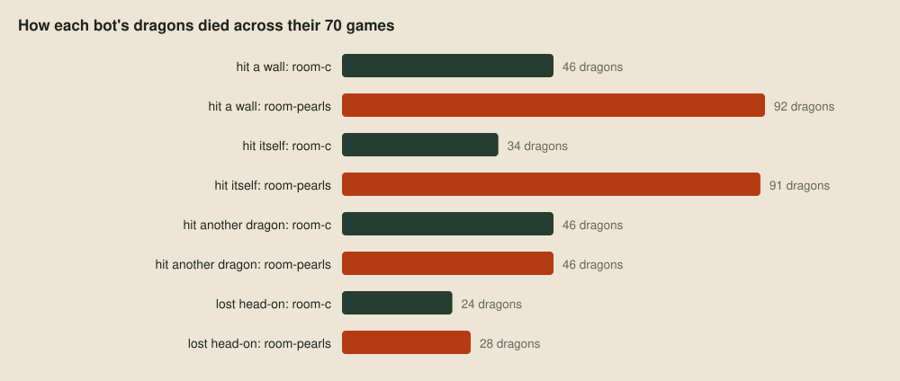

# Reading a replay

> **Editor's note, 4 October 2026.** The byte example and games below are the original recordings. The released schema also records SDK 1.2.7 queen standings and whether the match seed is known.

In the [wishlist](02-the-wishlist.md), a hex viewer showed us a replay's bot labels, scraps of the map and nothing else. Now that the [sampler](08-everyone-elses-games.md) fetches other teams' games, we need to read them. This post builds a decoder that reads the file, rebuilds the game one event at a time and works out what any dragon could see.

## The file format

A replay is a [Cap'n Proto](https://capnproto.org/encoding.html) message, laid out the way a C program holds data in memory: each struct is a block of 8-byte words, plain values at fixed offsets, then pointers to anything variable-sized. That leaves a lot of zero bytes, so the file is *packed*: each word becomes a tag byte, whose bits mark its non-zero bytes, followed by just those bytes. Here are the first bytes of one of our older replays:

| Packed bytes | Tag in binary | Unpacked word | Meaning |
| --- | --- | --- | --- |
| `11 03 d3` | `00010001` | `03 00 00 00 d3 00 00 00` | The message has four segments, and the first is 211 words long |
| `33 48 07 48 0b` | `00110011` | `48 07 00 00 48 0b 00 00` | The next two segments are 1,864 and 2,888 words long |
| `03 28 04` | `00000011` | `28 04 00 00 00 00 00 00` | The last is 1,064 words long |
| `50 02 05` | `01010000` | `00 00 00 00 02 00 05 00` | The root struct: two words of plain values, then five pointers |

The five pointers lead to the map text, the two bot labels, the list of events and the result. Replays downloaded from the site are also gzipped.

## The schema

The toolkit doesn't publish the schema, but `unswbc vscode` installs the official replay viewer, which includes Cap'n Proto's generated classes for the organisers' schema. Every field has a getter that reads a fixed offset. Here's a dragon splitting, tidied up from the minified original:

```js
get parentId()    { return $.getInt32(0, this) }
get childId()     { return $.getInt32(4, this) }
get team()        { return $.getUint16(8, this) }
get childFacing() { return $.getUint16(10, this) }
get parentBody()  { return $.getList(0, e._ParentBody, this) }
get childBody()   { return $.getList(1, e._ChildBody, this) }
```

Writing every class down in Cap'n Proto's schema language gives the whole format in [replay.capnp](https://github.com/overyonder/the-loong-game/blob/ca25234/replays/viewer/replay.capnp), with nothing guessed from byte patterns. The heart of it is the event list:

```capnp
struct Event {
  union {
    roundStart @0 :RoundStart; turnStart @1 :TurnStart;
    pearlCountdown @2 :PearlCountdown; tileChange @3 :TileChange;
    dragonAction @4 :DragonAction; engineLog @5 :TextEvent;
    dragonLog @6 :TextEvent; dragonIndicator @7 :TextEvent;
    debugDraw @8 :DrawEvent; dragonUpdate @9 :DragonUpdate;
    dragonSplit @10 :DragonSplit; dragonDeath @11 :DragonDeath; sonarPing @12 :SonarPing;
  }
}
```

Older files lack the newer queen and seed fields, so Cap'n Proto's defaults read them as an unknown seed and no known queen.

`just decode` runs our decoder, whose small Cap'n Proto reader is in [capnp_replay.nim](https://github.com/overyonder/the-loong-game/blob/ca25234/gamedata/capnp_replay.nim). Unpacking is one short loop, where a tag of zero is followed by a count of further all-zero words, and a tag of 0xFF by a count of words stored as they are:

```nim
while at < packed.len:
  let tag = packed[at]
  inc at
  for bit in 0 .. 7:
    if (tag and (1'u8 shl bit)) != 0:
      result.add packed[at]
      inc at
    else:
      result.add 0
  if tag == 0:
    let zeros = int(packed[at]) * 8
    inc at
    result.setLen(result.len + zeros)
  elif tag == 0xFF:
    let verbatim = int(packed[at]) * 8
    inc at
    let copyStart = result.len
    result.setLen(copyStart + verbatim)
    if verbatim > 0: copyMem(addr result[copyStart], unsafeAddr packed[at], verbatim)
    at += verbatim
```

Public replays leave the bot labels blank, so the decoder calls the players team A and team B:



## Rebuilding the game

A replay records changes in the engine's order, so finding where everything was at round 200 means replaying 200 rounds of changes. Our [reconstruction](https://github.com/overyonder/the-loong-game/blob/ca25234/gamedata/board.nim) starts from the map text and applies each event in turn. The interesting one is a move:

```nim
proc moveDragon*(board: var ReconstructedBoard, dragon: int32, head, tail: int, facing: char) =
  ## One step: the new head first, then tail cells dropped until the body ends
  ## at `tail`.
  board.unindexDragon(dragon)
  let entry = addr board.dragons[dragon]
  entry.directions[0] = facing
  entry.body.insert(head, 0)
  entry.directions.insert(facing, 0)
  while entry.body.len > 1 and entry.body[^1] != tail:
    entry.body.setLen(entry.body.len - 1)
    entry.directions.setLen(entry.directions.len - 1)
  board.indexDragon(dragon)
```

An update only gives the new head and tail, so the reconstruction adds the head and drops tail segments until the body ends at the new tail. An ordinary move drops one segment and a move that eats a pearl drops none, so one rule handles both.

## One dragon's window

A dragon sees the 7×7 square around its head, wrapping round the map's edges, and `floorMod` keeps a negative offset on the board:

```nim
proc cellAt*(board: ReconstructedBoard, x, y: int): int =
  floorMod(y, board.height) * board.width + floorMod(x, board.width)
```

```nim
for dy in -3 .. 3:
  for dx in -3 .. 3: visible.add board.cellAt(x + dx, y + dy)
```

The viewer builds its recovered [observations](https://github.com/overyonder/the-loong-game/blob/ca25234/gamedata/observations.nim) from these cells, and they match what the engine wrote to the bot. Site replays downloaded since 27 September no longer record pearl countdowns, although the bot saw them, so [Pearls from the seed](10-pearls-from-the-seed.md) recovers those timings from the match seed.



The dragon's program received only that lit square, and most of the enemies were invisible to it.

## Deaths by cause

The [verdict post](05-better-worse-or-undecided.md) found the pearl-chasing bot losing to the plain flood-fill bot, and even dropping a game to a starter. The [ladder](07-a-ladder-of-our-own.md) kept every replay, so `just deaths` can count how each bot's dragons died across the 70 games between them:



The pearl chaser's dragons run into walls twice as often and into themselves nearly three times as often, while meeting other dragons about as often. That shows what goes wrong, and finding out why needs the view from inside the game.

## Next up

[Pearls from the seed](10-pearls-from-the-seed.md): what the replay leaves out about pearl timing, and how to reconstruct it without guessing.
