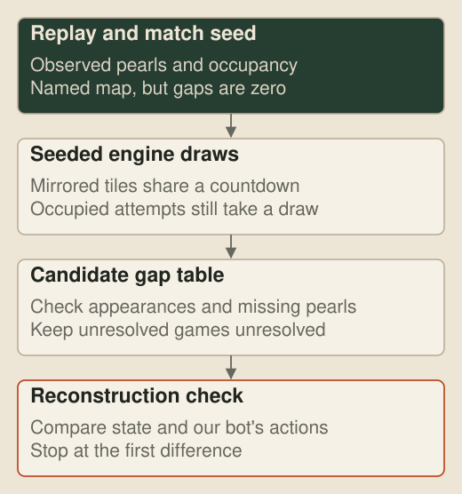
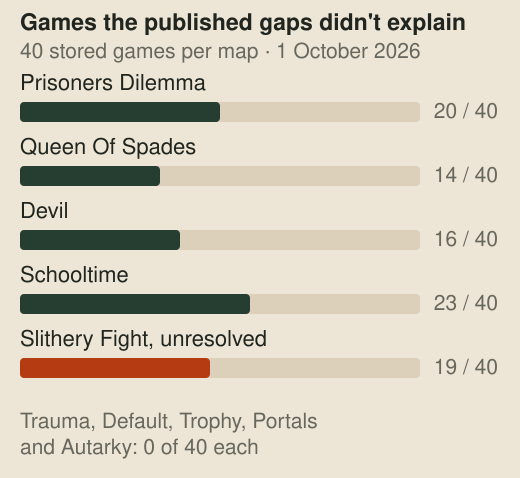

# Pearls from the seed

A replay downloaded from the competition site doesn't record pearl countdowns, and its copy of the map sets every tile's spawn gaps to zero, so the [replay reader](09-reading-a-replay.md) can't tell when an empty spawning tile is due to try again. The site also serves some maps in variants under the published name, with the same layout but different pearl timings, and one version of Prisoners Dilemma starts with ten dragons instead of six. Loading the named file can rebuild a plausible game that isn't the one played on the ladder.

## Seeded spawns

The match record's seed fills the gap. The engine uses it to initialise [`mt19937_64`](https://math.sci.hiroshima-u.ac.jp/m-mat/MT/emt64.html), and each draw sets a countdown for a tile with minimum gap `lo` and maximum gap `hi`:

```text
countdown = lo + draw % (hi - lo + 1)
```

Reflected tiles on a symmetric map share one countdown, owned by the first tile in the engine's scan. Each spawn attempt takes another draw for the next countdown, even on an occupied tile where no pearl appears. Attempts happen at the start of a round: an initial countdown of `c` attempts in round `c - 1`, and a countdown of `c` drawn in round `r` attempts in round `r + c`.



## Fitting a gap table

The published map is the first candidate. If its attempts don't match the replay, the fitting tool searches bounded ranges of gaps, checking each candidate against the replay's geometry, its starting dragons and the board's occupancy every round. Pearls dropped by dying dragons are kept separate from spawns:

| Candidate predicts | Replay records | Verdict |
| --- | --- | --- |
| Attempt on a free tile | A spawn there | Consistent |
| Attempt on a free tile | No spawn there | Reject |
| No attempt | A spawn there | Reject |
| Attempt on an occupied tile | No spawn there | Consistent, and the draw was still consumed |

Missing a hidden attempt shifts every later draw to the wrong tile. Several tables can explain one 500-round game, so the fit checks several games with different seeds, and a game unexplained by any candidate stays unresolved.

## Map variants

On 1 October we checked 40 stored games for each current map. Four maps had one repeatable variant, and fitting found its gap table. Slithery Fight's games stay unresolved:



The Prisoners Dilemma variant is the one with extra dragons. The fitted tables stay out of the release, because tournament maps are unseen and a bot shouldn't learn to recognise a familiar layout.

## Rebuilding a game

Fitting takes a TSV with a seed and replay path on each row, and regeneration uses the fitted tables to rebuild a game:

```sh
just map-variants fit \
  --map maps/published.map --games seeded-replays.tsv \
  --output variants/fitted.map

just regenerate --replay game.replay --seed MATCH_SEED \
  --maps maps --variants variants --output rebuilt.replay
```

The [reconstruction README](https://github.com/overyonder/the-loong-game/blob/ca25234/harness/README.md#regeneration) gives the formats and options. Use the engine version that played the original game, because newer rules can change the rerun.

For a local evaluation we have both builds, so the [Zig judge](19-the-machine-inside-the-judge.md) can replay the game and compare actions, the result and charged points. For a ladder game we only have our own build, so it reruns against the other team's recorded actions. That checks our actions and the game state, but it can't recover how many CPU points the other team spent. Either way, the rebuilt replay is only written once every comparison passes.

Recovered countdowns let the [viewer](11-through-one-dragons-eyes.md) show spawn gaps and check what a bot remembered about pearl timing.

## Next up

[Through one dragon's eyes](11-through-one-dragons-eyes.md): rerunning a bot on the observations in a replay, then drawing what it saw, believed and decided.
