# Through one dragon's eyes

When a dragon does something stupid, the official visualiser shows the whole board. But the dragon only saw the 7×7 square around its head, and a move that looks absurd from above can look sensible from inside that square. To debug it, we need to know what the dragon could see and what it made of it. The seventh tool shows both: a debug viewer that plays a game back through one dragon's eyes, written in [Odin](https://odin-lang.org) for the reasons in [The choice](03-the-choice.md) and built on the [decoder](09-reading-a-replay.md).


## The window

The board in the middle shows the replay's truth at the moment the focused dragon decides, with everything outside its window shaded. The left sidebar holds the overlay switches, the dragon's judge points against the 100M limit, and a chart of the team's decisions by round. The right sidebar is the dragon's own view: what it decided and why, its sent and received messages, and what it remembers. Mirror lays each dragon's reflected path over the matching half of a symmetric map, so the two openings can be compared on the same ground, and a saved comment returns to its exact turn, dragon and highlighted cells.

The Evaluation pane gives each side's chance of winning after every round, from xCirno1's [bceval](https://github.com/xCirno1/battlecode-eval), a logistic model over 23 features of the whole board. The Spawn gaps overlay tints each cell by how fast pearls come back to it, using a checked [reconstruction from the seed](10-pearls-from-the-seed.md) for site replays, which have the gaps zeroed. [Game data in columns](22-game-data-in-columns.md) explains how the viewer opens a 500-round game in under a second.

## Rebuilt decisions

A replay records what each dragon observed and what it did, but not why. The viewer gets the why from the bot itself. A bot is a deterministic program, so running the same build on the same recorded observations makes the same decisions again, and this time the bot can explain each one as it makes it. Each build is registered under a GUID with the hash of every source file and of the WebAssembly, so the viewer reruns exactly the build that played.

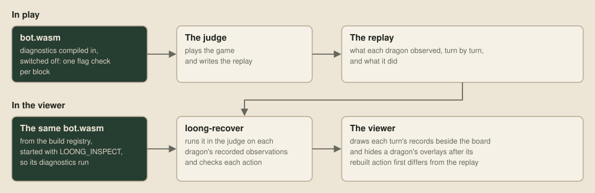

The bot writes its explanations inside diagnostic blocks, which are compiled into the build that plays but switched off, so in a game each block costs one flag check. The organiser's engine never switches them on. Our recovery tool, `loong-recover`, does, then feeds the dragon its recorded observations one turn at a time in the [Zig judge](19-the-machine-inside-the-judge.md). If a rebuilt action ever differs from the replay, the dragon's later turns are marked unreliable and their overlays disappear, since from then on they show some other game. The Nim helper also times each block, so the bot leaves those points out when it budgets its time:

```nim
template diagnosticBlock*(body: untyped) =
  when defined(loongDiagnostics):
    if diagnosticsEnabled != 0:
      if diagnosticDepth == 0:
        let started = rawPoints()
        inc diagnosticDepth
        try:
          body
        finally:
          dec diagnosticDepth
          diagnosticPoints += rawPoints() - started
      else:
        body
```

Each explanation is one JSON record on a `LOG` line, which the judge lifts out of the bot's output before the engine sees it. The records follow a small [public format](https://github.com/overyonder/the-loong-game/blob/ca25234/replays/viewer/diagnostics.md), and the viewer knows nothing about roles, score formulas or any other part of a strategy. It draws what the bot says, in the bot's own words.

## Records

The [showcase bot](../examples/showcase-bot/strategy.nim) emits every kind of record, and its play is simple on purpose. Each turn it scores four options on one utility scale, as in Dave Mark's *Behavioral Mathematics for Game AI* (2009), and takes the best eligible one: flee a nearby enemy head, eat the nearest reachable pearl, split once it's long enough, or explore wherever leaves the most room. It remembers every cell and dragon once it sees or hears of them, and it tells its teammates by sonar where its head is and how long it is.

On the board, it draws its route to its target pearl, every cell reached by its search, and a line to the nearest enemy head. A positions record lists every known dragon with where and when the bot last saw or heard of it, and the viewer shades every cell within that dragon's reach since then.

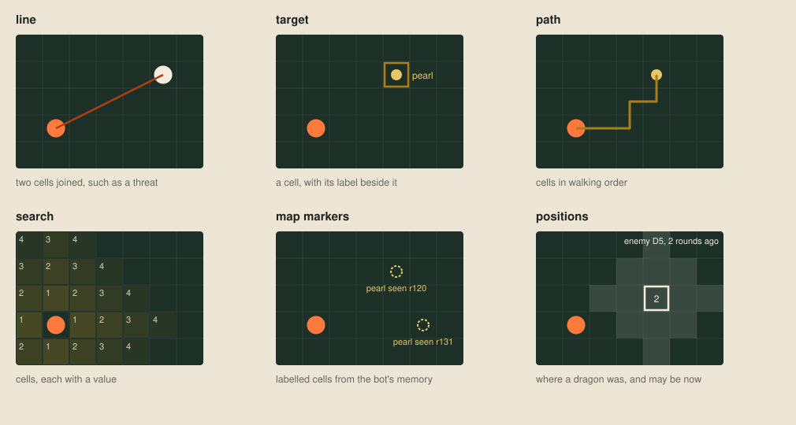

The other records lay out in the right sidebar. The Brain tab shows the options as a tree, each with its eligibility, utility and reason, and clicking a node opens its children. Under Eat, a calculation shows how the utility was reached and how each possible move scored:

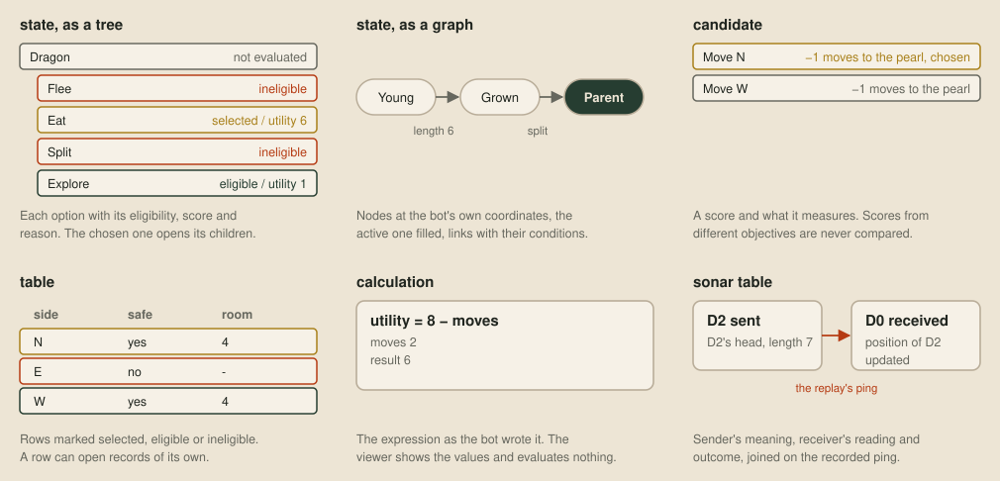

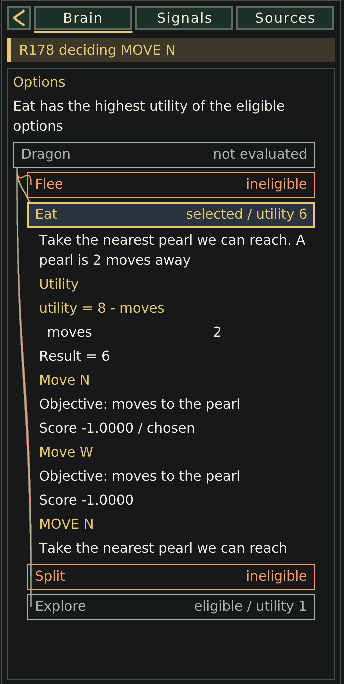

The Signals tab joins both ends of each sonar message on the replay's recorded pings, so the sender's meaning sits beside the receiver's reading, what the receiver did about it, and its memory of the cells involved before and after. A message without a matching ping is listed as a fault.

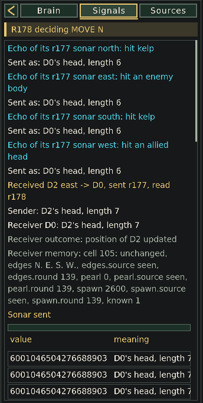

`just decisions` prints the same records as text, dragon by dragon and turn by turn, for reading or searching a whole stretch of a game:

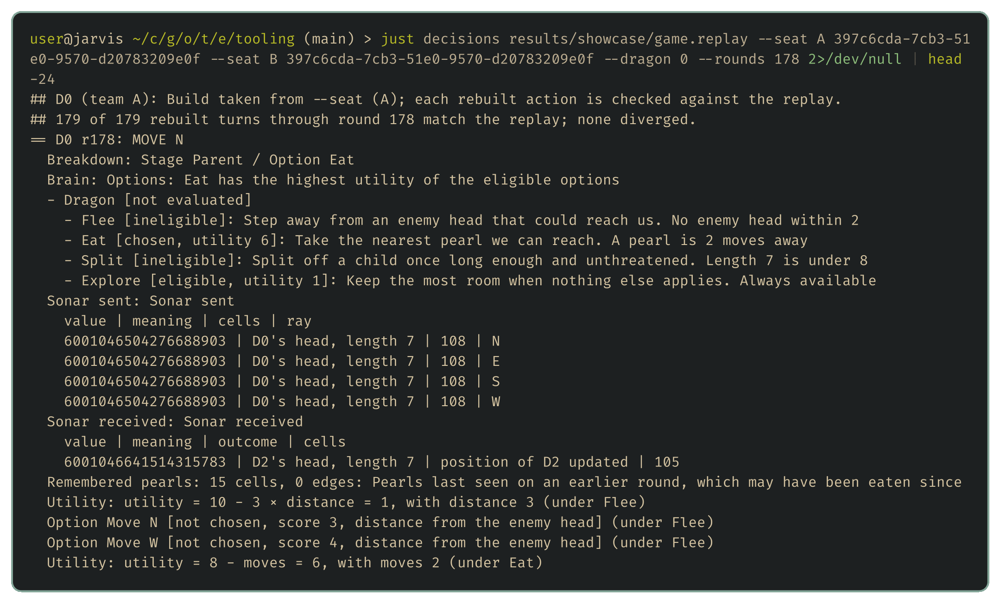

## State from memory

A bot that writes a second description of its state can easily make a debugger lie, because the description drifts from the bot's working state. The public introspection helper reads the real state instead. The bot writes a line giving the judge the address of a small region table and a schema made from its Nim types, and while the bot waits on that write, the judge copies those regions out of WebAssembly memory. Objects become tables, enums keep their labels, and arrays laid over the board become cell or edge records, so nobody lists fields by hand.

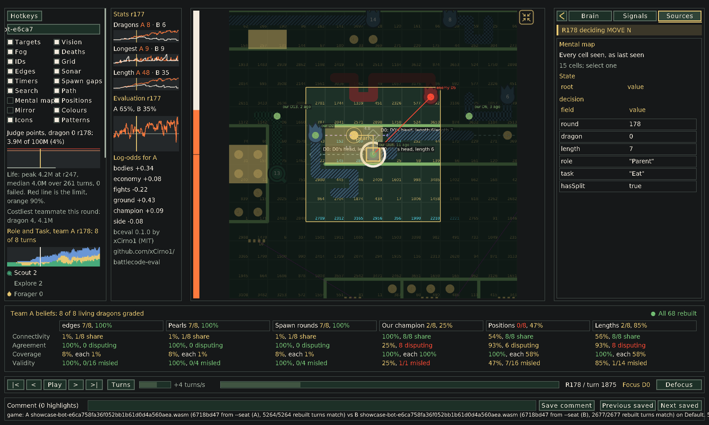

With captures from the start and end of a turn, the released recovery adapter lays out a role-and-task bot's full Brain, from the suitability of every role down to the claims and movement choices beneath each decision. The adapter turns those structures into the same generic trees, tables and calculations, so the viewer still knows none of the concepts.

Capturing all of that for every turn would make a long game slow and large, so the viewer asks for detailed records only in a window around the round on screen. Every other turn runs with diagnostics off, and every action is still checked. Moving outside the window resumes the bot from the nearest earlier checkpoint.

## Graded memory

A bot's mistakes often start in what it believes, before it decides anything. The viewer can check beliefs because it has the replay's truth to compare them with. A bot tags each remembered fact with its quantity, such as kelp on a cell's sides, a pearl, when the next pearl is due, another dragon's position and length, or a team's champion, along with where the fact came from and when it was learned. The showcase bot sends its map as one table, one row per cell seen so far, and `retain` tells the viewer to keep any rows not resent:

```nim
gizmos.emitGizmoJson($ %*{"version": 1, "kind": "table", "label": "Mental map",
  "slot": "memory", "id": "memory", "retain": true,
  "reason": "Every cell seen, as last seen",
  "columns": ["edges", "edges.source", "edges.round", "pearl", "pearl.source", "pearl.round",
    "spawn", "spawn.source", "spawn.round", "known"],
  "truth_columns": ["edges", "", "", "pearl", "", "", "spawn_due", "", "", ""],
  "rows": rows, "row_cells": rowCells,
  "display_column": 6, "display_overlay": "timers", "display_format": "round_delta",
  "consensus": [
    {"category": "Pearls", "column": 3, "known_column": 9, "minimum": 1, "scope": "cell"},
    {"category": "Spawn rounds", "column": 6, "known_column": 9, "minimum": 1, "scope": "cell"}]})
```

The Mental map overlay turns the board into that memory. Unseen cells are black, and a cell turns red where the replay contradicts its remembered contents. Each dragon in the bot's memory is a dot at its believed position, green if its true position falls within the bot's estimate and red if not. Crowns mark the enemy's actual champion and the focused dragon's belief about it.

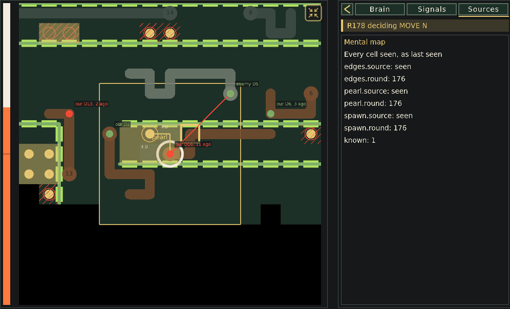

The strip under the board grades the whole team, with a column for each belief. Each box says how many living dragons hold that belief without a single false fact, followed by four measures taken from the requirements for a consensus protocol (Lynch, *Distributed Algorithms*, 1996, chapters 5 and 6):

- **Connectivity** is the share of other dragons that state each fact too, as an update spreads in the epidemic protocols of [Demers and colleagues](https://doi.org/10.1145/41840.41841) (1987).
- **Agreement** is the share of pairs of dragons stating the same fact that don't contradict each other.
- **Coverage** is the share of existing facts stated by at least one dragon. It stands in for termination, where every process eventually decides.
- **Validity** is the share of stated facts that are true.

Clicking a box lists every wrong fact, and a belief about cells opens as a map coloured by whether the dragons agree:


These views show two simple faults in the showcase bot's memory. It keeps an earlier sighting of a pearl until it sees that cell again, so it misses every pearl eaten or grown out of its sight, and it keeps a spawn round after that round has passed. Neither shows up in how the dragons move. The team also disagrees about its own champion, with only 2 of its 8 dragons right.

## Long dragons

Back to the question from the last post: why do the pearl chaser's dragons hit walls and themselves so much more often than the plain flood-fill bot's? Neither bot writes diagnostics, so the viewer shows them from the replay alone.

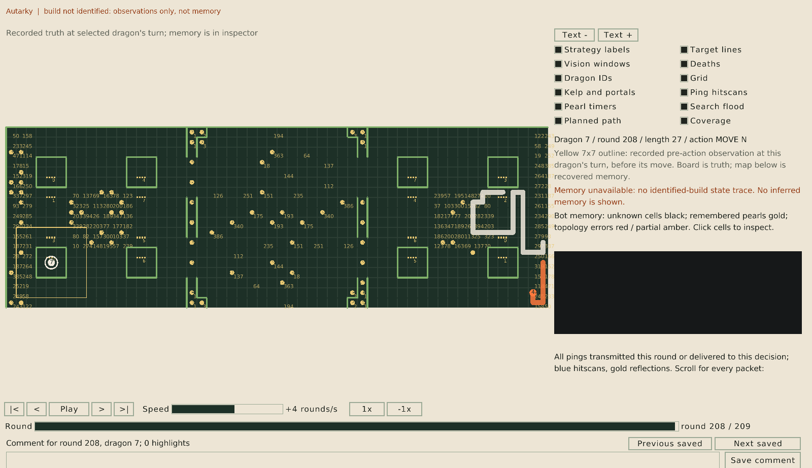

This dragon's head is in a walled box, entered through a portal, with most of its body far outside its window. Its next move went back through the portal and onto its own body, which is the portal blind spot from [the map generator post](06-maps-nobody-has-seen.md). The next dragon has no portal to blame:

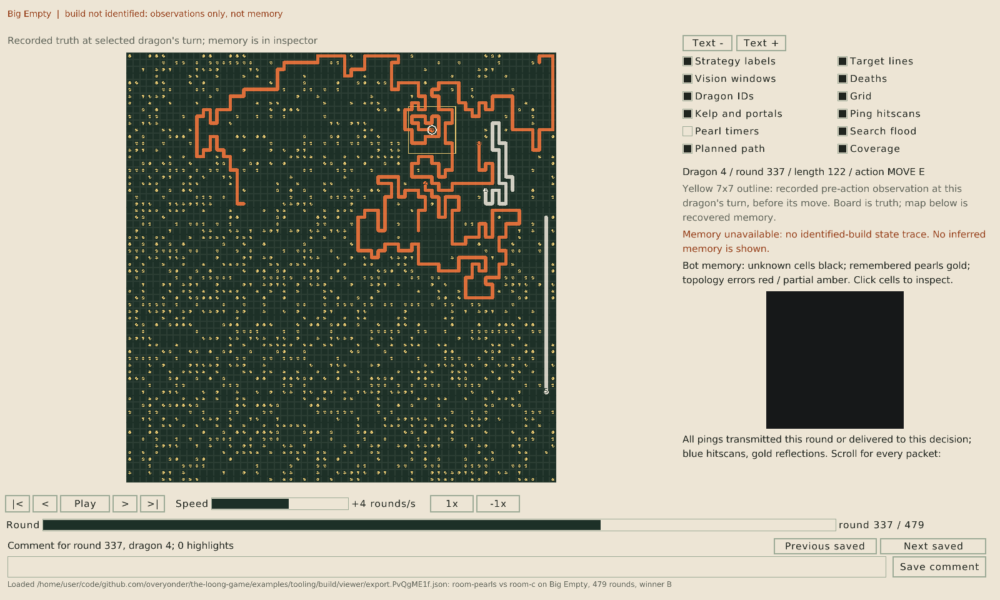

Its head is wound inside a loop of its own body, so its window shows little except itself. The flood fill only counts room inside the window, so it has almost nothing to choose between moves with. Across all 70 games, the pearl chaser's dragons get long, and the ones that die on their own bodies are long too:

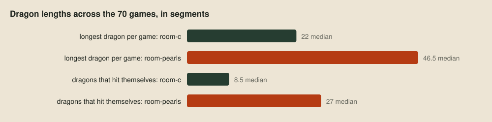

| The pearl chaser's self-hits in the 70 games | Count |
| --- | ---: |
| All self-hits | 91 |
| Through a portal | 28 |
| By dragons longer than 49 segments | A third |

A dragon longer than 49 segments can't fit in its own window. The flood fill was designed for a short dragon, and a bot that grows long needs to know where its own body is outside its window, which is a job for strategy.

## Next up

The last tool on the wishlist is profiling: [where the points go](12-where-the-points-go.md).
