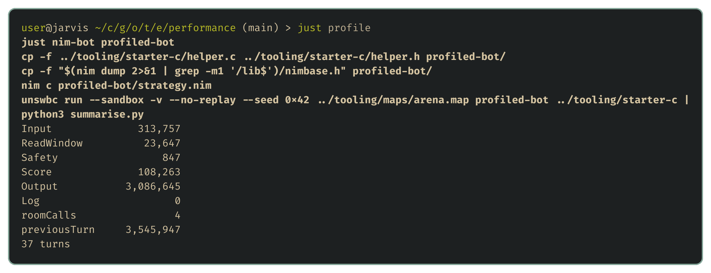
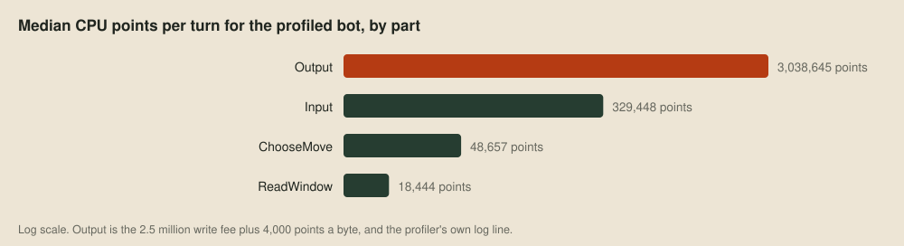
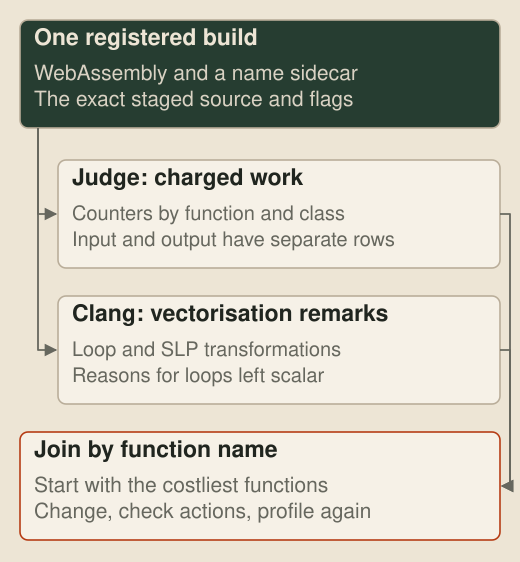
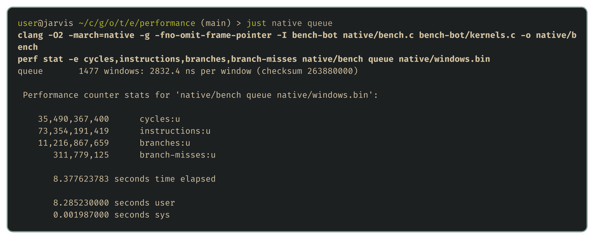
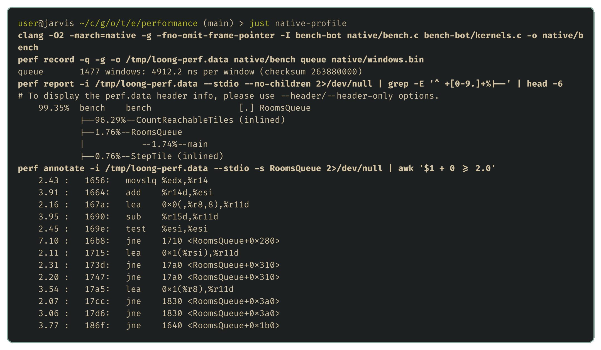

# Profiling CPU points

[The choice](03-the-choice.md) measured what a whole turn costs in each language, which was enough to pick one. It can't say what the points are spent on, and once a bot searches properly, every point spent elsewhere is lost search depth. The last tool on the wishlist splits a turn's cost into its parts and follows the expensive part down to individual instructions.

## The price list

The judge doesn't measure time. Instead, it gives each dragon 100 million points per turn and charges the bot for each WebAssembly operation, at the prices in the toolkit's `unswbc/metering.py` and `unswbc/sandbox.py`:

| Operation | Points |
| --- | ---: |
| Arithmetic, comparisons, constants and local variables | 1 |
| Memory loads and stores, and branches | 2 |
| SIMD instructions, whatever they do | 2 |
| Division and remainder | 3 |
| A direct function call | 4 |
| An indirect call, through a function pointer | 6 |
| Growing memory | 50 |
| Writing output | 2,500,000 per write, plus 4,000 per byte |
| Reading input | 6 per byte |

Output is by far a bot's most expensive operation, which is why the starter helpers write once per turn. A SIMD instruction costs the same as a load while doing up to sixteen times the work, which matters in the performance stage.

## A profiler inside the bot

The judge's clock advances one nanosecond per charged point, so a bot that reads the clock before and after a piece of its own code gets that code's exact cost. Reading it is one call into WASI, WebAssembly's system interface:

```nim
proc wasi_clock_time_get(id: uint32, precision: uint64, time: ptr uint64): uint16
  {.importc: "__wasi_clock_time_get", header: "<wasi/api.h>".}

proc clockNanoseconds*(): uint64 =
  discard wasi_clock_time_get(1, 1, result.addr)  # 1 is WASI's monotonic clock
```

A Nim template then adds any block's cost to a running total for that part of the turn:

```nim
type Part = enum Input, ReadWindow, ChooseMove, Output
var spent: array[Part, uint64]

template profile(part: Part, body: untyped): untyped =
  let started = clockNanoseconds()
  body
  spent[part] += clockNanoseconds() - started
```

The [profiled bot](../examples/performance/profiled-bot/strategy.nim) wraps each step of its turn in `profile` and logs the totals, and `just profile` takes the median of every part over a game:



## The profile

The bot's thinking, the move choice with its flood fills, is a tiny slice of the turn:



Most of the output bytes are the profiler's own log line, so the logging costs more than the measured code, and a profiling build is for reading, never for submitting. Input is the other surprise. Reading under a kilobyte costs about 6,000 points, and nearly all the rest of that bar is the starter helper turning text into numbers, so parsing costs more than the strategy.

That leaves about 96 million points of every turn for thinking. The flood fill is the part of the thinking that grows as a bot looks further ahead, since two moves deeper means sixteen times as many flood fills.

## A profiler outside the bot

Wrapping every function would be tedious, and printing the answers spends points of its own. Instead, the [Zig judge](19-the-machine-inside-the-judge.md) can count the charged instructions as it runs them. Its profiling pass gives each function seven counters: arithmetic, locals, memory, SIMD, calls, control and other. Input reads and output writes get separate rows, so the large cost of sending a move doesn't disappear into whichever function happened to call `write`.



The points profile takes two built bots, a map, a seed and a replay destination:

```sh
just points-profile A.wasm B.wasm arena.map 12345 game.replay
```

It writes a table beside the replay with each team's costliest functions first. A `.names` sidecar written with each bot keeps function identifiers even when the submitted module is stripped.

## Compiler vectorisation remarks

A hot function's cost doesn't tell us whether a different loop would cost less, but the compiler can explain its choices. [LLVM has two vectorisers](https://llvm.org/docs/Vectorizers.html): the loop vectoriser combines work from consecutive iterations, and the SLP vectoriser combines independent scalar operations. Their remarks record each success and the reason for each miss, such as an uncertain dependency or a cost model that prefers scalar code. The vector-remarks tool joins the remarks from the judge's clang to the function costs from the same build:

```sh
just vector-remarks BUILD_GUID game.profile.tsv A 10
```

That lets us start with the expensive function rather than a loop that merely looks worth optimising. Clang's cost model is built for a processor, while the judge has its own price list, so the charged points need profiling again after any change. The [profile README](https://github.com/overyonder/the-loong-game/blob/ca25234/harness/profiling/README.md) describes the output columns.

## Down to the instructions

Points say how much work code does but not why. For that, we compile the same code natively and use [perf](https://perf.wiki.kernel.org/), which reads the CPU's own counters. `just native queue` runs the flood fill from The choice over windows recorded from real games:



About two instructions per cycle is modest for a modern core, largely because of branch mispredictions. `just native-profile` pins the cycles to instructions:



No single instruction stands out. The cost is spread across the arithmetic that turns a tile number back into a row and column, and the jumps that test whether each step stays in the window and whether a tile was seen before, because the code handles one tile at a time. Since the judge counts instructions, the way to make the flood fill cheaper is fewer, bigger steps, and that's where the performance stage starts.

## Next up

That completes the wishlist. The series turns to the part that decides games, starting with [the shape of the problem](13-the-shape-of-the-problem.md).
