# The shape of the problem

With the tools in place, the series turns to strategy, starting with what kind of problem this is, because that decides what kind of bot is worth building.

## The problem

When a game has a fixed simulator and a clear score, it's tempting to throw compute at it: generate thousands of candidate bots, play them against each other for a week, and keep whatever wins. That only works when the target holds still, and in Battlecode very little does. Opponents change by the hour, every tournament map will be new, and even the rules move, as when random pearl seeding broke every hardcoded pearl schedule overnight.

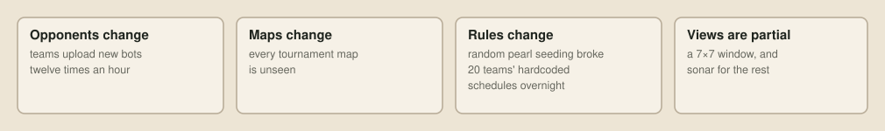

I learned this the expensive way. An evolutionary optimiser tuned my bot's decision weights against a fixed set of opponents on two maps, and its five best bots couldn't reliably beat a bot that moves at random. Asking an AI model for a bot fails differently: every team has the same models, so the ladder fills with similar bots that mostly beat each other at random.

In Russell and Norvig's [vocabulary](https://aima.cs.berkeley.edu/4th-ed/pdfs/newchap02.pdf), the game is *partially observable*, since a dragon only sees its 7×7 window, and *multi-agent* in two directions, competing with the other team while cooperating with teammates who don't share its memory.

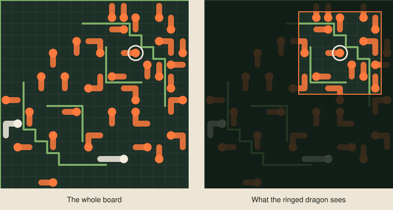

Problems like that reward bots that are quick to understand and change. When a dragon does something stupid, we need to see in the [viewer](11-through-one-dragons-eyes.md) what it knew, which choices it considered and why it picked that one. So the bot's architecture, the way its decisions are organised, is the first real strategic choice.

## Architectures

Game AI has settled on a handful of ways to organise an agent's decisions, and the *Game AI Pro* chapter *[Behavior Selection Algorithms](http://www.gameaipro.com/GameAIPro/GameAIPro_Chapter04_Behavior_Selection_Algorithms.pdf)* covers most of them:

| Architecture | How it decides | Strength | Weakness |
| --- | --- | --- | --- |
| State machine | One active state, with transitions between states, nested in hierarchical versions ([Harel](https://doi.org/10.1016/0167-6423(87)90035-9), 1987) | Cheap and easy to trace | Transitions multiply as states are added |
| Behaviour tree | A tree of priorities re-evaluated from the root each turn ([Colledanchise and Ögren](https://arxiv.org/abs/1709.00084), 2018) | Modular and reactive | Priorities are fixed in the tree's shape |
| Utility system | Every option gets a score and the best wins (Mark, 2009) | Smooth trade-offs | Scores need tuning |
| Subsumption | Higher reactive layers override lower ones ([Brooks](https://doi.org/10.1109/JRA.1986.1087032), 1986) | Reflexes win | Hard to plan with |
| Belief, desire, intention | A chosen desire is held as an intention until done or impossible (Rao and Georgeff, 1995) | Commits instead of dithering | Dropping intentions is subtle |
| Goal-oriented planning | Searches for actions that reach a goal (Orkin, 2006) | Finds new combinations | Replanning is expensive |
| Hierarchical task network | Breaks tasks into subtasks with authored methods (Erol, Hendler and Nau, 1994) | Builds in the designer's knowledge | Methods take a lot of authoring |
| Search | Looks ahead with [alpha-beta](https://doi.org/10.1016/0004-3702(75)90019-3) or [Monte Carlo tree search](https://doi.org/10.1109/TCIAIG.2012.2186810) | Strong with a good model | Hidden information and many agents explode the tree |
| Learned policy | A trained model maps observations to actions ([Sutton and Barto](http://incompleteideas.net/book/the-book-2nd.html), 2018) | Can find patterns beyond the designer's knowledge | Needs a stable environment and lots of data |

These can work at different levels of one bot, so a utility score can choose a task and a state machine can run its steps. Keeping the levels separate lets us change how a choice is made without rewriting the chosen behaviour.

## The repertoire

My reference repertoire sorts code by kind, the way a textbook would, and the dots mark the techniques implemented because the early reference bots needed them:

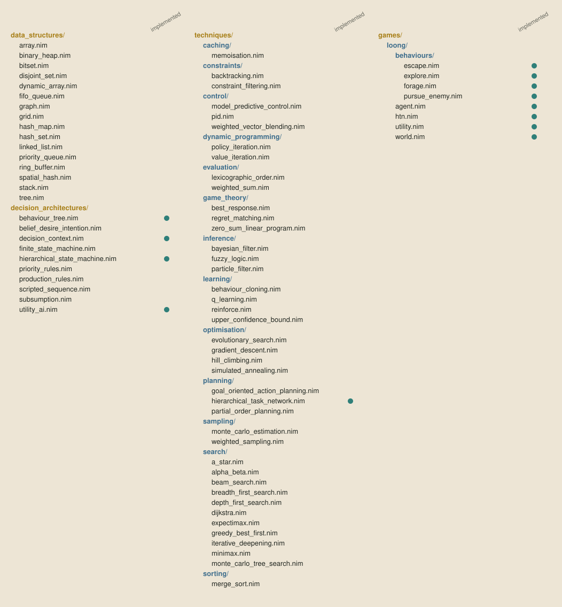

Data structures, decision architectures and techniques are generic and know nothing about this game. Only `games/loong/` does, with the world model, movement, the turn loop, a thin adapter for each architecture and one module per behaviour. A behaviour module owns when it's eligible, what it's worth and how it's carried out, and offers itself to each architecture through a small factory. A bot is then just a list of behaviours handed to an architecture. These two reference bots use the same four behaviours, one choosing by utility and the other planning with a task network:

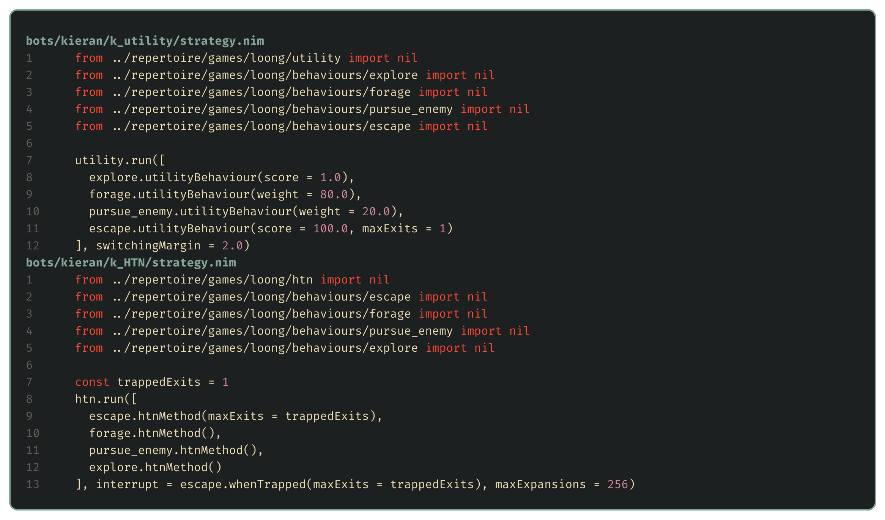

Nothing in either file knows how a behaviour works, and nothing in a behaviour knows which architecture will pick it, so changing a bot means editing a list. A new architecture needs one generic module, one adapter and a factory in each of its behaviours, and then every existing behaviour is available to it.

## Roles, tasks and states

The textbook competition bot assembles that repertoire into a hierarchy. At the top, a role has an objective and a need for some number of dragons. A scout exists to discover the map, so the need for scouts falls as unexplored sectors disappear. A champion exists to become the longest dragon, while guards protect it and an assassin pursues the enemy's champion. Each dragon picks its own role from what it sees and its teammates' sonar reports, because no central controller holds the whole board.

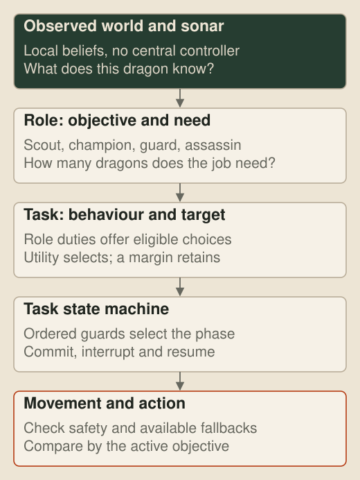

A task is a behaviour together with its target, so collecting one pearl and collecting another are two different tasks. A utility selector compares the role's eligible tasks and keeps the current one until another clears a switching margin, which stops a dragon changing its mind every time two scores trade places. Inside a task, a hierarchical state machine runs phases such as approaching a target and acting on it. To avoid the multiplying transitions, each state picks among ordered, guarded child states, and the kind of state decides what happens next turn:

| Control | On the next turn |
| --- | --- |
| Reactive state | Choose again from the ordered guards |
| Committed state | Keep its place until it completes or becomes unavailable |
| Urgent interrupt | Take the turn while retaining the interrupted task's phase |

Movement comes last. It checks which actions are safe before comparing them by the active behaviour's objective, so a high task score can't make a dangerous step safe. When a dragon makes a bad decision, the wrong role, the wrong target and a bad route each sit at their own level, and we can change that level alone. [Roles](15-roles.md) develops the objectives, and [Planning to play](26-planning-to-play.md) walks through the full turn loop.

## The first strategy bot

The example bots in this series are built the same way, on a small public repertoire in [examples/repertoire](../examples/repertoire/games/loong/hsm.nim). The first one is a state machine entered from the root every turn, and the first behaviour with a satisfied guard takes the turn:

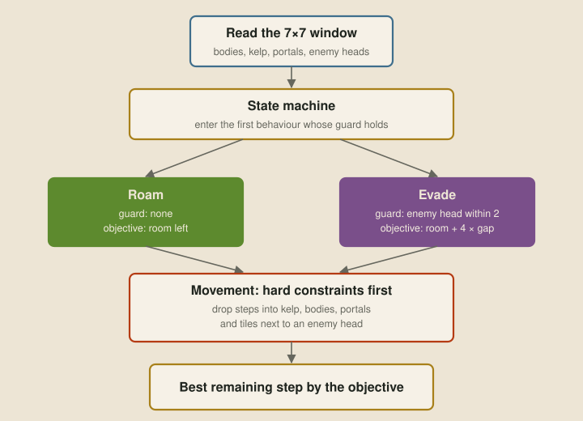

The whole bot is its assembly:

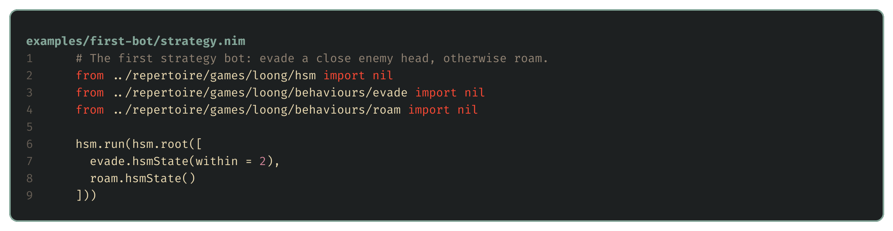

Roam keeps the most room, exactly as the flood-fill bot did. Evade adds a bonus for distance from the nearest enemy head, so it will give up a little room to get away:

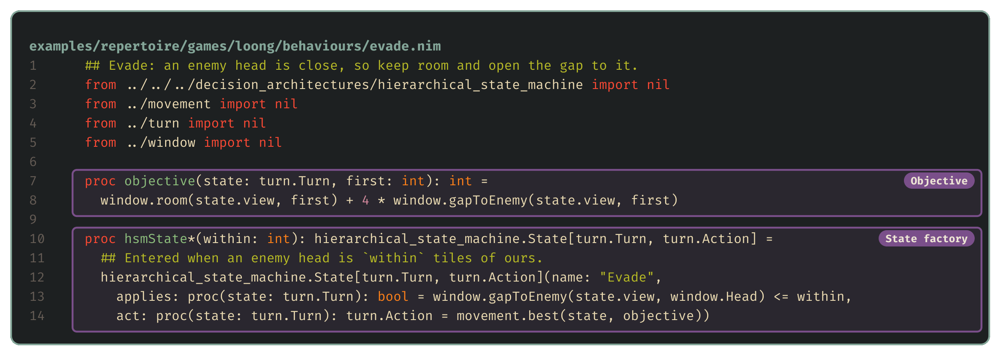

Movement drops steps into kelp and bodies, and steps next to an enemy head, since a head-on collision kills both dragons. It also drops portals, because vision doesn't reach through them. If no safe step remains, the fallback relaxes those checks:

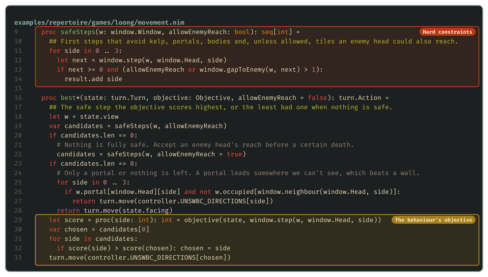

Against the flood-fill bot from [The choice](03-the-choice.md), on the bundled and generated maps, the [verdict](05-better-worse-or-undecided.md) finds it isn't better:

| Candidate | Opponent | W–D–L | Elo (95% interval) | Decision | Games used |
| --- | --- | --- | --- | --- | --- |
| `first-bot` | `room-c` | 17–2–21 | −35 (−151 to +73) | not better | 40, decided at 40 (cap 155) |

The result files also count deaths by cause, which points to games worth reviewing:

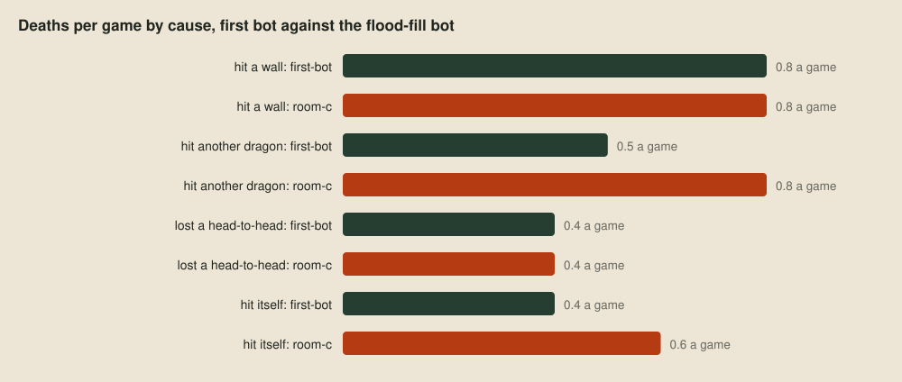

Across all the run's completed games, most of the first bot's losses came on length at round 500, so the question for the viewer is what stopped it growing. On the Portals map, nearly every pearl sits in a small walled box with a portal as its only entrance, and both bots avoid unseen portals while another move is available:

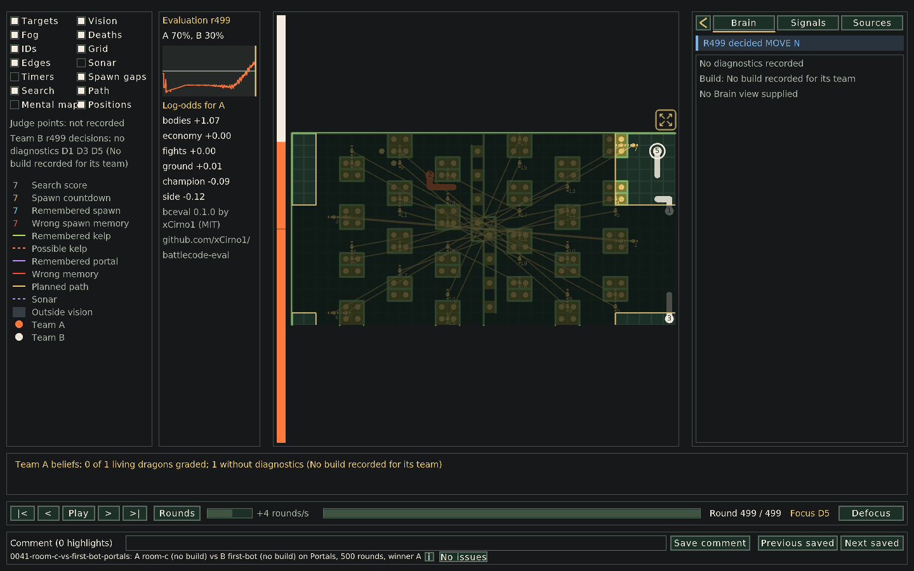

Growing a champion is a job for [the roles](15-roles.md), and the new structure gives that behaviour an obvious place to go.

## Next up

[Three lines](14-three-lines.md): why the textbook bot develops beside a free-form foil and a learned line, and how their versions stay reproducible.
