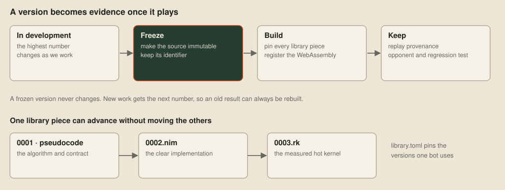
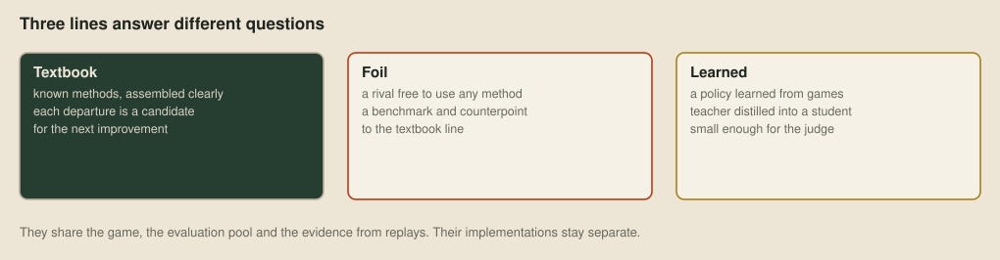

# Three lines

> **Editor's note, 2 October 2026.** Added the assembly of a bot from its numbered strategy, pinned library pieces and shared runtime.

Before comparing our textbook, foil and learned bots, it helps to define what one bot is. A numbered directory under `main/` holds one bot's assembly, the libraries hold selectable pieces, and the runtime connects every bot to the judge:

```text
bots/
  common/
    lib/                 # pieces used by more than one line
    runtime/             # the judge-facing runtime
  textbook/
    lib/                 # the textbook line's pieces
    main/NNNN/           # one numbered bot assembly
  foil/
    main/NNNN/           # one numbered foil bot
  rl/
    lib/                 # the learned line's pieces
    main/NNNN/           # one numbered learned bot assembly
```

A Nim assembly usually holds just `strategy.nim`, which chooses the behaviours and decision architecture, and `library.toml`, which pins the exact implementations behind its imports.


## Versioned pieces

Each library piece has numbered versions. A piece might start as pseudocode, become Nim when a bot uses it, and gain a Rake version when a hot loop needs a vector kernel, and each step is a new version, so an older bot's source never changes. The manifest maps each stable import path to one numbered implementation:

```toml
mount = "repertoire"

[files]
"decision_architectures/utility_ai.nim" = "textbook/lib/decision_architectures/utility_ai/0004.nim"
"techniques/cryptography/speck.nim" = "common/lib/techniques/cryptography/speck/0001.nim"
```

The build copies the bot and its selected pieces into a content-addressed tree, with the pieces under `repertoire/`, then adds the shared runtime, which supplies the entry point and judge integration. It records the hashes of every input and the compiler settings, and registers the resulting WebAssembly.

## Frozen versions



A line's highest-numbered version is the one in development. When it's worth evaluating, we freeze it, register its build and start the next number. A frozen version and its pinned pieces never change, so an identifier such as `textbook-main-NNNN` always means the exact program behind a result. Old versions stay as opponents in the [ladder](07-a-ladder-of-our-own.md), regression cases and provenance for replays.

## Three approaches to bot development

A *line* is a sequence of numbered assemblies, plus any library particular to its approach. We develop three, because each asks a different question:



| Line | Recurring question |
| --- | --- |
| Textbook | What established method should this layer use? |
| Foil | What can beat the current bots, by any method? |
| Learned | What policy can the games teach, within the judge's limits? |

### Textbook

The textbook line assembles standard computer-science methods from a library arranged by data structures, decision architectures, techniques and Loong-specific adapters. Each behaviour checks when it applies and proposes an action. Any departure from the textbook method is something to inspect, and when an idea looks novel while the bot still makes ordinary mistakes, I first check which established method it approximates.

### Foil

The foil is a rival that can use any method, with no duty to resemble the textbook design or share its library. We play it against the textbook line and carry lessons between them, but keep the code separate so the foil keeps its own mistakes instead of becoming another version of the same bot.

### Learned

The learned line trains a large teacher, then distils it into a student small enough for the judge's time and memory limits. [Learning to play](27-learning-to-play.md) follows that pipeline.

All three share the runtime, build registry, maps, evaluation pool and viewer, so their results stay comparable.

## Next up

[Roles](15-roles.md): giving dragons different jobs, and letting each one work out its role from the same local program.
