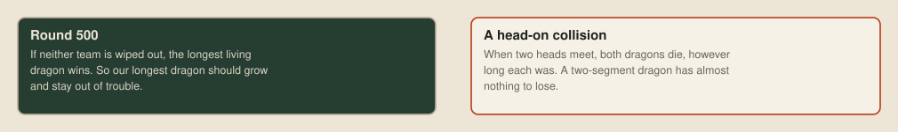
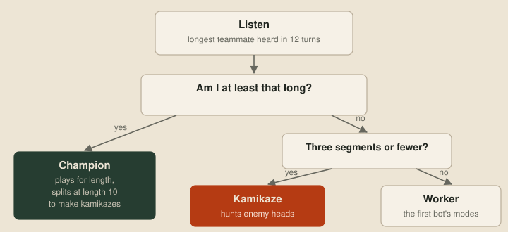
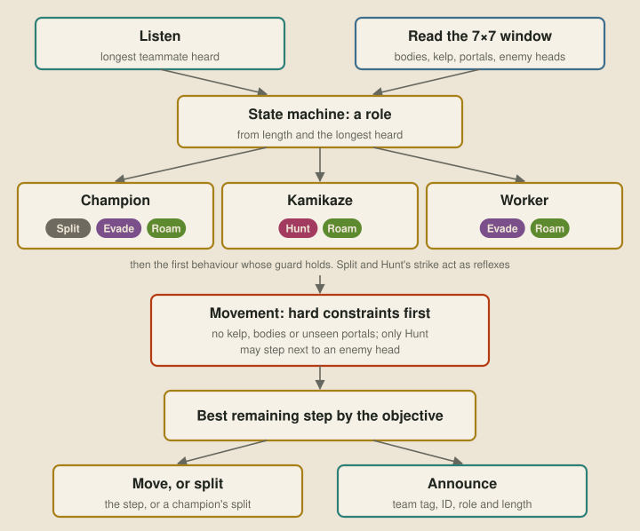
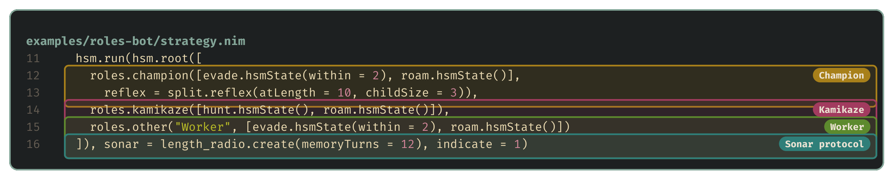
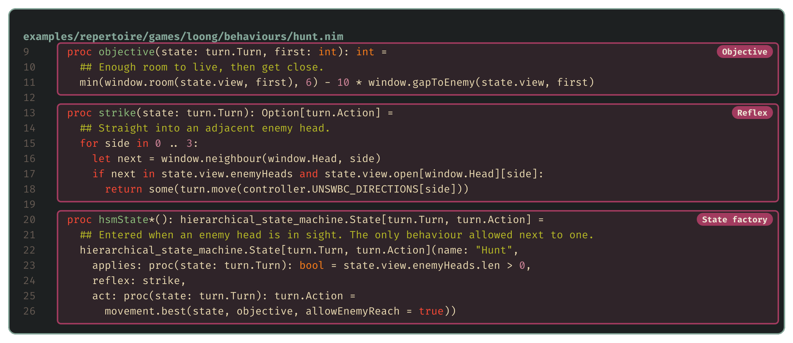
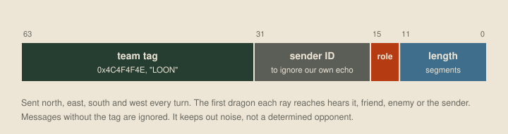
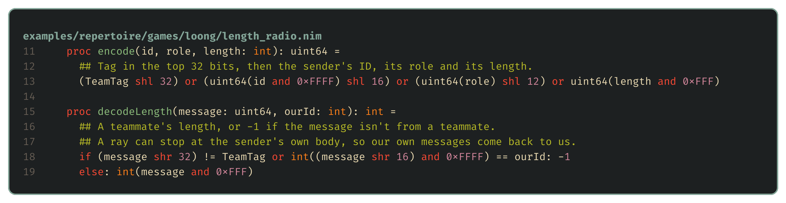
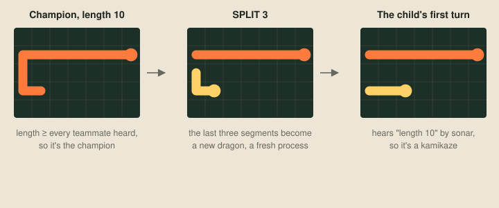
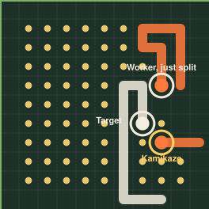
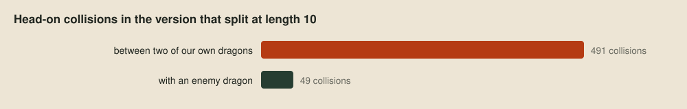

# Roles

> **Editor's note, 28 September 2026.** The tests below use the sequential verdict, toolkit 1.2.2 and the new generated maps.

The [first strategy bot](13-the-shape-of-the-problem.md) treats every dragon the same, but a long dragon carries the team's chance of winning at round 500, while a two-segment one isn't worth much alive. This post gives dragons different roles, so the same program behaves differently depending on who's running it, and uses sonar to let each dragon work out its own role.

## Different jobs

Two of the game's rules pull our dragons in opposite directions. If neither team is wiped out, the team with the longest living dragon wins at round 500, so our longest dragon carries the whole team's result. And when two heads meet, both dragons die, however long each of them was:

So a long dragon should avoid enemy heads and a short one should seek them out, which gives three roles:

- The **champion** is the team's longest dragon. It plays for length.
- A **kamikaze** is a short dragon, three segments or fewer, with a longer teammate to protect. It hunts enemy heads.
- A **worker** is everyone else, and plays exactly like the first bot.

## One program, three roles

Every dragon runs the same program as a separate process with its own memory, and nothing tells a dragon it's the champion. Robot soccer players in Stone and Veloso's [locker-room agreement](https://doi.org/10.1016/S0004-3702(99)00025-9) (1999) settle their roles the same way, from rules agreed before the game and what they learn of the team during it, and the plays of Browning and colleagues' [STP](https://doi.org/10.1243/095965105X9470) (2005) assign robots to roles as a team. Sonar is the only way to learn about teammates out of sight, so each turn every dragon announces its length, remembers the longest teammate heard in the last 12 turns, and picks its role from that:

The role adds a layer on top of the first bot's state machine, which makes it hierarchical in Harel's sense ([statecharts](https://doi.org/10.1016/0167-6423(87)90035-9), 1987). Each role is a parent state with a guard, and its children are the behaviours available to that role. The champion also gets a reflex, a check that runs before its children and can take the turn for itself:

The first bot's `evade` and `roam` modules now appear under more than one role, alongside a new `hunt` behaviour for kamikazes and the sonar protocol:

Hunt keeps just enough room to stay alive, then scores a move higher the closer it gets to an enemy head, and when the head is right next to it, a reflex drives straight in. Movement lets Hunt, and no other behaviour, step next to an enemy head:

## Talking by sonar

A sonar message is a single 64-bit number, sent out as a ray that travels in a straight line until it hits kelp or a dragon segment, and that dragon receives the number. It carries nothing else, not even the sender or its team, so an enemy in the way hears it just as clearly as a teammate would. Every message we send therefore starts with a fixed team tag, and a dragon ignores anything without it:

The tag stops a dragon mistaking random enemy traffic for a teammate, although an opponent could decode and copy it. Decoding also discards the dragon's own messages, for a reason explained below:

## The champion's berth

Like every other dragon, the champion keeps two tiles from enemy heads. A three-tile berth made it too timid to hold its ground, and the verdict found that version no better than the first bot. A control with the sonar running but every dragon playing like the first bot made identical moves to the first bot, so listening and announcing cost nothing. Even with the two-tile berth, though, the roles bot only came out level with the first bot, because just 5.3% of its dragon-turns were kamikaze turns. Short dragons with a longer teammate nearby were rare.

## Making kamikazes

A dragon can split, turning the end of its body into a new dragon, so a champion that reaches 10 segments now splits off its last three. That's the champion's reflex in the assembly above. The child runs a fresh copy of the program with no memory, hears the champion announce length 10, sees that it's only three segments long, and picks the kamikaze role itself:

With splitting, the roles bot beat the first bot convincingly, as the verdict below shows. Splitting brings two things at once, though: more dragons, and new ones that hunt. A version whose children became ordinary workers did just as well against the first bot, and played directly against the kamikaze version, the two ran to the verdict's cap of 155 games with no material difference. So the extra dragons do most of the work. The kamikaze stays, since trading a three-segment child for an enemy head that might otherwise win at round 500 is a sound idea.

## A bug in the replay

Here's one of those kamikazes on Arena, the turn before it drives into an enemy head:

The dragon at the top has just split off that kamikaze. It's still our longest dragon, so it should be the champion, but its indicator says Worker. A sonar ray stops at the first dragon segment in its path, including the sender's own body, and rays wrap around the edges of the board. On a small map like Arena, 11 tiles across, a ray can travel all the way round and hit the dragon that sent it. This one had been 13 segments long before it split, so it heard its own old announcement of 13, concluded some teammate was longer than its current 10, and demoted itself for 12 turns, until that message left its memory.

The fix puts the sender's ID in each message, and `decodeLength` ignores the dragon's own. The verdict called the fixed version better than the one before it. It's the one in [examples/roles-bot](../examples/roles-bot/strategy.nim), and `just roles` builds it and runs the verdict against the first bot:

| Candidate | Opponent | W–D–L | Elo (95% interval) | Decision | Games used |
| --- | --- | --- | --- | --- | --- |
| `roles-bot` | `first-bot` | 21–2–4 | +257 (+122 to +558) | better | 27 (cap 155) |

The roles bot also won all ten of its upset games against the starter.

## Friendly fire

Head-on collisions kill teammates as well as enemies, but movement only keeps clear of enemy heads. Once splitting fills the board with our own dragons, they start running into each other, and in the version that split at length 10, nine in ten head-on collisions were between two of our own dragons:

You'd expect giving friendly heads the same berth as enemy ones to fix this, but it made things worse. The verdict found it no better than the version without it, and it lost 2 of its 10 upset games to the starter. Finding out why will need a closer look at the games themselves.

## Next up

[Tactics](16-tactics.md): once a dragon knows its role, how to carry it out well.
