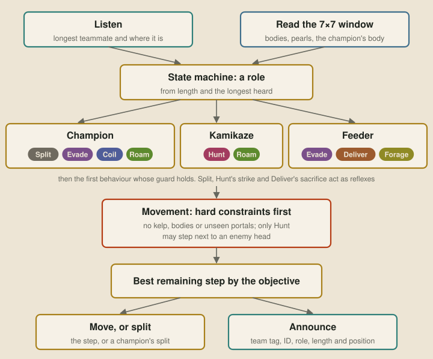
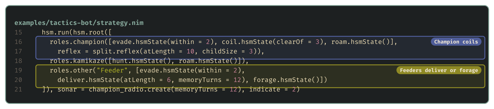
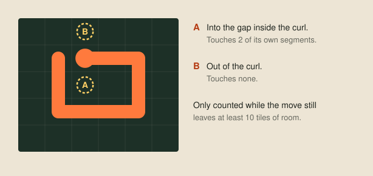
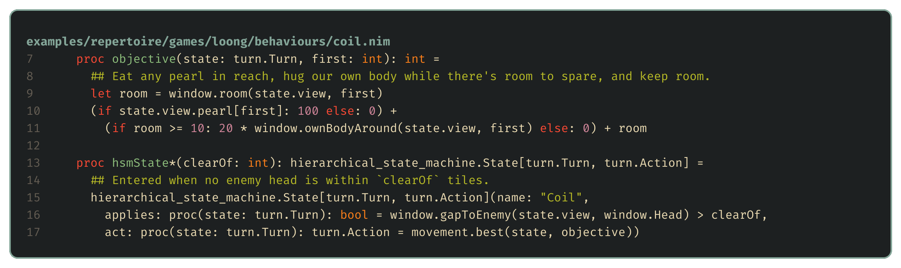
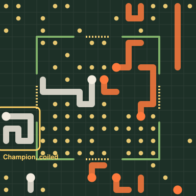
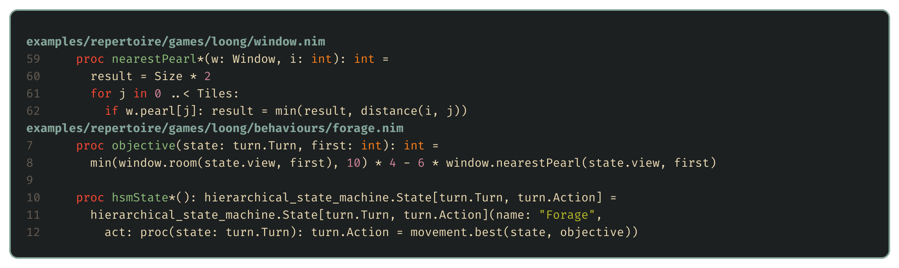
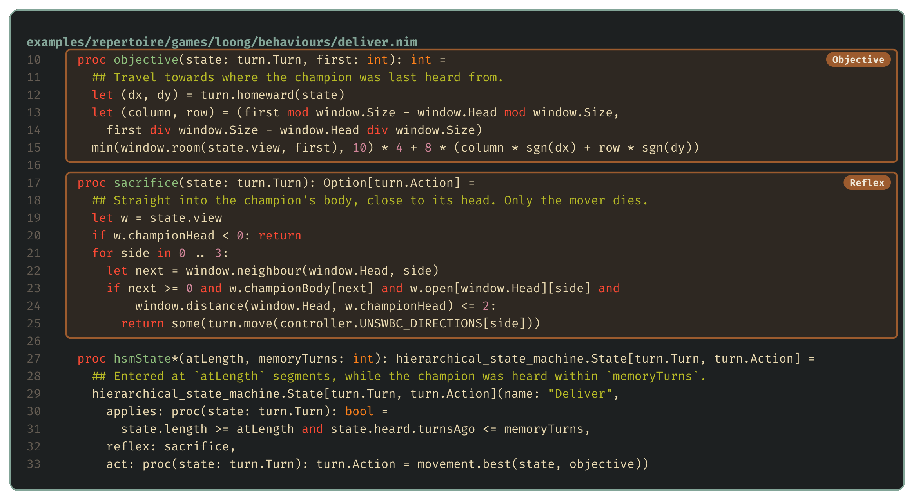
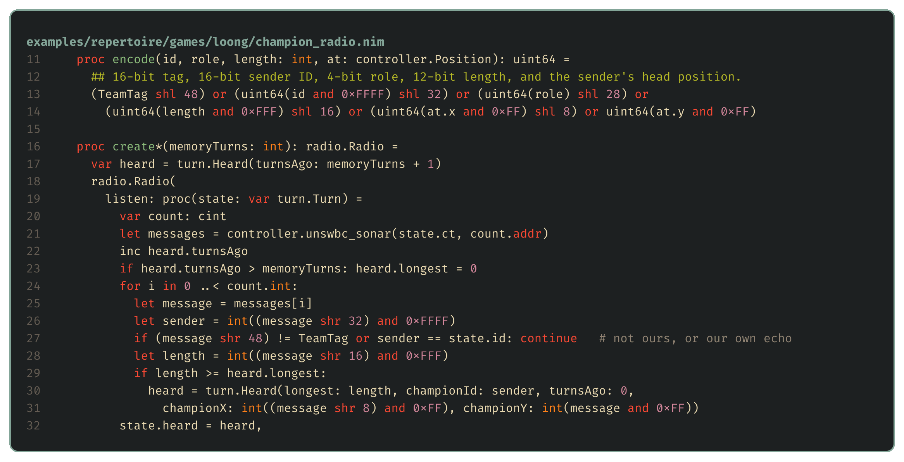

# Tactics

> **Editor's note, 28 September 2026.** The tests below use toolkit 1.2.2 and the new generated maps.

The last two posts were about strategy, which decides what each dragon is for, such as staying long for round 500 or hunting enemy heads. Tactics is the other half: once a dragon knows its job, doing that job precisely and efficiently. Two bots with the same strategy can play very differently depending on how well each carries it out.

## A note on secret sauce

I'm competing in this tournament too, so I can't walk through all my current ideas without handing them to everyone else. These questions shaped my own thinking, and none of them has an obvious answer:

- Which of your dragons would it hurt most to lose, and does your plan survive losing it?
- How much of your 100 million points a turn do you actually use, and what would the rest buy?
- What does your bot do differently when it's winning than when it's losing?

Winners of other Battlecode competitions have written up their thinking, and it carries over even where the games differ:

| Team | Result | Write-up |
| --- | --- | --- |
| Just Woke Up | MIT 2025 champions | [Units built around explicit state machines](https://battlecode.org/assets/files/postmortem-2025-just-woke-up.pdf), compact typed messages, and every version compared across many maps |
| Generalized Stroke's Theorem | MIT 2026 runners-up | [Watching replays](https://battlecode.org/assets/files/postmortem-2026-generalized-strokes-theorem.pdf) and experimenting with the big picture, ahead of shaving instructions |
| Austen Wayne | Cambridge 2026 novice champion | [Remembering what the bot had seen](https://github.com/AustenWayne/battlecode-bot/blob/main/Cambridge_Battlecode_Postmortem.pdf) and planning routes over that memory, and candid that he spent too long on his economy |

## A question from Discord

A good tactical question came up on the competition Discord recently:

> Does anyone have any ideas for mimicking the self-coil + self sacrificing mini to feed the big one? As seen by the number 1 on the leaderboard?
>
> — Dearest You [IU]

That's two tactics working together: the champion curls up tight against its own body, and smaller dragons deliberately die next to it to feed it. When a dragon dies, every other segment of its body turns into a pearl, so a mini that has grown by eating elsewhere can pass about half its length to the champion by dying where the champion can eat the remains. The longest dragon decides the game at round 500, so funnelling the team's length into one dragon makes sense.

Both fit into the roles bot as new behaviour modules. The champion gains Coil, and the workers become feeders, with Forage for finding food and Deliver for the sacrifice:

The assembly is the roles bot's with the champion's and feeders' lists changed:

## Coiling

A long dragon stretched across the board is an easy target, because every segment gives an enemy somewhere to cut in. Curled into a tight knot, most of its body is out of reach, and it stays in one place for teammates to bring it food. So a champion with no enemy head within three tiles coils. It only needs one preference for that: it likes moving onto tiles that touch its own body, and a dragon that keeps hugging itself winds into a spiral:

Left unchecked, that preference would have the dragon wall itself in, so hugging only counts while the move still leaves at least 10 tiles of room. A coiled champion still needs to grow, so a pearl right next to its head is always worth taking:

Here's a champion from one of the test games, nine segments packed into a three-by-three square:

## Feeding the champion

A feeder goes looking for pearls, keeping a reasonable amount of room, and heads for the nearest visible one:

Once it has grown to six segments, Deliver takes over and heads towards the champion's last known position. When the champion's head is within two tiles and one of its segments is right beside the feeder, a reflex skips the scoring and drives into it. When a dragon runs into another dragon's body, only the one that moved dies, so the champion comes to no harm, and half the feeder's segments turn into pearls right beside it:

The champion is usually far out of sight, so the sonar message needed its position as well as its length. To make room in the 64 bits, the team tag shrank to 16 bits:

## Numbers to tune later

The sacrifice's three numbers are first guesses: a feeder delivers once it's six segments long, only while it has heard the champion within the last 12 turns, and it only drives in when the champion's head is within two tiles. In early tests, versions with the sacrifice lost more often to the roles bot than versions without it. Those numbers and where the champion waits to collect are the first things to tune once the rest of the bot settles. The number one team may only sacrifice when the champion is short of food, or position the champion to collect.

## The verdict

`just tactics` builds the tactics bot and runs the verdict against the roles bot:

| Candidate | Opponent | W–D–L | Elo (95% interval) | Decision | Games used |
| --- | --- | --- | --- | --- | --- |
| `tactics-bot` | `roles-bot` | 8–1–14 | −93 (−273 to +47) | not better | 23 (cap 155) |

The test rejected a +70 Elo improvement. The tactics bot still won all ten of its upset games against the starter, so whatever it gives away doesn't make it beatable by a bot that doesn't try. The code is in [examples/tactics-bot](../examples/tactics-bot/strategy.nim).

## Every version on one ladder

Each verdict in the last three posts compared a new version with the one before it, using numbered snapshots that [never change](14-three-lines.md#frozen-versions). The [ladder](07-a-ladder-of-our-own.md) checks that the chain of improvements adds up and that nothing went round in a circle. Here are the saved versions from the flood-fill bot (room-c) onwards, with the pearl chaser and the C starter for reference, over 1,050 games on 35 maps. Each head-to-head column shows the row's score against that bot, out of 70:

| Bot | Rating | vs roles-bot | vs tactics-bot | vs first-bot | vs room-c | vs room-pearls | vs starter-c |
| --- | ---: | ---: | ---: | ---: | ---: | ---: | ---: |
| roles-bot | 1762 | | 37.5 | 55 | 53 | 61.5 | 70 |
| tactics-bot | 1750 | 32.5 | | 51.5 | 54.5 | 63.5 | 70 |
| first-bot | 1569 | 15 | 18.5 | | 42 | 51.5 | 68 |
| room-c | 1539 | 17 | 15.5 | 28 | | 52 | 69 |
| room-pearls | 1356 | 8.5 | 6.5 | 18.5 | 18 | | 56 |
| starter-c | 1024 | 0 | 0 | 2 | 1 | 14 | |

Every bot has a winning record against every bot rated below it, so nothing went round in a circle. The roles bot's jump over the first bot is the biggest step among the strategy bots, as its verdict found. The first bot's step over the flood-fill bot works out at about +70 Elo, near the top of its verdict's interval, so that step was real but smaller than the verdict looks for. The tactics bot finishes level with the roles bot, by a gap well inside what luck produces over 70 games, so coiling and feeding haven't paid for themselves yet.

## Next up

Next in the series is [sonar](17-sonar.md), the mechanic underneath all of this, and what else it could be used for.
