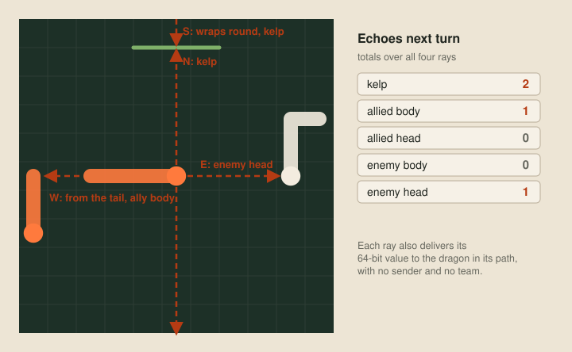
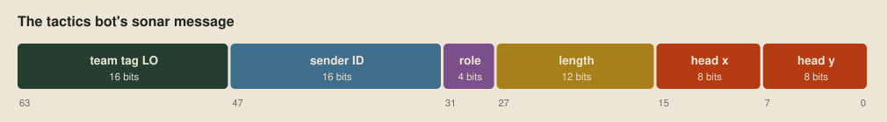
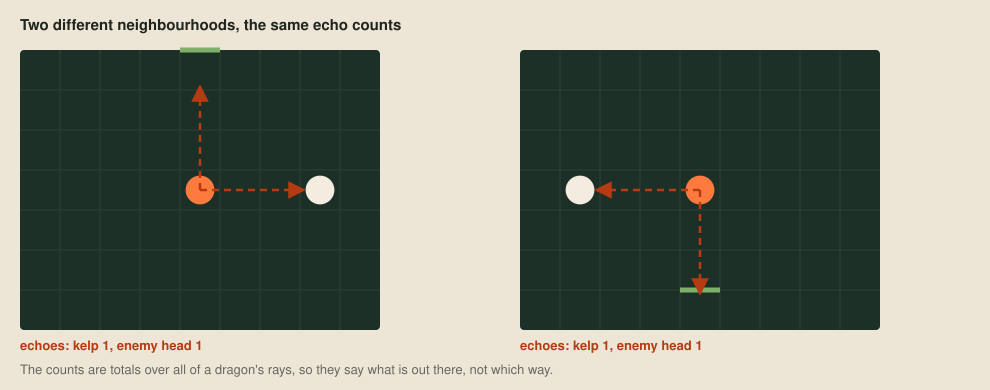
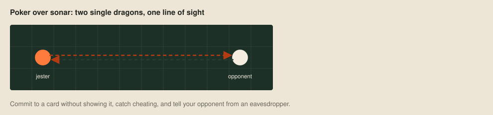

# Sonar

Most Battlecode seasons are built around one unusual mechanic, and the strongest teams exploit it better than anyone else. In 2026 it's sonar. It's the only way dragons can talk, the only way they learn anything beyond their 7×7 window, and every message is as audible to the enemy as to a teammate.

[Roles](15-roles.md) used sonar to announce a dragon's length, and [Tactics](16-tactics.md) added its position. This post works through what else the rules allow, then checks a few of those ideas against public ladder replays.

## Rays and echoes

Each turn, after it acts, a dragon may send up to four 64-bit values, one in each direction. Each becomes a ray that travels in a straight line, wraps round the board's edges, passes through portals, and stops at the first kelp wall or living dragon segment in its path, the sender's own body included. A ray that finds nothing within the board's width plus its height is lost. The ray opposite the dragon's facing starts from its tail.

Whoever a ray hits receives its value next turn, with no sender or team attached. With `PROTOCOL 3` switched on, the sender also learns next turn how many of its rays hit kelp, an allied body, an allied head, an enemy body or an enemy head, totalled over all its rays.

Two of those details have already bitten us. The wrap-around made the roles bot hear its own messages, and the missing sender is why we needed a team tag.

## Encoding

Sixty-four bits holds a team tag, an ID, a role, a length and a position, which is what the tactics bot sends, but every bit spent on one field is taken from another. A message also doesn't have to fit in one ray. A dragon can send four values a turn, over as many turns as it likes, so larger facts can be split up and reassembled, as long as every piece reaches the same listener.

## Listeners and forgers

An enemy in the way receives our messages just as a teammate would, and we receive theirs. A team tag stops random traffic being mistaken for a teammate's, but it hides nothing, so a bot should assume the other team reads all its messages. Even unreadable messages can identify their sender by their shape. Nothing stops a dragon sending a message in another team's format either, so a bot that believes every message can be misled, and the simplest defence is to check a message against what the dragon can see for itself.

## Echolocation

The echo counts are the only information from beyond the window that arrives without a teammate sending it. A hit means something out of sight lies in that direction, but the counts are totals over all four rays, so turning them into a direction takes some thought.

## The replay census

Later in the season we tested these ideas against 800 public replays from 20 teams:

| Question | Supported result |
| --- | --- |
| How many of the 20 teams encrypted sonar? | 8 |
| How many teams' packet fields could we validate? | 3 |
| How many teams could we fingerprint by packet shape? | 19 |
| Did a forged command make an enemy split? | No forgeable split command was found |
| Did fake length claims move a tested team? | None of the testable teams moved |

[Modelling other teams](25-modelling-other-teams.md#sonar) puts the census beside the rest of the opponent study and explains how little of it entered our bot, which never used the fingerprints.

## Poker

My favourite sonar idea so far came from the competition Discord: a jester bot that drops to a single dragon, lines up with an enemy, spins in a circle and plays poker over the line between them.

It's a joke, but it describes sonar well: a channel between two programs that don't trust each other and can't see each other's cards. Poker over sonar needs what a serious protocol needs: a way to commit to a card without revealing it, a way to catch cheating, and a way to tell whether a message came from your opponent or from someone listening in. Shamir, Rivest and Adleman showed how to deal cards with no trusted dealer in [Mental Poker](https://doi.org/10.1007/978-1-4684-6686-7_5) (1981).

## Next up

That ends the ideas stages. The last stage is performance, making a bot's thinking cheaper so it can afford more of it, starting with [counting room faster](18-counting-room-faster.md).
