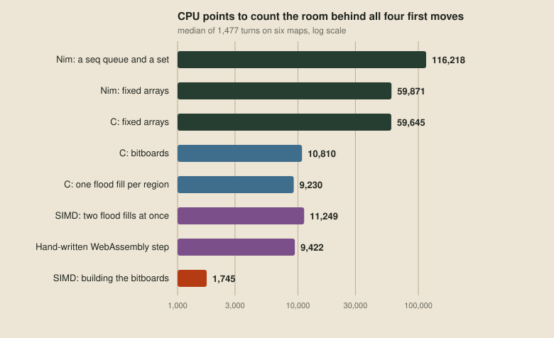
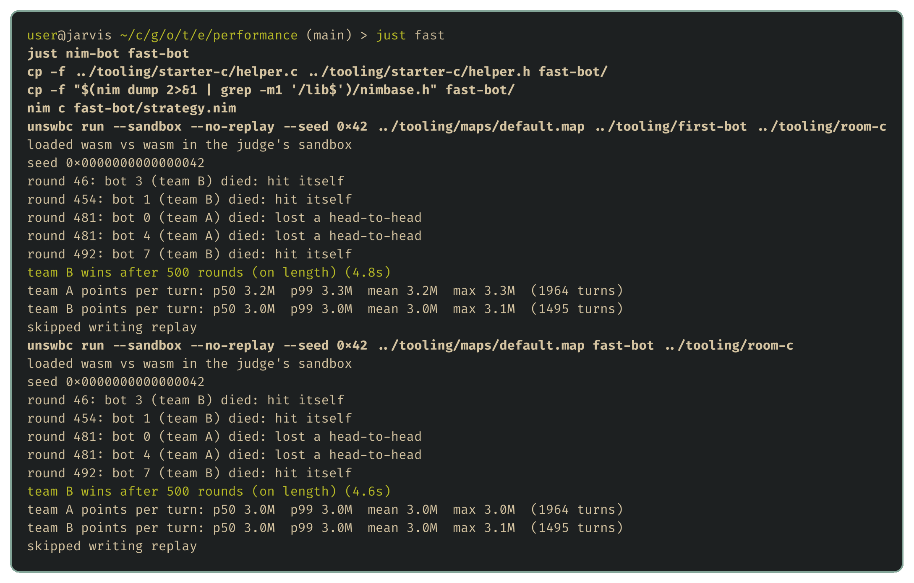

# Counting room faster

Every bot in this series counts how much room a move leaves, and [where the points go](12-where-the-points-go.md) found that this count is the only part of a turn that grows when a bot thinks further ahead. This post makes it cheaper, from the first bot's Nim down to vector instructions.

A benchmark bot plays the first bot's moves and runs every version of the room count on the same window each turn, checking that they agree and timing each on the judge's own clock. Every version agreed on every turn:



The code is in [examples/performance](../examples/performance/bench-bot/kernels.c), and `just bench` reruns the benchmark on one map.

## Nim's generated C

The first bot's flood fill keeps its queue in a growable `seq` and its visited tiles in a `set`. Nim compiles to C, so we can read what it made:

```c
visited_1 |= ((NU64)(1) << ((start_p1) % (sizeof(NU64) * 8)));
queue_1.len = 1; queue_1.p = (tySequence__qwqHTkRvwhrRyENtudHQ7g_Content*) newSeqPayload(1, sizeof(NI), NIM_ALIGNOF(NI));
/* ... for each tile in the queue, for each side ... */
            visited_1 |= ((NU64)1) << ((next_1) & 63);
            add__fgengrtl_u27((&queue_1), next_1);
/* ... */
eqdestroy___fgengrtl_u293(queue_1);
```

The `set` is already a single 64-bit word, one bit per tile, so the cost is in the `seq`. Every flood fill allocates its queue on the heap, calls `add` for every reached tile, which checks the capacity and grows the queue, and frees it all at the end. A fixed array on the stack, still in Nim, halves the cost, and hand-written C costs the same, because Nim and C now produce the same program.

## Bitboards

The rest of the cost is the flood fill's shape: one tile at a time, with a test at every step. The 49-tile window fits in one 64-bit word, so every reached tile can move at once, as chess programs have done since Slate and Atkin's [CHESS 4.5](https://doi.org/10.1007/978-1-4612-5515-4_4) (1977). With bit `row × 7 + column` for each tile, a step north is a shift right by 7 and a step east a shift left by 1, and a mask per direction marks the tiles open that way:

```c
static uint64_t FloodFill(WindowBits const* bits, uint64_t reach, uint64_t allowed)
{
    for (;;)
    {
        uint64_t const grown = (reach
                                | (reach & bits->can_move[0]) >> 7
                                | (reach & bits->can_move[1]) << 1
                                | (reach & bits->can_move[2]) << 7
                                | (reach & bits->can_move[3]) >> 1)
                               & allowed;
        if (grown == reach)
        {
            return reach;
        }
        reach = grown;
    }
}
```

Each pass costs about twenty instructions however many tiles it adds, and one `popcnt` counts the result. Flooding once per connected region instead of once per follow-up move saves a little more, because two follow-ups either reach the same tiles or none in common.

A hand-written WebAssembly growth step, as inline assembly in the C, costs slightly more, because Clang already emits that loop about as tightly as a person can. Flooding two regions side by side in one 128-bit vector costs more too, because the pair runs until the slower flood finishes and the packing outweighs the saving.

## SIMD for the masks

Most of the per-region version's points go on building the bitboards, turning 49 tiles with four sides each into five masks one bit at a time:


The window arrives as bytes, one per tile and side, each 0 or 1. `i8x16.bitmask` gathers one bit from each of 16 bytes in a single instruction, after byte shuffles pull out every fourth byte, since the sides are stored four to a tile:

```c
for (int chunk = 0; chunk < 4; chunk++)
{
    uint8_t const* tiles = open + 64 * chunk;
    v128_t const   a = wasm_v128_load(tiles), b = wasm_v128_load(tiles + 16);
    v128_t const   c = wasm_v128_load(tiles + 32), d = wasm_v128_load(tiles + 48);
    bits.can_move[0] |= (uint64_t)BoolBits(SIDE_OF_16_TILES(a, b, c, d, 0)) << (16 * chunk);
    bits.can_move[1] |= (uint64_t)BoolBits(SIDE_OF_16_TILES(a, b, c, d, 1)) << (16 * chunk);
    bits.can_move[2] |= (uint64_t)BoolBits(SIDE_OF_16_TILES(a, b, c, d, 2)) << (16 * chunk);
    bits.can_move[3] |= (uint64_t)BoolBits(SIDE_OF_16_TILES(a, b, c, d, 3)) << (16 * chunk);
}
```

That brings the whole room count down to the chart's cheapest bar, all in WebAssembly compiled from plain C.

## Keeping it vectorised

A small edit elsewhere can quietly turn part of a vectorised kernel back into scalar code. [Rake](03-the-choice.md#rake-for-vector-kernels) exists for this problem: a kernel that would fall back to scalar code doesn't build. Here is the north mask in Rake:

```rake
crunch north_bits(a: u8s, b: u8s, c: u8s, d: u8s) -> u32:
  | low <| shuffle(a, b, [0, 4, 8, 12, 16, 20, 24, 28, 0, 0, 0, 0, 0, 0, 0, 0])
  | high <| shuffle(c, d, [0, 4, 8, 12, 16, 20, 24, 28, 0, 0, 0, 0, 0, 0, 0, 0])
  | sides <| shuffle(low, high, [0, 1, 2, 3, 4, 5, 6, 7, 16, 17, 18, 19, 20, 21, 22, 23])
  bitmask(sides != <0>)
```

The judge only takes C, so Rake's WebAssembly profile emits C, one intrinsic per instruction, then compiles and disassembles it and rejects any function containing anything but locals, constants and vector instructions. The Rake masks matched the hand-written ones on every turn, at the same cost:

| Mask builder | CPU points |
| --- | --- |
| Hand-written SIMD intrinsics | 435 |
| Rake | 437 |

The code is in [examples/performance/rake](../examples/performance/rake/window_bits.rk). In our bot library it becomes a new numbered version of the flood-fill piece, leaving old bots on the Nim version, as [Three lines](14-three-lines.md#versioned-pieces) explains.

## The fast bot

The fast kernel drops into the first bot as its `room` function, with the strategy still in Nim, as [The choice](03-the-choice.md) proposed. On the bundled maps it plays exactly the same games as the original:



The median turn barely gets cheaper, because the output fee and input parsing dominate it. The gain is in thinking: the same points now buy 66 times as much room counting for a deeper search.

The mask builder still spends 42 of its 260 or so WebAssembly instructions on shuffles that only pull every fourth byte out of the interleaved sides. x86 can gather arbitrary bits in one `PEXT` instruction, but WebAssembly has nothing like it.

## Next up

[The machine inside the judge](19-the-machine-inside-the-judge.md): our own judge, which plays these games four times faster, and the machine inside it, as a bot sees it.
