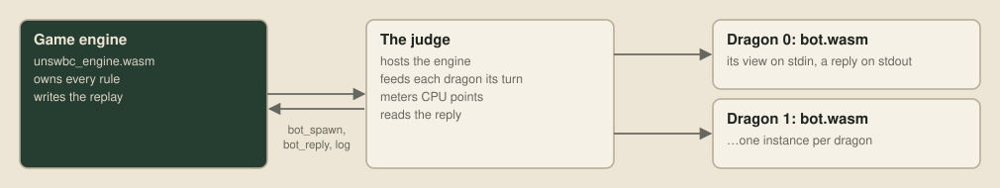
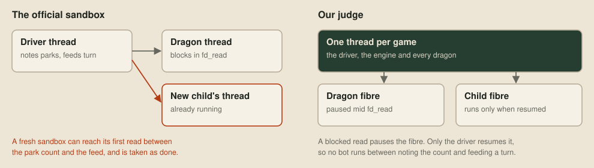
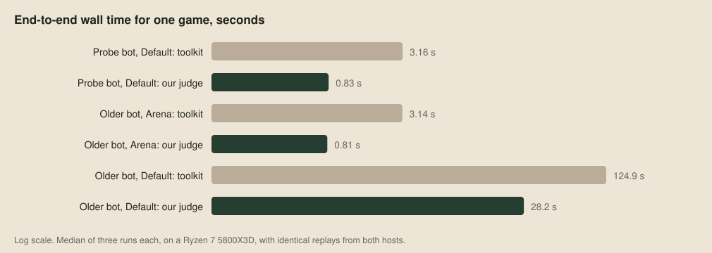
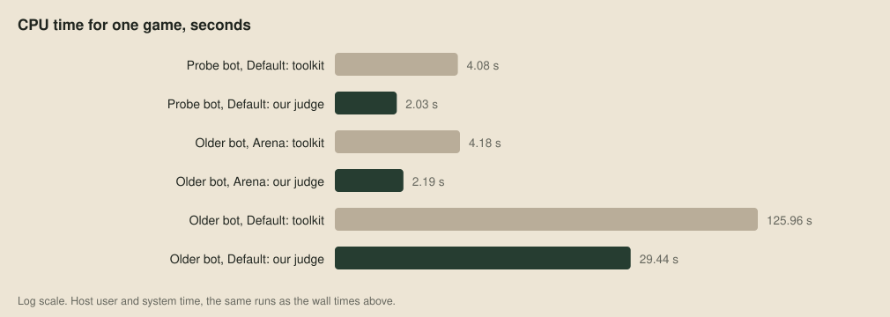
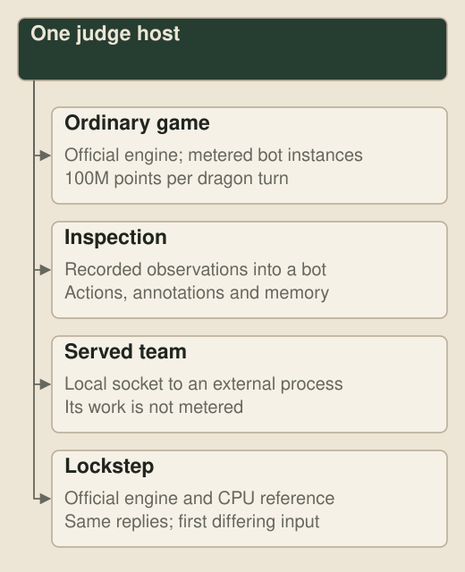
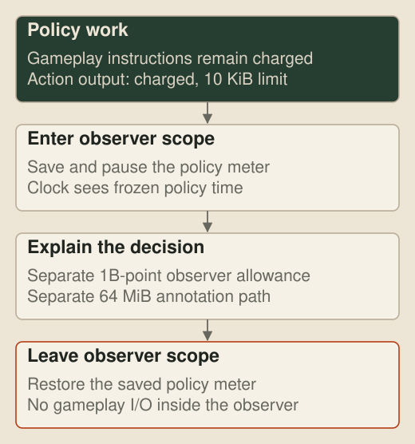
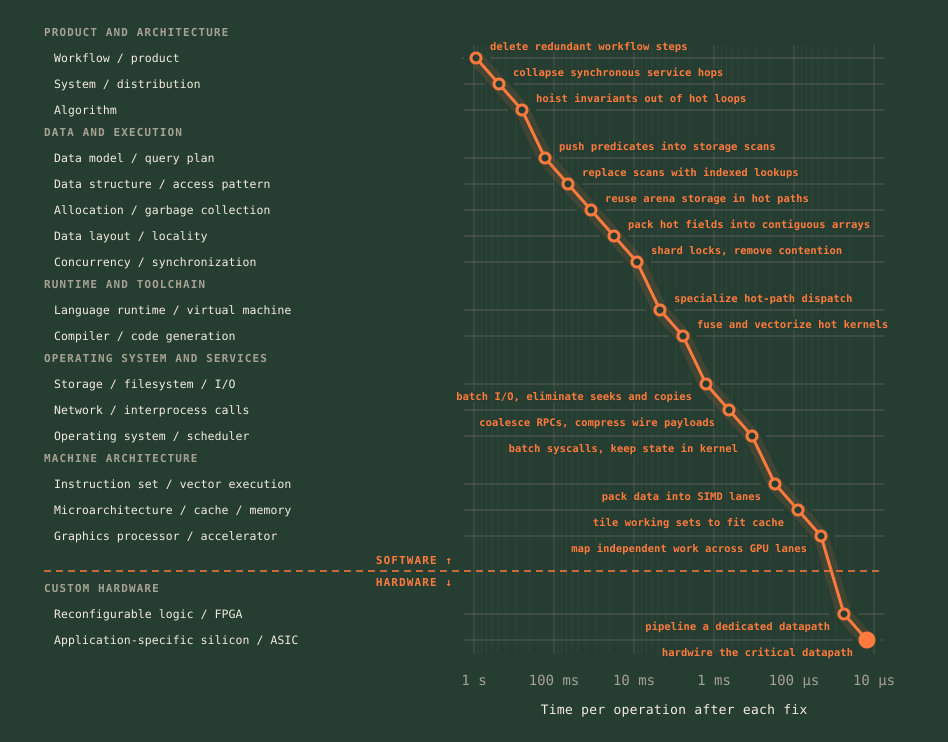

# The machine inside the judge

> **Editor's note, 4 October 2026.** The judge now offers native C++ CPU and CUDA references for SDK 1.2.7, and reads the later twelve-field engine result. The host comparisons and timings below are the originals.

We wrote [our own judge](https://github.com/overyonder/the-loong-game/blob/ca25234/harness/zig_judge/src/main.zig). It plays the official toolkit's games event for event in about a quarter of the time, and all our evaluations run through it. Because each bot runs as a fibre on the judge's own thread, it also can't hit a race in the official sandbox that occasionally kills a freshly split dragon.

## Engine and host

The rules aren't in the judge. The organisers' WebAssembly module, `unswbc_engine.wasm`, owns every rule and writes the replay, and the judge hosts it beside one WebAssembly instance per dragon. Each turn the judge gives a dragon its view on stdin, runs the bot until it ends its reply with `ENDTURN`, and charges for the CPU points spent.



The online judge runs bots in Wasmer, and the toolkit reproduces it in wasmtime with a metering pass that counts points inside each bot's module. Our judge uses the same engine and a port of that pass, [metering.zig](https://github.com/overyonder/the-loong-game/blob/ca25234/harness/zig_judge/src/metering.zig), which produces byte-identical modules. Only the host around them is new.

## The race in the official sandbox

The toolkit's sandbox gives every dragon its own Python thread. A bot that has written its reply goes back to read stdin, finds nothing waiting and blocks, and the host counts these waits as *parks*. Before feeding a turn, the host notes the count, so a higher count afterwards means the bot has finished this turn:

```python
def _write(self, data: bytes) -> bool:
    ...
    self._parks = self._stdin.parks    # line 1469: note the park count
    self._stdin.feed(data)             # line 1470: then feed the turn
    self._box.frozen.set()
    return True
```

Those two lines don't hold the pipe's lock between them. That's usually harmless, because a bot between turns is frozen, but a dragon that has just split is already running on its own thread towards its first read. If it reaches that read between line 1469 and line 1470, it parks on an empty stdin. The host then sees a higher park count, takes the new dragon's empty reply, and the dragon dies of "no valid action" with no error line. It's rare, but it kills the fresh child that was the whole point of the split. The bug is in toolkit 1.1.0 and 1.2.2, and holding the lock across both steps fixes it:

```python
with self._stdin.cv:
    self._parks = self._stdin.parks
    self._stdin.feed(data)
```

## Fibres instead of threads

No bot in our judge runs on a thread of its own. wasmtime can run a WebAssembly call as a fibre, a call stack that pauses and resumes on the same thread, like the coroutine of Conway's [Design of a separable transition-diagram compiler](https://doi.org/10.1145/366663.366704) (1963). When a bot's read would block, the instance pauses, and the judge's loop resumes it only on that dragon's turn. The park count only rises inside that loop:

```zig
fn suspendOn(self: *Instance, binding: *Binding) void {
    if (!self.may_run) {
        self.state = .frozen;
    } else {
        std.debug.assert(binding.syscall == .fd_read);
        self.state = .reading;
        self.parks += 1;
    }
}
```

Feeding a turn notes the count, appends the turn and lets the bot run, with no bot able to run in between:

```zig
pub fn write(self: *Instance, data: []const u8) !bool {
    if (self.state == .finished) return false;
    self.budget = if (self.module.inspection_enabled) INSPECTION_TURN_POINTS else MAX_TURN_POINTS;
    self.parks_snapshot = self.parks;
    self.calls = 0;
    try self.stdin.appendSlice(self.allocator, data);
    self.may_run = true;
    return true;
}
```

Nothing crosses a thread, so there's no window to close with a lock.



## Same games

We played the same bots, engine, maps and seeds through both hosts and compared all their output:

| Check | Games | Result |
| --- | --- | --- |
| A probe bot calling all 40 starter helper functions, covering splits, sprints, sonar, portals and annotations | 6 paired games, 15,296 dragon turns | Identical events, clock readings and CPU points |
| 12 varied maps against toolkit 1.1.0 | 144 paired games, 96 reaching round 500, about 128,000 splits and 1,030 turns over the CPU limit | Identical replays, per-turn points and logs |
| Metering every bot build we had | 1,238 builds | Byte-identical modules |

The same comparison ships with the judge as `just judge-fidelity`.

The one deliberate difference is the first read. The toolkit charges 6 points per byte read from stdin, including a new process's first read, which carries the whole starting block. The competition's judge doesn't charge that first read, so ours doesn't either, and a dragon's first turn costs what it will online.

## Four times faster

Timed one game at a time on the same inputs, the judge is about four times faster end to end, and the host does far less work:





On a busy 32-vCPU fleet worker, the saving depends on how much of each game is the host's work, so it's smallest when the bots think hardest:

| Paired games | Toolkit core-seconds a game | Judge core-seconds a game | Saving |
| --- | ---: | ---: | ---: |
| All 144, on average | 46.3 | 16.3 | 2.85 times |
| Our main line against an older version | | | 2.4 times |
| That older version against a random bot | | | 3.6 times |

## Other ways to run the host

The same host runs three more modes besides the ordinary game:



### Inspection without charging the explanation

The [viewer](11-through-one-dragons-eyes.md) replays recorded turns through an inspection build to recover a bot's decisions and explanations. An explanation runs inside an observer scope that saves the policy meter, uses its own one-billion-point allowance and a separate 64 MiB output path, then restores the meter. The scope can't read input, act, consume randomness or yield, so explaining a decision can't change it. Submission builds leave these imports out, and ordinary games refuse them.



### A team outside WebAssembly

The judge can hand one team to an external process over a local socket, sending it setup, spawns, turns and deaths and taking back its actions. We use this to play a large [teacher model](27-learning-to-play.md) against our bots before distilling a small student. The served process isn't metered, so these games are for evaluation only.

### Two engines, the same replies

Lockstep runs the official engine beside a CPU reference port and gives both the same reply each turn, chosen from a hash of the observation block. Odd seeds play recklessly, with invalid splits and rejected moves, while even seeds play carefully enough to reach later rounds. The run stops at the first observation block that differs. The released [CPU reference](https://github.com/overyonder/the-loong-game/blob/ca25234/harness/zig_judge/README.md#lockstep) makes the check reproducible without a GPU.

### Selecting native simulation

The host can also run the simulation through a native library, while the bots still run as metered WebAssembly:

| Selected engine | Simulation | Bot execution | Text and replay output |
| --- | --- | --- | --- |
| Official, the default | WebAssembly on CPU | Wasmtime on CPU | Official engine |
| Native CPU | C++ on CPU | Wasmtime on CPU | Native host code |
| Native CUDA | CUDA on GPU | Wasmtime on CPU | Native host code |

The [released libraries](https://github.com/overyonder/the-loong-game/blob/ca25234/harness/zig_judge/reference/README.md) implement SDK 1.2.7 with fixed-array rule code, a reply parser and a packed replay writer.

## The metered machine

The meter charges for WebAssembly instructions: 1 point for most arithmetic, 2 for loads, stores, branches and vector instructions, 3 for division and more for calls. Whatever the hardware does with them, the price is set by the instructions, so the judge behaves like a CPU with no pipeline and no cache. A few [loops](../examples/performance/machine-bot/experiments.c) show it:

| Loop | Natively | In the judge |
| --- | ---: | ---: |
| Sum floats with one running total | 1.50 ms | 24,117,351 points |
| Sum floats with four totals, so adds overlap | 1.10 ms | 24,117,363 points |
| Sum 8 MB of words in order | 1.1 ms | 33,564,773 points |
| Sum the same words 4 KB apart | 10.2 ms | 33,564,773 points |
| Sum the same words four at a time with SIMD | 0.11 ms | 5,242,996 points |

Overlapping additions and cache-friendly access speed up a real CPU but cost the same in the judge. Only vector instructions pay on both, because they do more work per instruction, so in the judge the only way to make code cheaper is fewer instructions.

## Below the instruction set

Everything in this series happens in software, and in the judge even the instruction set is fixed. On a real computer the stack keeps going down to FPGAs and custom silicon, each step trading flexibility for speed:



At [over|yonder](https://over-yonder.tech/) we work down the whole of that stack.

## Next up

[An engine on the GPU](20-an-engine-on-the-gpu.md): porting the simulation to fixed arrays and CUDA, checking the same games turn by turn, and keeping the training loop on the card.
