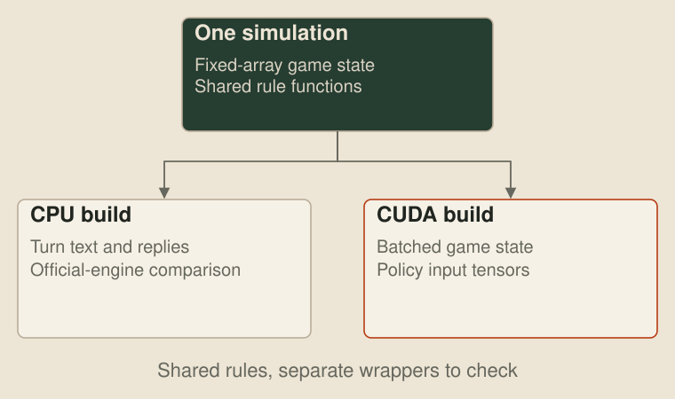
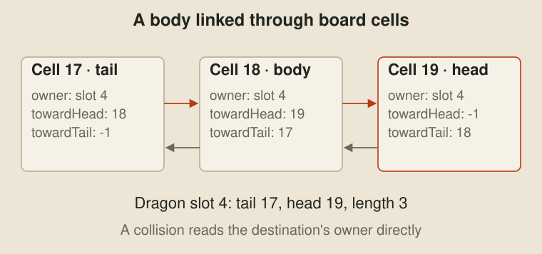
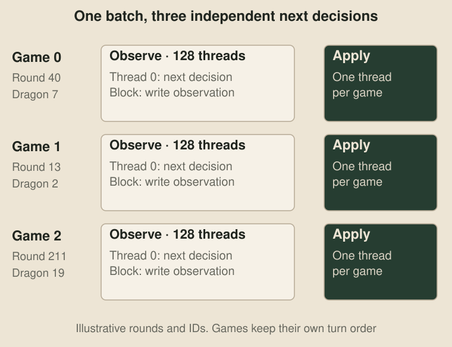
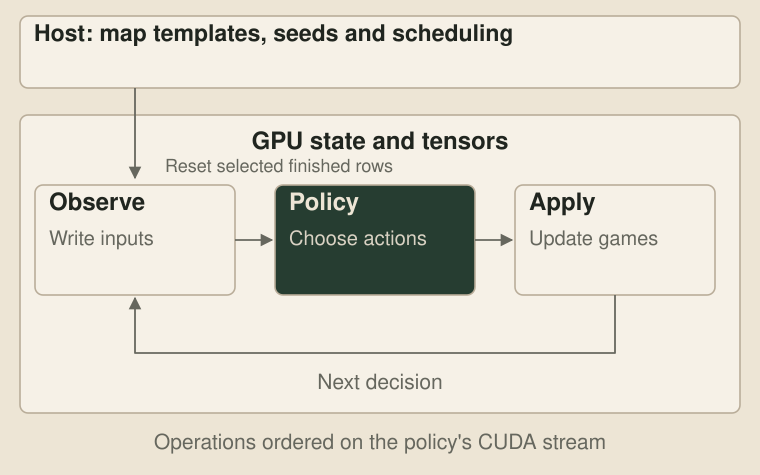
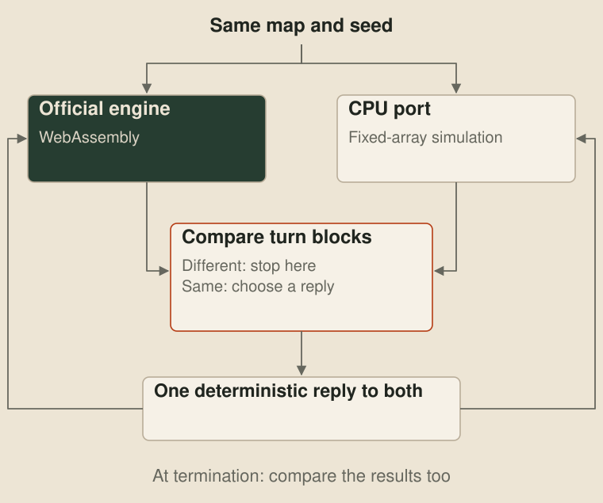
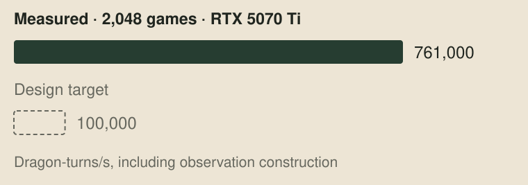

# An engine on the GPU

> **Editor's note, 4 October 2026.** The training engine, checks and throughput below are the original SDK 1.2.2 implementation. The released CPU and CUDA references target SDK 1.2.7, after the rule change in [Slay the Queen](29-slay-the-queen.md).

[Our judge](19-the-machine-inside-the-judge.md) runs the organisers' engine in WebAssembly and asks each bot for its next move, which suits checking a submission. Training a learned bot instead needs thousands of games feeding one network on the graphics card, without every dragon's turn passing through a CPU sandbox. So I ported the organisers' C++ engine to fixed arrays, compiled the same simulation for the CPU and CUDA, and checked it against the official engine. [Learning to play](27-learning-to-play.md) covers the network that trains in it.



## Fixed arrays

The [organisers' engine](https://github.com/unswcpmsoc/unswbc/tree/main/engine) already has the rules in C++, so the work is making its state fit a batch of GPU games while keeping the rules' order. Map loading and text parsing stay on the host, and each game's changing state goes in one fixed-size record, so a map template can be copied in and seeded without any heap allocation.

The board is at most 64 by 64, so a cell fits in a signed 16-bit index, with `-1` for no cell. Arrays indexed by `y * width + x` hold pearls, spawn countdowns and the dragon occupying each tile. Dragons live in 128 reusable slots, and the turn queue has room for 512 entries. A game that overflows a bound is recorded and can't count as an agreeing check. These are the body fields from the released [CPU reference](https://github.com/overyonder/the-loong-game/blob/ca25234/harness/zig_judge/reference/engine.h):

```cpp
uint8_t  pearl[MAX_CELLS];
int32_t  countdown[MAX_CELLS];
int16_t  occupant[MAX_CELLS];
int16_t  towardHead[MAX_CELLS], towardTail[MAX_CELLS];
Dragon   dragon[MAX_SLOTS];
```

A dragon's body is a linked list through the board. Every occupied cell records its owning slot and its neighbours toward the head and tail, while the dragon record keeps just the head, tail and length. A collision check is one read of `occupant`, and a portal can join distant cells without changing the representation. Removing the tail follows one link:



```cpp
LE void PopTail(Game& g, Dragon& d)
{
    int const tail = d.tail;
    int const next = g.towardHead[tail];
    g.occupant[tail] = -1;
    g.towardHead[tail] = -1;
    d.tail = static_cast<int16_t>(next);
    g.towardTail[next] = -1;
    d.length--;
}
```

A split reverses the links along the rear segments, hands them to the child's slot and makes the old tail the child's head. Slots get reused, so the turn queue also keeps each dragon's ID, and a dead dragon's entry can't run the slot's new occupant.

## One simulation, two targets

Under CUDA the rule functions carry `__host__ __device__`, so the compiler builds a CPU and a GPU version of each, as NVIDIA's [CUDA C++ guide](https://docs.nvidia.com/cuda/cuda-programming-guide/02-basics/intro-to-cuda-cpp.html#device-and-host-functions) describes. The CPU build adds a text interface for the judge, and the GPU build wraps the same functions in batch kernels. With the rules in one source, there's no second port to drift, and only the GPU wrapper's own work needs separate checks: which game a thread touches, where it writes and when the next kernel can read.

## Games in parallel

Dragons in one game can't move together, because each move, death or split changes what the next dragon sees. Independent games have no such dependency, so that's where the parallelism goes.

The observation kernel gives each game a CUDA [block](https://docs.nvidia.com/cuda/cuda-programming-guide/01-introduction/programming-model.html#thread-blocks-and-grids) of 128 threads: thread 0 advances the game to its next decision, then the whole block remembers the view and writes the observation. The action kernel gives each game one thread to apply its chosen action, so each game's decisions stay in order.



Each row moves at its own pace and supplies its next decision with the acting dragon's identity, so the policy's recurrent memory can follow that dragon. A finished row restarts with a new map and seed while the others carry on.

## Staying on the card

The batch writes observations straight into PyTorch's device buffers and reads actions from them, and Python drives the loop through a small C interface that passes tensor pointers and the current CUDA stream. The kernels share the policy's stream, and a [stream runs its operations in order](https://docs.nvidia.com/cuda/cuda-programming-guide/02-basics/asynchronous-execution.html#cuda-streams), so each step waits for the one before without the payloads ever leaving the card.



The engine knows the full board, but the policy's observation comes only from the dragon's view and permitted sonar messages, while the training critic's privileged state has a separate output. That boundary needs checking as carefully as movement, because a network trained on an unseen enemy position could look strong and then fail in the judge.

## The same games

In the judge's [lockstep mode](19-the-machine-inside-the-judge.md#two-engines-the-same-replies), the official engine and the port start from the same map and seed, compare each turn's observation byte for byte, and receive the same deterministic reply. The first difference stops the game at the turn where it diverged. This is McKeeman's [differential testing](https://www.cs.tufts.edu/comp/150FP/archive/bill-mckeeman/DifferentailTesting.pdf) (1998): comparable implementations get the same inputs, and each disagreement is a case to investigate.



Odd seeds use reckless replies, with bad splits and rejected moves, while even seeds play carefully so games reach later rounds, where pearl spawning and the round limit matter. The seed also has to reproduce every random draw in order, including failed pearl attempts, as [Pearls from the seed](10-pearls-from-the-seed.md) explains.

| Check | SDK 1.2.2 result |
| --- | --- |
| Official engine against CPU port | 100,000 games on 30 September across all 122 maps in our evaluation pool, 8,534 reaching round 500: 126,645,678 turns, no differences or skips |
| GPU against CPU port | 1,024 games, the same acting dragon at each decision and the same final results |
| GPU observation against text encoding | 512 games, 19,716 turns, no differing observations |

The last check runs the CPU port's turn text through a served policy's encoder and compares every input with the GPU's, since agreeing on winners would miss a transposed observation or a forgotten cell. The [CPU reference](https://github.com/overyonder/the-loong-game/blob/ca25234/harness/zig_judge/README.md#lockstep) runs the official-engine comparison without a graphics card, and the 1.2.2 checks need its [historical source](https://github.com/overyonder/the-loong-game/tree/2933c03/harness/zig_judge/reference).

## Released CPU and CUDA references

The [public reference libraries](https://github.com/overyonder/the-loong-game/blob/ca25234/harness/zig_judge/reference/README.md) play complete games with real WASM bots and write packed replays. The judge's official engine stays the default, and [the judge post](19-the-machine-inside-the-judge.md#selecting-native-simulation) shows how to select a native one. Their loop differs from the training loop, because the bots still run on the host:

| Work | Native CPU game | Native CUDA game |
| --- | --- | --- |
| Apply the rules | C++ on host | Shared C++ compiled for the device |
| Build turn text | Host | Host, after receiving game state and events |
| Run the bot, parse its reply and write the replay | Host | Host |

The CUDA library transfers full game snapshots and ordered events to the host, so measurements of complete games need to include that traffic. A game that hits a fixed capacity produces no replay rather than a truncated one.

## Throughput

A dragon-turn is one dragon observed and acted on, which is much smaller than a round or a game. With random actions and including the observations, the engine supplies decisions far faster than its design target:



Training adds policy inference, rollout storage and optimisation on top, and the judge remains where a bot's actions and budget are checked against the official engine.

## Next up

[Games in the cloud](21-games-in-the-cloud.md): running big batches of games on AWS Spot workers, and how every run ends on its own.
