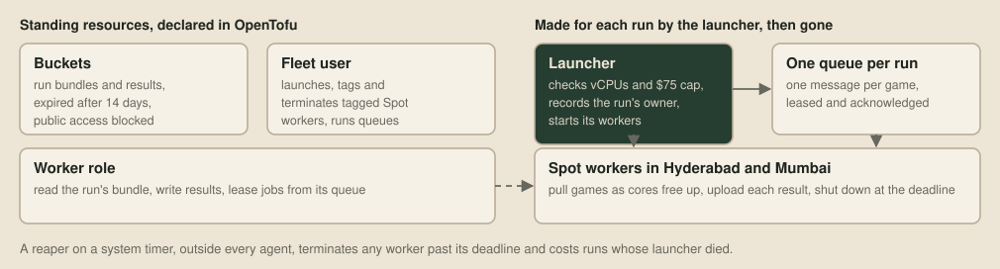
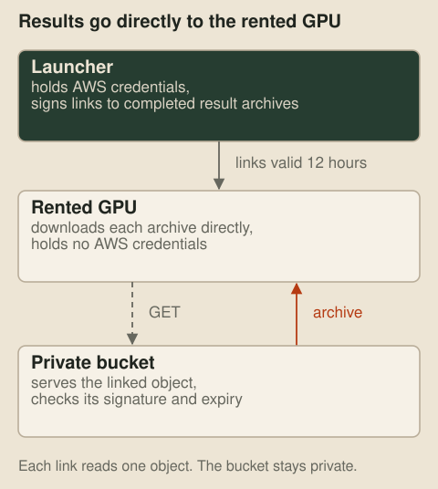

# Games in the cloud

The [harness](04-the-evaluation-harness.md) plays games side by side on every core of one machine. Playing our bot against a pool of opponents across 120 maps, both sides and several seeds runs to thousands of games, and several of us also work on my desktop, so big batches go to a fleet of cloud machines. A handful of long-lived AWS resources are declared in OpenTofu, the launcher creates everything else for a run when it starts, and every run ends on its own, even if everything watching it dies.



## One run

The launcher bundles the bots, maps and runner into one archive, uploads it to a bucket, and creates a queue with one message per game. Then it asks AWS for Spot instances, which are spare capacity sold cheaply on the understanding that it can be taken back, and packs them into the run's vCPU allowance, cheaper region first.

Each worker downloads the bundle and pulls games off the queue, one per free core, playing each one in our own [Zig judge](19-the-machine-inside-the-judge.md) under a wall-clock limit of 300 seconds. A game's queue message is leased while it plays ([Gray and Cheriton](https://doi.org/10.1145/74850.74870), 1989), and only acknowledged once its result is safely in the bucket. A worker that disappears mid-game therefore loses only that game, which goes back on the queue for someone else. The launcher collects results as they land, so a run that gets cut short still returns every finished game.

The workers run in two AWS regions, Hyderabad and Mumbai. Mumbai's workers use Hyderabad's queue and bucket across the region boundary, which keeps a run in one place however its workers are spread. Every run records its owner in the ledger and on its workers' tags, so each bot line's spending is visible.

## Results on a rented GPU

Some results need to reach a machine outside AWS, such as a rented GPU that will learn from the games. Copying them home and uploading them again would send the same files over the internet twice, so the launcher makes a presigned link for each completed result archive. The link lets the rental download that one archive straight from the private bucket for 12 hours, without holding our AWS credentials.



## Standing resources in OpenTofu

The buckets, the launcher's IAM user and the workers' role outlive any run, so they're declared in [OpenTofu](https://opentofu.org), the open source fork of Terraform. The fleet user can launch and tag instances only in the fleet's regions, and can only terminate instances that carry the fleet's project tag, so a bug in the launcher can't touch anything else in the account:

```hcl main.tf
{
  Effect   = "Allow"
  Action   = ["ec2:TerminateInstances"]
  Resource = "*"
  Condition = { StringEquals = {
    "aws:RequestedRegion"     = local.ec2_regions
    "ec2:ResourceTag/project" = local.fleet.project
  } }
},
```

Every name and region comes from one small JSON file, shared with the launcher. The buckets expire their contents after two weeks, because the launcher copies every result home as it lands.

## Runs that end on their own

The fleet is the one place where a mistake costs money, and the agents that launch runs can crash, time out or be interrupted like any other program. A run normally ends when every game is in, or when nothing has been committed for a while. Behind that, each run gets a hard deadline at launch, three hours out at most, and each worker, as soon as it boots, schedules its own shutdown for that moment:

```bash
shutdown -h +$(( ({deadline} - $(date +%s) + 59) / 60 ))
```

An instance that shuts down is terminated. As a backstop, a reaper runs every ten minutes on a system timer that belongs to no agent at all. It terminates any fleet instance past its deadline, removes orphaned queues, and records a cost for any run whose launcher died before it could.

Spending has its own guard, a shared cap of $75. Before admitting a new run, the launcher adds that run's worst-case cost through its deadline to the spend so far, and refuses the run if the total would exceed the cap:

| Ledger figure | Counts towards the cap | Basis |
| --- | --- | --- |
| Settled spend | Yes | Finished workers' runtimes |
| Accrued spend | Yes | Running workers' time so far |
| Existing reservations | No | Worst case through each run's deadline |
| Proposed run | Checked before launch | Its own worst case through its deadline |

The ledger estimates compute at the Spot quote, plus disks and public addresses, and leaves out transfer, storage requests and tax.

## Cost

Moving the games into our judge cut the compute by more than half:

| Work | Estimated cost |
| --- | ---: |
| Eleven full runs, to 26 September | $17.51 |
| 1,000 games of our main line against an older version, through the toolkit | $0.09 |
| The same 1,000 games in our judge | $0.04 |

At that price, downloading a 1,000-game run's replays, about 2 GB compressed at roughly $0.11 a gigabyte, costs more than playing the games.

## Next up

[Game data in columns](22-game-data-in-columns.md): one binary format for all our game data, mapped into memory and used without parsing.
