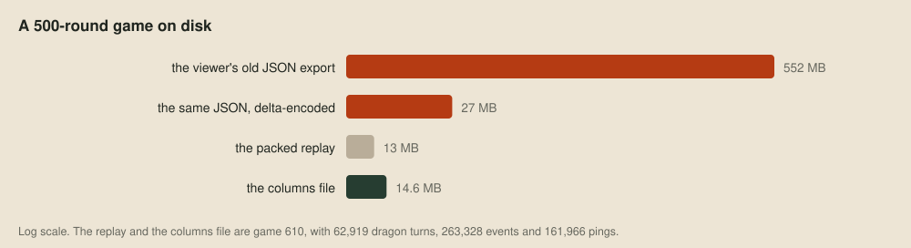
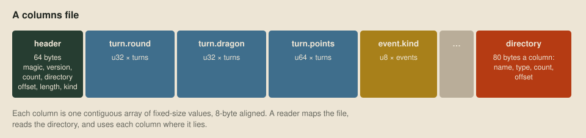
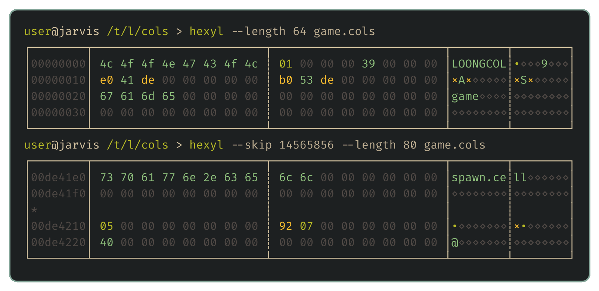
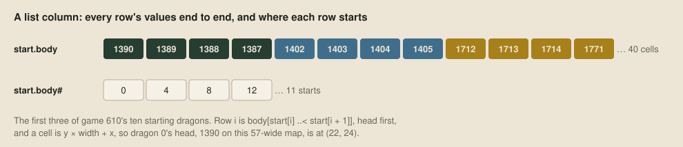
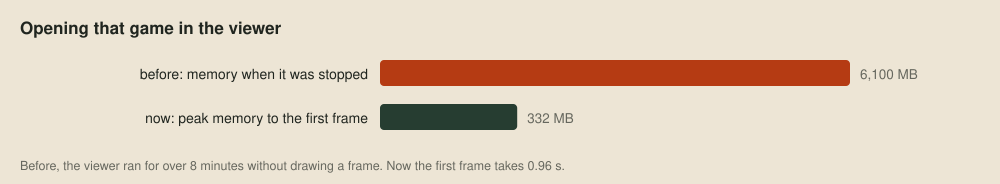
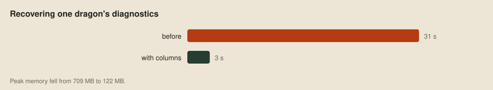
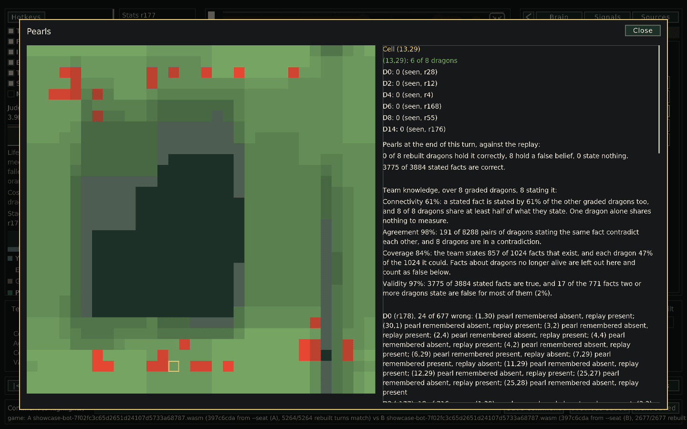

# Game data in columns

The [debug viewer](11-through-one-dragons-eyes.md) started life reading a JSON export of each game, which was fine for short games. On a 500-round game it ran for minutes and filled gigabytes of memory without drawing a frame, because the whole export had to be parsed into objects first.



So all our game data now goes in one binary format, which we call Loong columns. The judge's packed replay is still the smallest, but it's a Cap'n Proto message that has to be walked event by event, as in [Reading a replay](09-reading-a-replay.md). A columns file takes about the same space and needs no parsing: a reader maps it into memory and uses the numbers where they lie.

## Columns

Almost everything in a game is a long table, such as every event on the board, every dragon turn or every sonar ping, and almost every question reads one field down a whole table. So each field is stored as one contiguous array of fixed-size numbers, the way column stores such as Stonebraker and colleagues' *C-Store* (2005) keep their tables. A file is a header, those arrays, and a directory saying where each one is:



Here's the start of a real one, game 610, through [hexyl](https://github.com/sharkdp/hexyl), with the header first and then the first directory entry:



The header's total length lets a reader catch a truncated file, and its kind, `game`, says what the file holds. Values are signed or unsigned integers from 8 to 64 bits, `f32` or `f64`, and every column starts on an 8-byte boundary, so any of them can be read as a typed array without copying.

## Reading in place

The [viewer's](https://github.com/overyonder/the-loong-game/blob/ca25234/replays/viewer/columns.odin) [Odin](https://odin-lang.org) reader maps the file, checks the header and indexes the directory by name:

```odin columns.odin
open_columns_file :: proc(path: string, allocator := context.allocator) -> (file: Columns_File, ok: bool) {
	data, error := virtual.map_file_from_path(path, {.Read})
	if error != nil || len(data) < COLUMNS_HEADER_BYTES || string(data[:8]) != "LOONGCOL" {return}
	version := (^u32le)(&data[8])^
	count := int((^u32le)(&data[12])^)
	directory := int((^u64le)(&data[16])^)
	length := int((^u64le)(&data[24])^)
	if version != 1 || length != len(data) || directory + count * COLUMNS_DIRECTORY_BYTES > len(data) {
		virtual.unmap_file(data)
		return
	}
	file.data = data
	file.kind = trim_name(data[32:64])
	file.entries = make(map[string]Column_Entry, count, allocator)
	for index in 0 ..< count {
		at := directory + index * COLUMNS_DIRECTORY_BYTES
		file.entries[trim_name(data[at:at + COLUMNS_NAME_BYTES])] = {
			value_type = data[at + 48],
			count      = int((^u64le)(&data[at + 56])^),
			offset     = int((^u64le)(&data[at + 64])^),
		}
	}
	return file, true
}
```

A column is then a slice straight into the mapping. The caller says what type it expects, and gets nothing back if the file disagrees:

```odin columns.odin
column_values :: proc(file: ^Columns_File, name: string, $T: typeid) -> []T {
	entry, found := file.entries[name]
	if !found || entry.value_type != column_type_code(T) {return nil}
	return ([^]T)(&file.data[entry.offset])[:entry.count]
}
```

Loading a game in the viewer is now a list of lines like `view.turn_points = column_values(file, "turn.points", u64)`, and our Nim tools read the same way through `memfiles`. The operating system reads a page only when a question touches it, so a large file costs nothing until it's used.

## Tables, lists and gaps

Column identifiers carry the structure. A column called `turn.points` belongs to the table `turn`, and every plain column in a table has one value per row. A column that points at rows of another table is a u32 row index named after that table. A value that varies in length per row, like a dragon's body, becomes two columns: every row's values end to end, and a `#` column of where each row starts.



Strings are lists of UTF-8 bytes. A value that can be missing, such as the CPU points of a game played outside the judge's sandbox, gets a companion `turn.points?` column of 1s and 0s. Enums are small integers whose labels live in a string list called `enum.<name>`.

## Events

The JSON export stored the board before every round, whereas a game file stores only the events, in replay order, as a kind and four integers:

| Kind | Event | a | b | c | d |
| ---: | --- | --- | --- | --- | --- |
| 1 | round start | round | | | |
| 2 | turn start | dragon | | | |
| 3 | pearl countdown | cell | countdown | | |
| 4 | tile change | cell | has pearl | | |
| 5 | dragon moved | dragon | new head cell | tail cell after | facing |
| 6 | dragon split | parent | child | child team | row of `split` |
| 7 | dragon death | dragon | reason | | |

Each round and each turn records the row of its starting event, so the viewer jumps to any turn by applying events forward from the nearest board already in memory.



The same change went into our bots' decision records, regenerated in the viewer one dragon at a time by [re-running the bot](11-through-one-dragons-eyes.md) on that dragon's observations. The recovery now rebuilds those observations as a columns file of their own and streams each turn's records to the viewer, which parses them only for the turn on screen:



## Writing and merging

Our converter, [gamedata/gamedata.nim](https://github.com/overyonder/the-loong-game/blob/ca25234/gamedata/gamedata.nim), builds each column in memory, writes the file under a temporary name and renames it into place, so a reader never sees half a file. Nothing changes a file once it's written.

The harness also writes a small `result` file for each of its games, with how the game ended and each side's economy, such as pearls eaten, splits and deaths by cause. When a run ends, its games merge into one file of the same kind, table by table, with list starts and row indices shifted past the rows before them.

Readers look columns up by name and ignore unknown ones, so new columns can appear without breaking anything. Each kind records its version in a `meta.version` column, and removing a column or changing its meaning raises that version, so an old reader can refuse the file instead of misreading it. [gamedata/format.md](https://github.com/overyonder/the-loong-game/blob/ca25234/gamedata/format.md) describes the container and the public tools' kinds.

## Team knowledge and census records

The viewer [grades the team's beliefs](11-through-one-dragons-eyes.md) against the replay, and its knowledge export writes those grades as a columns file of kind `knowledge`, one row per belief, team and round. The rows keep raw counts, such as facts stated and facts correct, so a report can follow a belief through the game without reopening every dragon's diagnostics.



The [census of other teams](25-modelling-other-teams.md) uses kind `census` in the same container, with a row for each sampled game and each of its sides, holding that side's counts beside its opportunities. A count alone doesn't show what happened, so a detector also writes an `event` row whenever it finds a tail strike, champion hunt, shadowing episode or delivered feed, with the round and dragon to open in the viewer.

## Next up

That's the last of the performance posts for now. Behind the bot starts with [how we played the ladder](24-playing-the-ladder.md) and [what we learned by modelling other teams](25-modelling-other-teams.md), then opens the bot itself in [the planning design](26-planning-to-play.md), [the learned design](27-learning-to-play.md) and [a tour of our bot](28-a-tour-of-our-bot.md).
