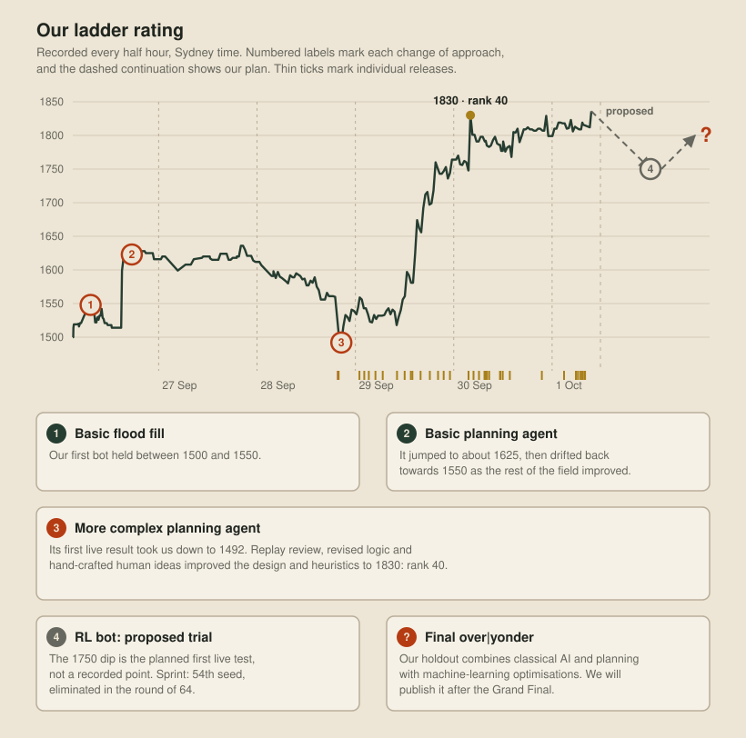
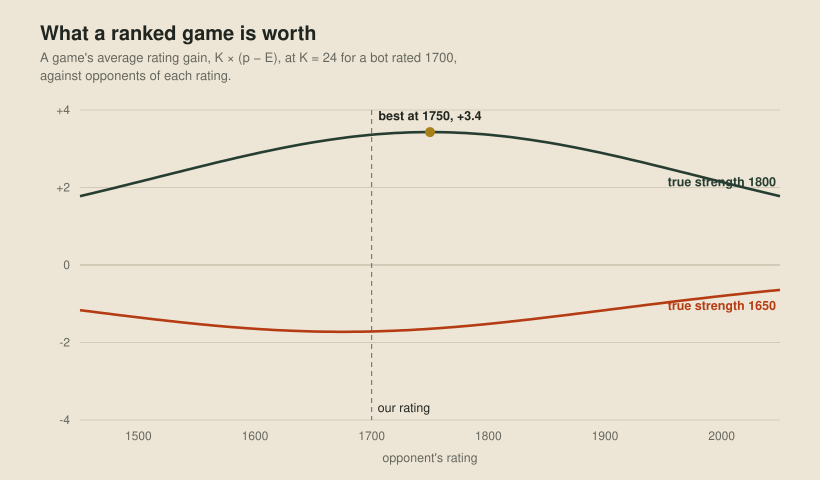
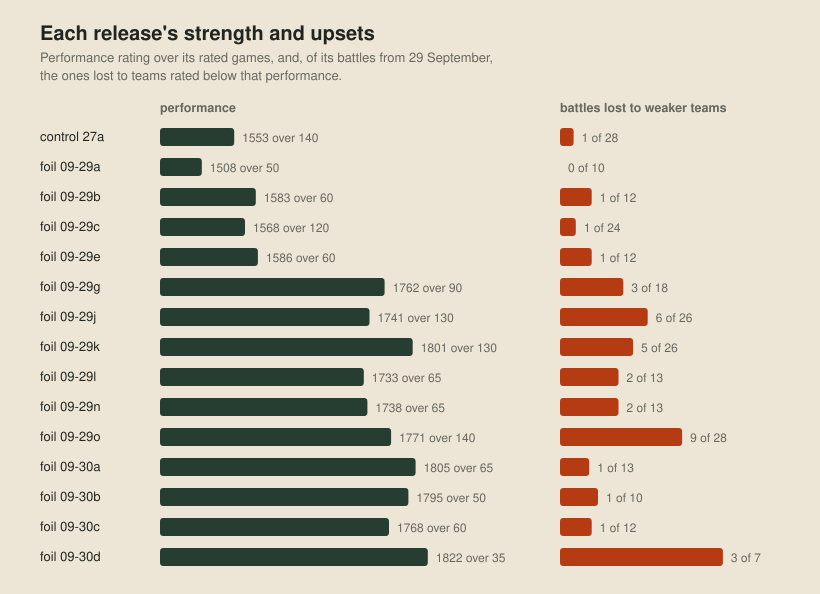

# Playing the ladder

A strong bot is only half of a good placing. The rest is how you play the ladder: which bot is live, its opponents, and when you change it. Tournament seeds come from the ladder rating, and every tournament is a single-elimination knockout, so a rating point is worth something and one lost series ends a run. This post builds on the Elo ratings from [A ladder of our own](07-a-ladder-of-our-own.md) and the tests in [Better, worse or undecided](05-better-worse-or-undecided.md) for how far a difference between two bots can be trusted.

## The ladder's rules

- A ranked battle is five games on random maps. Each team's rating then moves by K × (S − E), where S is its score and E is the score predicted by the two ratings, the formula from [A ladder of our own](07-a-ladder-of-our-own.md#ratings).
- K is 96 for a new bot and falls by 7.2 with each of its ranked battles, to a floor of 24 after ten.
- K resets for only one bot per 12 hours. If another of the team's bots started from zero in that time, a new bot inherits the count of the bot last played, capped at ten, so it starts at the floor. Reactivating an old submission carries on from its own count.
- Every hour the site draws each team one ranked battle against a team within eight places, using whichever bot is active when the battle is queued. A team can also challenge any team rated no more than 50 below it, up to 60 games an hour.

## Choosing opponents

A ranked battle is worth K × (p − E) on average, where p is our true chance of winning a game against that opponent and E is the chance predicted by the two ratings. If our bot is stronger than its rating, p beats E against most opponents, and the gap is widest against an opponent rated about halfway between our rating and our true strength:

When a bot is weaker than its rating, every challenge loses rating on average, so our challenger sent none and the hourly draws were the only games played.

Choosing well needs our true strength and each opponent's. For ours, we used the live bot's performance rating, the rating that would have predicted its recent results. For theirs, the live rating is only a start. Mean reversion, Galton's [regression towards mediocrity](https://doi.org/10.2307/2841583) (1886), suggests a team that has risen unusually far has been lucky and will drift back, while a falling team will recover. We tested that on the site's rating history for 557 teams, comparing each team's next twelve hours with how far its rating sat from the median of its previous six readings:

| Rating against its recent median | Next 12 hours, against steady teams |
| --- | ---: |
| 60 or more above | +17 |
| 25 to 60 above | +14 |
| 8 to 25 above | +10 |
| 8 to 25 below | +9 |
| 25 to 60 below | +15 |
| 60 or more below | +21 |

Fallers partly recovered from bad luck, as expected, but risers kept rising too. A rating only estimates strength while the bot behind it stays the same, and a large move in either direction mostly means the team has uploaded a new bot. The ladder's six-hour rating moves are fat-tailed, with a kurtosis of 16 where a normal curve has 3, and the tails are those uploads. A new bot is a lasting change that doesn't revert, so the challenger adds this drift to every mover's estimate and prefers steady teams.

A new bot of ours has no measured strength, so for its first 40 games the challenger plays the steady teams nearest our rating. Against an even opponent a game costs nothing in expectation, and an even game tells us the most about a bot.

## Estimates before release

The foil, our second bot line, was developed during the season in a loop: study live games, make one upgrade, check it, release it. A local series against the previous release proved a poor check, because close versions of one line mostly play each other, whereas on the ladder they meet everyone else:

| Release | Check before release | Live result |
| --- | --- | --- |
| foil-2026-09-29l | Beat 29k 52–36 locally | Rated below 29k |
| foil-2026-09-30c | Lost to 30b 36–57 in the cloud, about −80 Elo (−157 to −10) | Rated below 30b |

So the check moved to the cloud, with more games against both live incumbents and a non-inferiority test, the margin form of the verdict in [Better, worse or undecided](05-better-worse-or-undecided.md).

After upload, the live numbers take over. A performance rating over n games has a standard error of about 380/√n, the binomial value widened by a factor of 1.2 because games within a five-game battle move together. That's about ±60 at 40 games, so we never judged a bot on one battle or on an afternoon's rating moves.

## Swapping bots

The rule for which bot is live changed with our aims for the ladder.

### Growth

At first the only aim was a higher rating. The strongest measured bot stayed live until its edge over its last 40 games, its score less what the ratings predicted, fell below +0.05. Then a queued release replaced it, and was rolled back if it performed below its predecessor after 40 to 50 games.

### Keeping a release

From 30 September, a release that has calibrated stays live unless it's worse than its predecessor by more than 1.28 standard errors of the difference, a one-sided 90% test. A new release is usually the line being improved, and its live games feed the replay reviews that improve it. Leaving a slightly weaker release live costs little, because the stronger one would win the difference back within a few hours of being restored.

### Snapshots

The tournaments take a snapshot: the Sprint plays whatever is active at 9:00 AM on 1 October, and the Qualifiers take each team's rating and active submission as of 10 October. Close to a snapshot there's no time left to win rating back, so within 12 hours of one, the highest measured bot goes live and stays.

## The K window

K 96 moves rating four times as fast as K 24, in either direction. That's worth having for a bot that's much stronger than its rating and dangerous for any other, so we spent each 12-hour window deliberately. Most releases played their first ranked battle within 12 hours of the previous fresh start, so they inherited the count and calibrated at floor K.

foil-2026-09-30a got the window that opened just after midnight on 30 September, because a build one fix short of it beat 29o in the cloud by about 41 Elo, with an interval from +8 to +75. It took our rating from 1748 at rank 73 to 1830 at rank 40 in under half an hour of K 96 battles against the steady teams nearest our rating, then settled near 1800 as K fell. The window cut the other way on 28 September, when mainline-2026-09-28-02 was live for only a few minutes, long enough for two K 96 battles. It scored 0 and 2 out of 5, and our rating fell to its low of 1492.

## Knockout tournaments

Every tournament is a seeded single-elimination bracket, and the Sprint and the Qualifiers play best-of-7 matches, with a drawn match sending the higher seed through. Upsets therefore matter more than margins, and a bot that wins big but occasionally loses to a weak team is worse in a tournament than its rating says. For each release, we counted its battle losses to teams rated below its own performance rating:

Between two bots with level performance, we kept the one that lost fewer of those battles.

## Opponent styles

Some opponents played in ways not captured by their rating, and we labelled their styles so we could talk about them. The teams stay anonymous here.

We found them through upsets: teams that beat much stronger ones, and the teams that beat us while rated below our bot's performance. To see why we lost, our judge replays a ladder game exactly from its seed and the opponent's recorded moves while our bot runs with its diagnostics on, so [the viewer](11-through-one-dragons-eyes.md) shows why each of our dragons did what it did. The foil then wrote sparring bots that copy a style, so a defence could be measured in the cloud before it went live.

### The swarm

The top teams fielded far more dragons than we did. At round 400 of two games, our opponents were at the 64-dragon cap while we had 28 and 39. The foil's first sparring bot copies Swarm Lord 1: every dragon splits at length four, chases the nearest remembered pearl and trades heads while small.

### Endgame feeders

The same teams concentrate before round 500, when the longest dragon decides the game. On one map, Feeder 1's team fell from 24 dragons to 5 in sixty rounds, most of them dying beside its champion's route and leaving their pearls for it. Only about a third of our own late feeds reached our champion, because the rest died beside the long teammate most recently heard by the feeder. After the review, feeders fed only the elected champion.

### Champion hunters

Short dragons converge on a long one and ram it, trading two or three segments for the dragon that decides the game. In 7 of 16 live games replayed exactly, a rival killed our longest dragon head-on after round 300, and we lost 6 of those 7. The foil answered with an escort, counting a small dragon's ram on an enemy head near our champion as worth half the champion's length, and gave the champion room to keep away from hunters. Shadow 1 hunted alone: one small head sat two to five cells from our champion for six to eight rounds and then moved into it.

### Tail strikes

A dragon that splits leaves a new dragon at its old tail, and the new dragon acts after everyone else alive that round. Tail Biter 1 split beside our champion, so its new dragon's first move was a ram. The foil learned to treat an enemy's tail as a possible place for a new head, and adopted the move itself: a dragon of four or more splits off a two-segment child when the head of an enemy of six or more sits beside its tail, having already moved that round.

### The ramming swarm

Swarm Lord 2 combined numbers with rams, and in three of its games against us, its head-on collisions caused more than half of our deaths. An even trade costs each side a dragon, so the side with more dragons wins the attrition. Keeping our small dragons out of reach of equal heads made things worse, because stepping away in cramped ground handed the swarm the initiative and it caught our dragons anyway.

### Ram rushers

Two mid-pack teams, Rammer 1 and Rammer 2, sent their dragons straight at enemy heads and eliminated much stronger teams early. In their 450 losses to teams rated no more than 50 above them, the defenders took the trades, losing more heads than the rushers did, and most of those games went the full 500 rounds, where the longest dragon wins. A rush is absorbed with numbers and beaten on length, and a strong economy supplies both.

### The wall

One low-rated team, The Wall 1, won three games against teams rated more than 500 above it, with the stronger team losing well over a hundred dragons to walls. That looks like a bot that herds opponents into dead ends, but it may equally have been a broken build on the other side.
