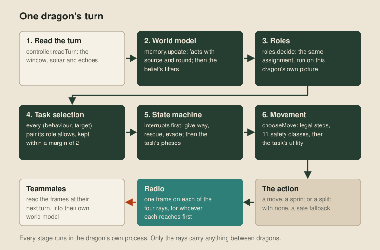
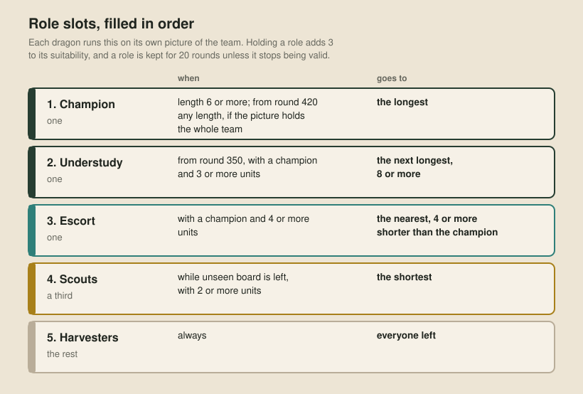
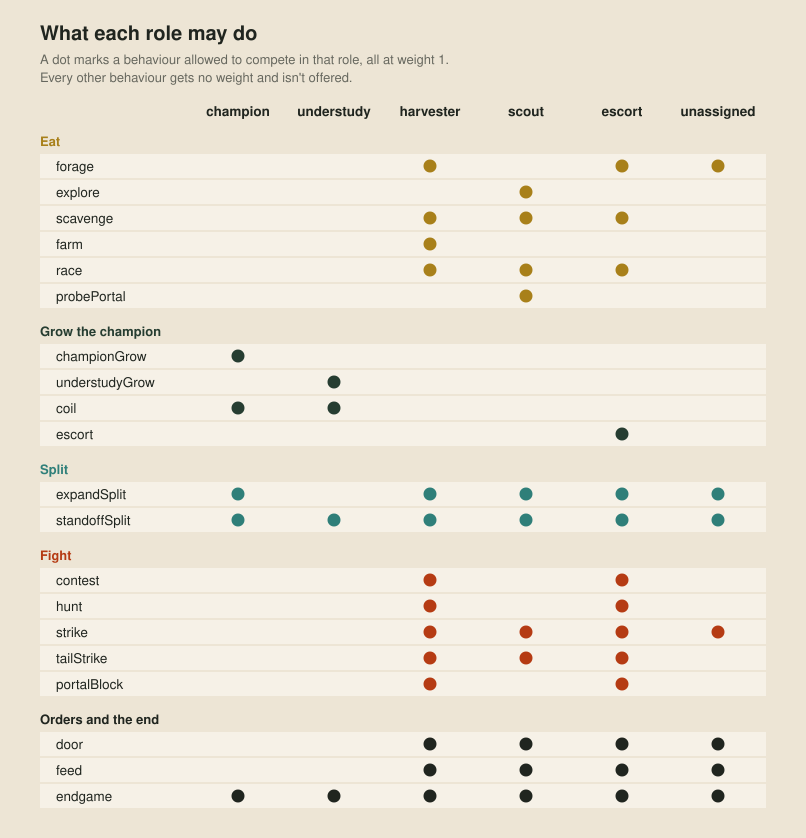
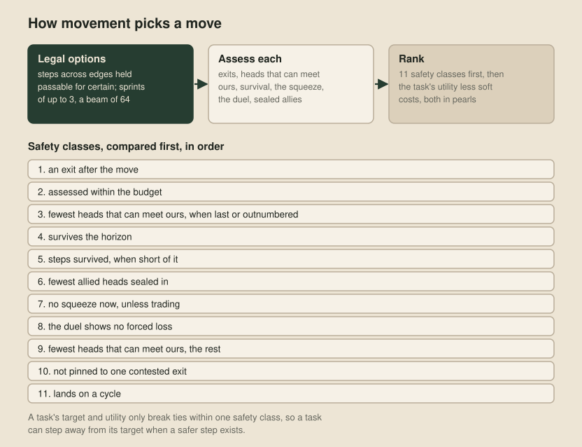

# Planning to play

The planning bot makes its choices from our own rules and scores. This article follows one turn of textbook-main-0025, a single Nim strategy file that assembles behaviours from a repertoire of modules, built the way [The shape of the problem](13-the-shape-of-the-problem.md) set out.

Every dragon runs its own copy of the program. It sees the 7×7 cells round its head and whatever its teammates tell it by sonar, and nothing else, so everything below happens inside one dragon. The team only acts as a team because every dragon runs the same rules on what it knows.

## Five layers

The design is a model-based, utility-based agent in the terms of chapter 2 of Russell and Norvig's *[Artificial Intelligence: A Modern Approach](https://aima.cs.berkeley.edu/4th-ed/pdfs/newchap02.pdf)* (4th edition, 2020). Each of its five layers is a textbook technique:

1. a **world model**, recursive Bayes filters over everything out of the dragon's sight (Thrun, Burgard and Fox, *Probabilistic Robotics*, 2005)
2. **team roles**, where every dragon runs the same assignment so they agree without negotiating (Stone and Veloso's [locker-room agreement](https://doi.org/10.1016/S0004-3702(99)00025-9), 1999, and the plays of Browning and colleagues' [STP](https://doi.org/10.1243/095965105X9470), 2005)
3. **utility selection**, which scores every behaviour against every target and commits to the best (the infinite axis utility system of Dave Mark's *Behavioral Mathematics for Game AI*, 2009, and his GDC lectures of 2013 and 2015)
4. a **hierarchical state machine** inside each task, with interrupts that preempt it (Harel's [statecharts](https://doi.org/10.1016/0167-6423(87)90035-9), 1987, and chapter 5 of Millington and Funge's *Artificial Intelligence for Games*, 2nd edition, 2009)
5. **tactical search**, which turns the task's intent into a safe move

Here is one turn through them. The last section lists where the code departs from each layer.

A turn may spend 100 million judge points. Optional work, such as the deeper parts of assessing a move, starts only while the turn has spent under 60 million and stops at 75 million.

## The world model

The world model has two halves. The **memory** keeps facts about every cell, teammate, enemy sighting and death, each with its source and learning round. Sight rewrites a cell's record, while a teammate's report only fills in sides with no sighted description, and a pearl or timer only when it's newer.

The **belief** turns those facts into probabilities once a turn, so no later layer keeps its own rules about how old a fact is:

- Each unseen edge gets a probability of being open, kelp or a portal, from counts of the edges seen so far under a Dirichlet prior (Gelman and colleagues, *Bayesian Data Analysis*, 3rd edition, 2013, section 3.4). Official maps are symmetric, so the belief also fills unseen edges from their partners under each likely symmetry, and a ray that came back reporting nothing makes the edges along its path less likely to be kelp.
- Each spawning tile's next attempt is a distribution over rounds, spread over the reset gaps observed at that tile, which treats it as a renewal process (Feller, *An Introduction to Probability Theory and Its Applications*, volume 1, 3rd edition, 1968, chapter 13). Each cell's pearl is a two-state hidden Markov model (Rabiner's [tutorial](https://doi.org/10.1109/5.18626), 1989), so a behaviour can ask how likely a pearl is to be there when it arrives, up to 64 rounds ahead.
- Every known dragon has a Bernoulli filter (Ristic and colleagues' [tutorial](https://doi.org/10.1109/TSP.2013.2257765), 2013) over a histogram, as in section 4.1 of *Probabilistic Robotics*: the chance it's alive, and where its head is and which way it faces if so. Each round the filter predicts one move from how often that team's dragons turn and sprint, and corrects on what the window shows, including where a dragon isn't. Out of sight, the chance of being alive falls at the team's observed death rate. The belief keeps at most 3,000 states a turn, choosing them with Hoare's selection algorithm, [Find](https://doi.org/10.1145/366622.366647) (1961).

Three parts of the memory have no textbook counterpart. It detects deaths from a body turning into pearls and withdraws all its facts about that dragon. A teammate still on a claimed path a round later counts as a longer champion that outranks this dragon. And a distance field counts steps from our head, the nearest teammate's head and each visible enemy head, letting a body's cells clear as it moves off them.

## Sonar

A dragon sends one 64-bit value on each of its four rays every turn. A ray stops at the first body in its path, friend or enemy, so after the move the radio asks the belief who each ray will reach first. A ray sends nothing when it will certainly hit kelp or our own body, or when its only likely reader is an enemy. A teammate gets what it probably lacks: our status and task, then facts from outside its view, newest first. A behaviour can also put a record on a particular ray, such as the champion's order to a teammate or its claim on the path ahead.

A frame is the send round mod 4, then records, each followed by a bit saying whether another follows, then at least 14 zero bits, all enciphered with SPECK64/128 ([Beaulieu and colleagues](https://eprint.iacr.org/2013/404), 2013) under the team's key. Another team's value deciphers to noise, which passes the zero check about once in 16,000 values, and the receiver then checks every record's plausibility. Records carry statuses, enemy sightings, runs of tiles, pearls and spawn timers, claims on paths and cells, deaths, orders to one teammate, portals and newly split bodies.

## Roles

Each turn, every dragon builds a picture of its team from the belief, with each teammate at its likeliest cell. The team's exact size is known, so if the picture holds too many dragons, some have died unseen and the least certainly placed are dropped. Then the dragon fills the role slots in order, each with the best-suited dragon left:

A role's hold ends early when the dragon can't take it any more, the team no longer needs it, or a teammate holding a one-place role outranks it. A dragon also switches at once to a vacant one-place role, so the team never waits out a hold without a champion. Pictures differ between dragons, so assignments can too: one game had a team of twenty with eight champions at round 420, which is why a short dragon can be champion only when its picture holds the whole team.

## Choosing a task

A task is a behaviour bound to a target: a cell to reach, an enemy dragon to engage, or neither. Each turn, every behaviour allowed by the dragon's role offers its targets, and each pair scores the role's weight for that behaviour times the behaviour's own formula. The best pair becomes the task, unless the current task is within 2 of it, which stops a dragon flipping between nearly equal plans. Most scores are in one unit, food: a pearl worth 80 over one plus the rounds to reach it. Fights are priced by the swing in length, and splits and orders at fixed scores, so every choice competes on one scale.

A task on a cell claims it, a lightweight form of Smith's [contract net](https://doi.org/10.1109/TC.1980.1675516) (1980) with no bidding. The claim travels with the dragon's status and holds for 8 rounds unless renewed, a lease in Gray and Cheriton's sense ([Leases](https://doi.org/10.1145/74850.74870), 1989). Teammates leave a claimed cell alone unless the belief gives its owner under a 10% chance of being as near to it as they are. Two claims on one cell go to the lower ID, and the champion yields to no claim.

## Behaviours

Each role lets a different set of behaviours compete:

| Behaviour | Action | Score |
| --- | --- | --- |
| forage | Heads for the richest ground within 26 steps, counting each cell's chance of a pearl on arrival, unseen ground and nearby fast spawners. A pearl counts less when a teammate in sight would reach it first or as soon, so dragons share food without a message. | 80 × (the best pearl's chance over one plus the steps to it + 0.1 × the stale share of reachable ground) |
| explore | The scouts' forage, with unseen ground worth three times as much. | as forage, with 0.3 in place of 0.1 |
| scavenge | Heads for the nearest pearl from a dead dragon's body, unless a teammate claims it or an enemy head gets there first. | 80 over one plus the steps |
| farm | Loops over a patch of fast spawners. | 80 × pearls a round, at most 1, over one plus the steps |
| race | Sprints for a pearl two steps away before a walking enemy head gets there. | 80 |
| probePortal | A dragon of length 3 or less explores an unseen portal landing before round 120, unless it's the team's last. | 80 × 49 cells × the unexplored share × pearls per cell, over one plus the steps plus 3 |
| championGrow | Eats pearls by arriving a step ahead of every enemy head, and sheds two-segment children until the team is as large as the food supports, keeping its body whole from round 350. | 120 × (1 − the corridor's risk) over one plus the rounds to eat |
| understudyGrow | The same, on pearls clear of the champion's. | as championGrow |
| coil | Walks a fixed cycle through a region, so every pearl that spawns there lies on its path, and splits off a two-segment stub to trade heads with an intruder. | 80 × (pearls a turn + the champion's lead share), or 300 to leave or escape |
| escort | Guards the champion against enemy heads within 5 of it, or closes on it. | 110 to guard, 40 to close in |
| expandSplit | Halves the dragon, or sheds two segments from the champion, while the team is under its population target, until round 380. | 180 |
| standoffSplit | A lone dragon beside an enemy at least as long, with too little food to outgrow it, halves so its head can trade while its tail survives. | 150 |
| contest | Closes on an enemy head no longer than us within 4, taking its possible next cells. | 80 × their length ÷ their exits, over one plus the distance |
| hunt | Covers the last exit of an enemy head that has only one within 3. | 80 × their length over one plus the steps to the exit |
| strike | Trades heads with a longer enemy, and dragons of 8 or less also hunt likely enemies out of sight, but never with our last dragon or while we're outnumbered. | 80 × (their length − ours) × the chance it's there, over one plus the steps, with more for a kill in reach this turn or an enemy's last dragon |
| tailStrike | Splits off a two-segment child at our tail to trade heads with an enemy head beside it, or moves so the tail lines up next turn. | 80 × (their length − 2), or half that, less any sprint cost, to set one up |
| portalBlock | Lays our body across a portal landing, so an enemy head that takes that exit dies. | 80 × the pearls dropped by its death × the chance it takes that exit, over one plus the steps |
| door | On the champion's order, walks a ring across an entrance to its coil, closing the lane. | 200 |
| feed | Dies beside the champion so it can eat the body, on the champion's order or unasked late in the game: a dragon of 3 to 6 in a team of 6 or more walks over from round 380 and dies from 400. | 130 to die, 85 to travel |
| endgame | From round 420, the champion backs away from enemy heads within 3, and shorter dragons trade heads with any visible enemy at least as long as our longest and its own team's longest. | 500 to retreat, 400 to trade |

The population target sets how far the team splits: the team's cap of 63 dragons where food is plentiful, 24 where it's scarce, and in between one dragon per two spawning tiles seen, with at least 24. The board caps it at one dragon per 16 cells.

## The state machine

The task runs inside a small state machine. Three interrupts come first, in this order, and preempt any task while they apply:

1. Give way moves a teammate out of the champion's claimed cells by the shortest path through free cells, found by breadth-first search (Cormen, Leiserson, Rivest and Stein, *Introduction to Algorithms*, 4th edition, 2022, chapter 20). The teammate dies only when there's no way out or the champion's head is about to meet it, and the champion treats its claimed path as clear.
2. Rescue, when the dragon has no legal step and will die whatever it does, splits off a child with all but two segments, unless every exit from the tail is known to be blocked.
3. Evade, with no safe single step, sprints away from the nearest enemy head.

When none applies, the task acts. Seven behaviours work in phases, such as coil's escape, leave, follow and approach, and the first phase that can act this turn runs. While an interrupt runs, the task keeps its phase and picks up where it left off.

## Movement

Most behaviours hand movement a target and an objective, and movement picks the safest move that serves them:

A step onto a cell out of sight is legal only if it's at least 50% likely to be empty. The task's utility is its objective in pearls, less soft costs for a squeeze, blind landings, cramped pockets, corridors and crowding. Routes to a target use [Dijkstra's algorithm](https://doi.org/10.1007/BF01386390) (1959), on Dial's [bucket queue](https://doi.org/10.1145/363269.363610) (1969), over every edge at least 5% likely to be passable, each priced 4 over that chance, so an uncertain shortcut costs more than a certain detour. The last safety class, landing on a cycle, uses the 2-core of the known map in Seidman's [k-core](https://doi.org/10.1016/0378-8733(83)90028-X) sense (1983): the cells on a cycle or on a path between cycles.

Survival is a depth-limited search, as in section 3.4.4 of Russell and Norvig, over our own single steps, with every other dragon frozen in place and no splits or deaths. It goes to our length plus 2, at most 24, within 512 expansions, while sprints are searched as a local beam (section 4.1.3). A second pass, the squeeze, bars each cell from the round the nearest enemy head could reach it. The only adversarial search is the duel: alpha-beta ([Knuth and Moore](https://doi.org/10.1016/0004-3702(75)90019-3), 1975) against the two nearest enemy heads within 6, which reply together, 4 plies deep within 8,192 expansions, and only when the nearest enemy's whole body is in view. Treating the two as one opponent is the paranoid search of Sturtevant and Korf's *On Pruning Techniques for Multi-Player Games* (2000), rather than the max^n of Luckhardt and Irani's *An Algorithmic Solution of N-Person Games* (1986), where each player maximises its own score.

An enemy head threatens every cell within its sprint reach. For the champion, our last dragon or a team outnumbered by the enemy, every enemy head counts. Other dragons count only heads no longer than themselves, or up to 2 longer when the dragon's tail is at or beyond the edge of that head's window.

## Departures from the textbook

Each layer is a simpler version of its textbook form:

- No separate stage passes a task's intent to the search, because each behaviour calls movement itself.
- A behaviour's score is one formula of its own, rather than a product of considerations on response curves.
- Selection filters only by each behaviour's own eligibility. Safety applies when the task executes, where it outranks the target.
- The state machine declares no transitions. Every compound state is an ordered list of children, rechecked every turn, and the first that can act wins.
- There's no shared team picture. Each dragon assigns roles from its own belief, and the radio keeps those beliefs close.
- The filters are approximate: at most 300 states a dragon, and echoes correct geometry but not where dragons are.

This was the planning line before the rules changed. [Learning to play](27-learning-to-play.md) follows the teacher, student and training, and [A tour of our bot](28-a-tour-of-our-bot.md) covers the later frozen planning version and its student-mover experiment, including what remained unfinished when the Queen rewrite began.
