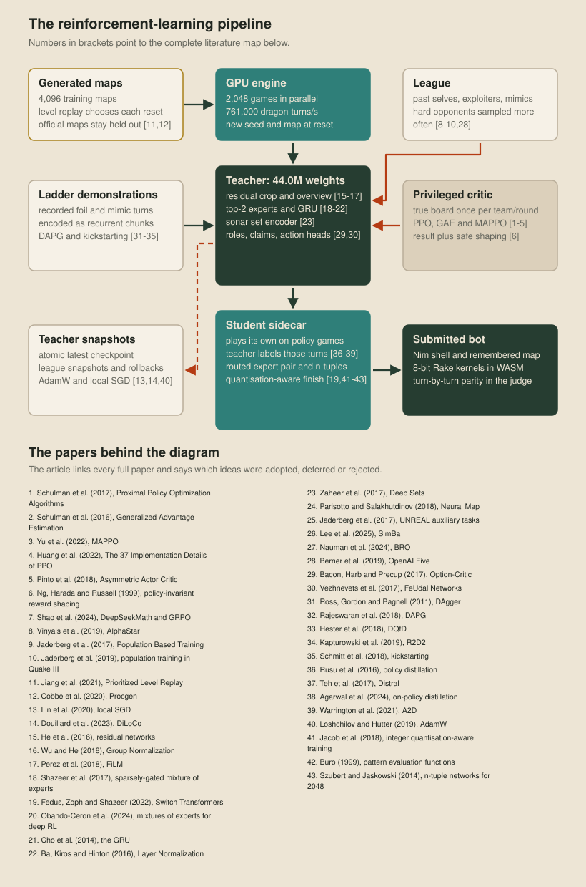
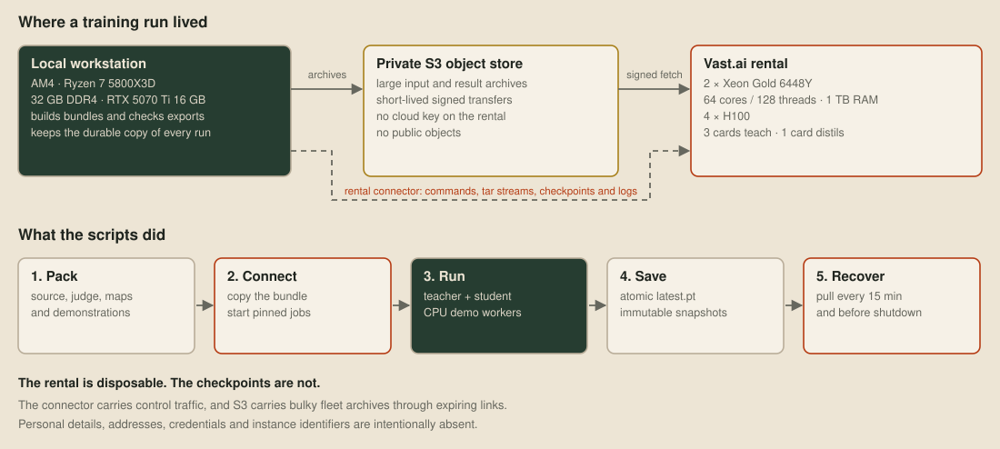
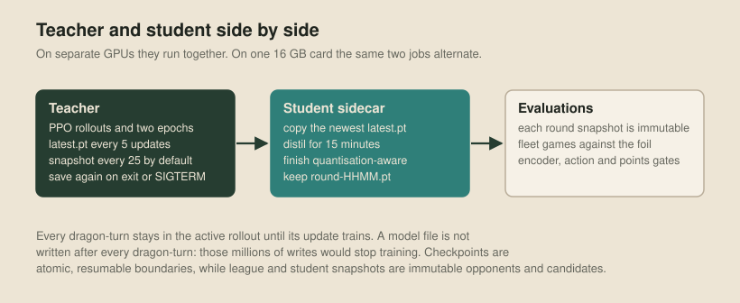
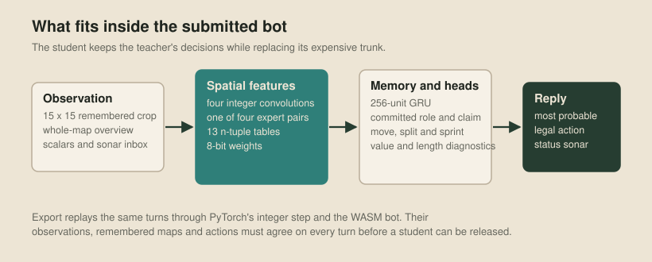

# Learning to play

The planning bot in the previous article makes its choices from hand-written rules and scores. Our learned bot gets the same incomplete view of the game, but learns those choices from games. We train a 44-million-weight teacher network by reinforcement learning where compute is cheap, then distil it into a smaller student that fits inside the competition judge's turn budget.

## The whole pipeline

Training runs on our [GPU port of the organisers' engine](20-an-engine-on-the-gpu.md), which keeps thousands of games resident on one card, so observations, actions and rewards never leave the GPU.

When a game ends, the trainer resets its lane with a new map and a new 62-bit seed. The pool holds 4,096 generated maps, plus more generated and community maps, varying in size, symmetry, kelp, portals, pearl gaps and starting bodies. [Prioritized Level Replay](https://arxiv.org/abs/2010.03934) picks each lane's map: unseen maps get half of new starts, and the rest mix maps with the most positive advantage left in their last game and maps that have gone longest without play. The official and ladder maps are held out for evaluation, so a student has to generalise to them.

## The machines

The workstation prepares maps and demonstrations, starts the rental jobs, checks the exported student and keeps the durable copy of every checkpoint. On the disposable four-H100 rental, three cards trained the teacher with local SGD and the fourth trained the student, while the CPU cores played and encoded new demonstrations.

## The teacher

One policy controls every dragon. Its observation is egocentric: a 15 by 15 crop of the remembered map, a coarse overview of the whole remembered map, scalar facts and up to eight sonar messages. The crop is rotated so forward is always up and mirrored at random during training, which spares the network from relearning those two symmetries.

Eight residual blocks process the crop, with FiLM injecting the scalar state into each one, while separate convolutions read the overview. A set encoder pools sonar, and two top-two-of-sixteen expert layers add capacity without running every expert on every turn. A 512-unit GRU carries each dragon's memory, and every reader takes a layer-normalised copy. Without that normalisation, the update gate saturated and the network learnt little beyond its commonest action.

The action is a tree of parts rather than one enormous categorical choice. One head chooses move, sprint or split, and further heads choose a move's relative direction or a split size. A sprint uses a recurrent decoder for two to eight steps, with each direction conditioned on the steps before it. Illegal split sizes and unaffordable sprint steps are masked. Nothing else is forbidden, because deliberately dying can be the correct move.

The policy also chooses a role at birth and every fixed role interval, then holds it between choices, while a claim head picks a nearby cell or no claim and sends the choice in the status packet. Roles give temporal commitment, and actions remain free to react on every turn.

## Critic and reward

The critic is a training-only network that estimates the return to expect from a position. It sees the true board, every dragon and every pearl countdown, while the actor, and the student after it, only ever receive information available to a submitted dragon. This is centralised training with decentralised execution, in the style of MAPPO and asymmetric actor-critic.

The terminal reward is the game result. Potential-based shaping adds 0.02 for each segment of longest-dragon lead and 0.01 for each segment of total-length lead, which makes the signal denser without changing which terminal policy is optimal.

PPO trains on rollouts of many games under fixed weights, making two passes over each before collecting fresh games, with Generalized Advantage Estimation carrying delayed results back through the rollout and AdamW applying the gradients. Auxiliary heads ask the memory to reconstruct hidden cells, enemy heads three rounds ahead and the dragon's own future length.

## The league

The league holds frozen teacher snapshots from this run and others, including exploiters, and learned imitations of other ladder bots. Prioritised fictitious self-play weights an opponent by the square of one minus our smoothed win rate, so policies that still beat us appear more often. Self-play remains the default, and a fixed reference policy takes a smaller share so the run can't forget its starting competence.

Public ladder games also enter as demonstrations. We replay a foil or imitation policy, record every decision and encode each dragon's life into recurrent chunks, applied by the trainer through the DAPG demonstration loss beside PPO. Training rescans the demonstration directory every few updates, so new games join without a restart.

Our compiled planning bots can't run inside the training engine, so they play the teacher through the judge's served-team mode, with the official engine and the WASM opponent on the CPU and a GPU server batching the teacher's replies. Those games are mainly for evaluation, and they occasionally join training when an evaluation exposes a weakness.

## The sidecar

The teacher writes `latest.pt` beside the live file and renames it into place, so the student never opens a half-written checkpoint. Each student round copies the newest teacher checkpoint and plays games under the student's own policy while the teacher labels the action distributions on those positions. The round ends quantisation-aware and is saved as an immutable `round-HHMM.pt`, so every policy sent to evaluation can be reproduced. On a single card, the two networks take turns.

## The student

The submitted bot can't carry the teacher. Each dragon has 48 MB of memory, and the judge also limits the submission's size and each turn's cost:

| Resource | Judge's limit | Student |
| --- | --- | --- |
| Submission | 4 MB ZIP | About 1 MB of embedded weights |
| Work per turn | 100 million points | About 8 million multiply-adds |

The student replaces the teacher's trunk with four 3 by 3 convolutions, and it stores four routed expert pairs but runs only one on a turn. Thirteen n-tuple tables recognise small spatial patterns in the fresh window, and a 256-unit GRU, overview and sonar encoders, role and claim heads, and the teacher's action tree complete it.

The student trains on-policy. It plays under its own imperfect policy and asks the teacher what distribution it should have produced at each state along the way. Otherwise a student can look good on teacher states, make one different move in a real game, and then have no training for everything that follows.

During the final third of each distillation round, training fakes the bot's exact arithmetic. Convolution weights are signed 8-bit values, activations are 16-bit, sums are exact 32-bit integers and each layer requantises with its recorded scale. Later dense layers and the GRU use 8-bit weights with one scale per row.

Export checks that PyTorch's integer path agrees with the quantised student's actions, then replays the same turns through the WebAssembly bot in the judge, which has to agree on the observation, remembered map, action and status sonar on every turn. The judge also measures its p99 point cost before the student plays verdicts against the foil and the latest planning bot.

## Literature

| Papers | Used for |
| --- | --- |
| Schulman et al., [Proximal Policy Optimization Algorithms](https://arxiv.org/abs/1707.06347) (2017), and [High-Dimensional Continuous Control Using Generalized Advantage Estimation](https://arxiv.org/abs/1506.02438) (2016) | Optimiser and credit assignment |
| Yu et al., [The Surprising Effectiveness of PPO in Cooperative Multi-Agent Games](https://arxiv.org/abs/2103.01955) (2022), Huang et al., [The 37 Implementation Details of PPO](https://arxiv.org/abs/2205.09123) (2022), and Pinto et al., [Asymmetric Actor Critic for Image-Based Robot Learning](https://arxiv.org/abs/1710.06542) (2018) | Centralised critic and PPO details |
| Ng, Harada and Russell, [Policy Invariance under Reward Transformations](https://ai.stanford.edu/~ang/papers/icml99-shaping.pdf) (1999) | Reward shaping |
| Vinyals et al., [Grandmaster Level in StarCraft II Using Multi-Agent Reinforcement Learning](https://doi.org/10.1038/s41586-019-1724-z) (2019), Jaderberg et al., [Population Based Training of Neural Networks](https://arxiv.org/abs/1711.09846) (2017), and [Human-level Performance in 3D Multiplayer Games with Population-Based Reinforcement Learning](https://doi.org/10.1126/science.aau6249) (2019) | League, exploiters and autoregressive action heads |
| Jiang, Grefenstette and Rocktaschel, [Prioritized Level Replay](https://arxiv.org/abs/2010.03934) (2021), and Cobbe et al., [Leveraging Procedural Generation to Benchmark Reinforcement Learning](https://arxiv.org/abs/1912.01588) (2020) | Generated maps and map selection |
| Lin et al., [Don't Use Large Mini-Batches, Use Local SGD](https://arxiv.org/abs/1808.07217) (2020) | Three-GPU teacher training |
| He et al., [Deep Residual Learning for Image Recognition](https://arxiv.org/abs/1512.03385) (2016), Wu and He, [Group Normalization](https://arxiv.org/abs/1803.08494) (2018), and Perez et al., [FiLM](https://arxiv.org/abs/1709.07871) (2018) | Spatial trunk |
| Shazeer et al., [Outrageously Large Neural Networks](https://arxiv.org/abs/1701.06538) (2017), Fedus, Zoph and Shazeer, [Switch Transformers](https://arxiv.org/abs/2101.03961) (2022), and Obando-Ceron et al., [Mixtures of Experts Unlock Parameter Scaling for Deep RL](https://arxiv.org/abs/2402.08609) (2024) | Expert layers |
| Cho et al., [Learning Phrase Representations using RNN Encoder-Decoder for Statistical Machine Translation](https://arxiv.org/abs/1406.1078) (2014), and Ba, Kiros and Hinton, [Layer Normalization](https://arxiv.org/abs/1607.06450) (2016) | Normalised GRU memory |
| Zaheer et al., [Deep Sets](https://arxiv.org/abs/1703.06114) (2017), Parisotto and Salakhutdinov, [Neural Map](https://arxiv.org/abs/1702.08360) (2018), and Jaderberg et al., [Reinforcement Learning with Unsupervised Auxiliary Tasks](https://arxiv.org/abs/1611.05397) (2017) | Sonar encoder, remembered map and auxiliary heads |
| Bacon, Harb and Precup, [The Option-Critic Architecture](https://arxiv.org/abs/1609.05140) (2017), and Vezhnevets et al., [FeUdal Networks](https://arxiv.org/abs/1703.01161) (2017) | Committed role head |
| Rajeswaran et al., [Learning Complex Dexterous Manipulation with Deep Reinforcement Learning and Demonstrations](https://arxiv.org/abs/1709.10087) (2018), Kapturowski et al., [Recurrent Experience Replay in Distributed Reinforcement Learning](https://openreview.net/forum?id=r1lyTjAqYX) (2019), and Schmitt et al., [Kickstarting Deep Reinforcement Learning](https://arxiv.org/abs/1803.03835) (2018) | Learning from demonstrations |
| Rusu et al., [Policy Distillation](https://arxiv.org/abs/1511.06295) (2016), Agarwal et al., [On-Policy Distillation of Language Models](https://arxiv.org/abs/2306.13649) (2024), and Warrington et al., [Robust Asymmetric Learning in POMDPs](https://arxiv.org/abs/2012.15566) (2021) | On-policy distillation, with privileged information kept in the critic |
| Loshchilov and Hutter, [Decoupled Weight Decay Regularization](https://arxiv.org/abs/1711.05101) (2019), and Jacob et al., [Quantization and Training of Neural Networks for Efficient Integer-Arithmetic-Only Inference](https://arxiv.org/abs/1712.05877) (2018) | AdamW and quantisation-aware training |
| Buro, [From Simple Features to Sophisticated Evaluation Functions](https://doi.org/10.1007/3-540-48957-6_8) (1999), and Szubert and Jaskowski, [Temporal Difference Learning of N-Tuple Networks for the Game 2048](https://doi.org/10.1109/CIG.2014.6932877) (2014) | N-tuple tables |

Next: [A tour of our bot](28-a-tour-of-our-bot.md), the historical planning design and its unfinished student-mover integration.
