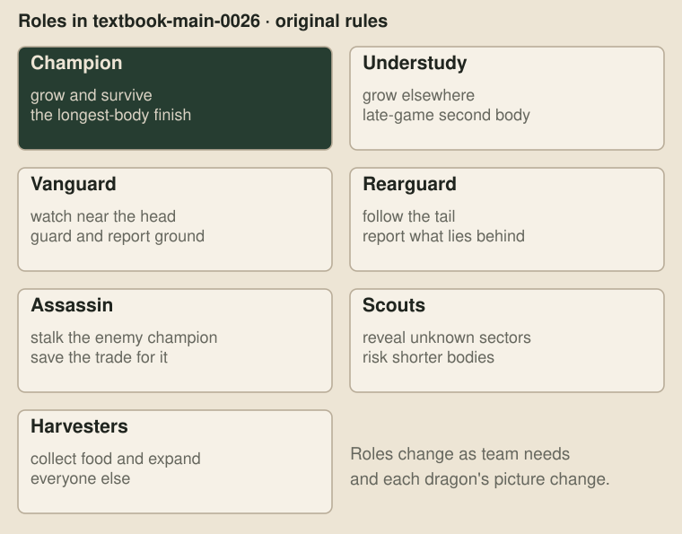
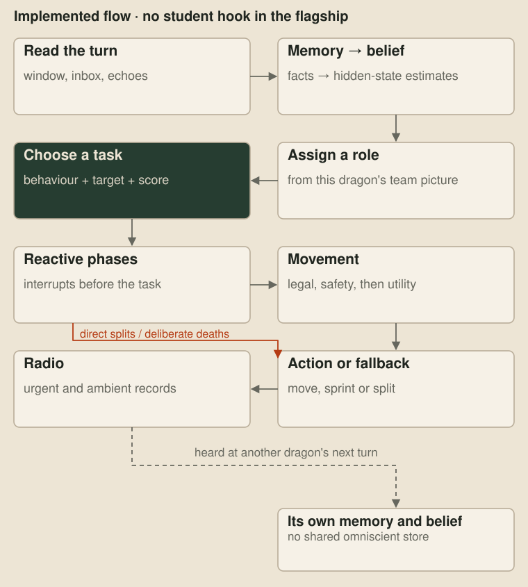
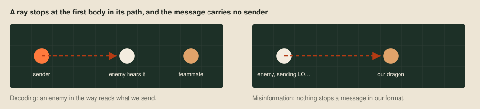
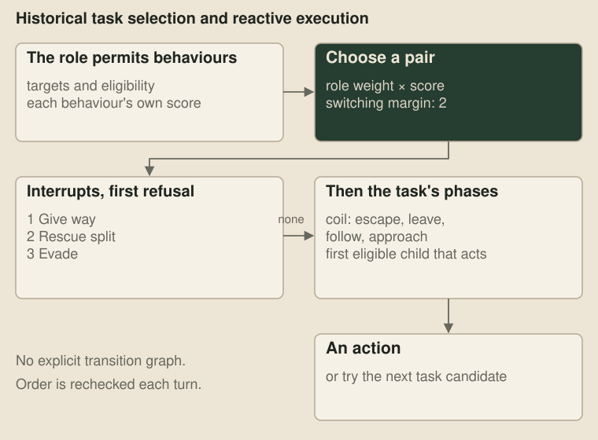
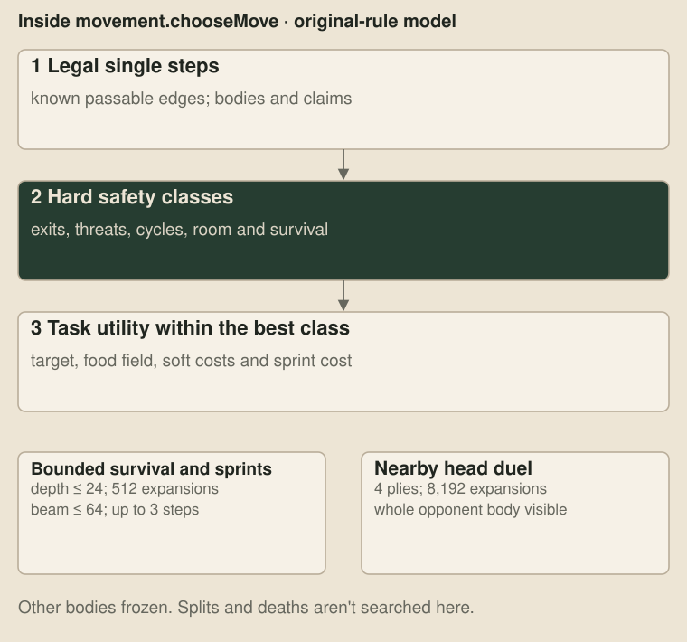
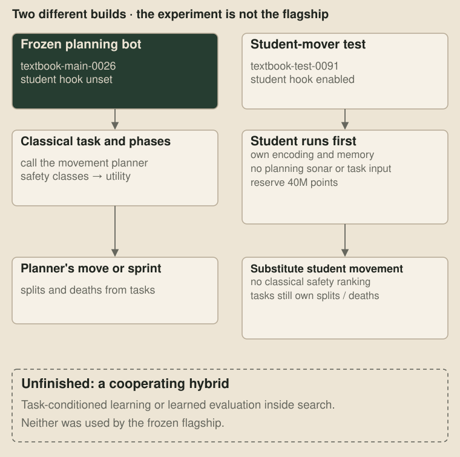
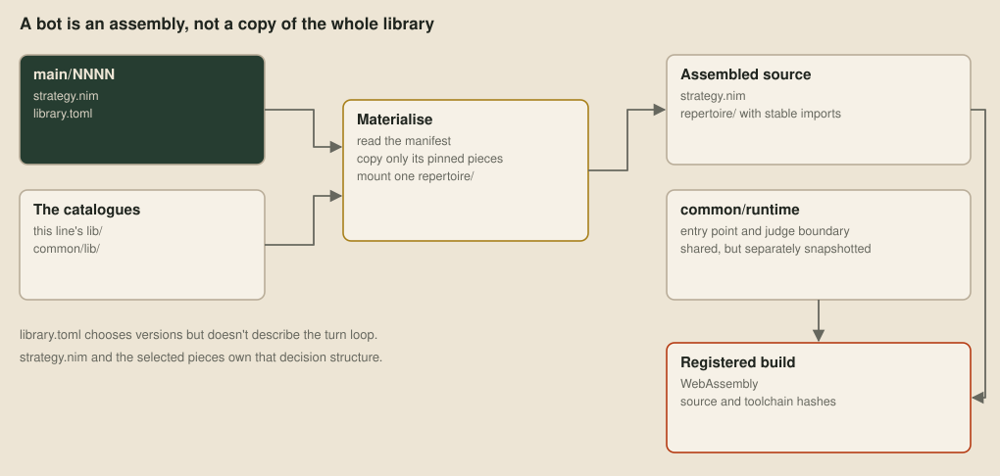

# A tour of our bot

I'd planned to finish this series with our bot for the Grand Final, with the planning design and the learned policy finally working together. Then the rules changed, as [Slay the Queen](29-slay-the-queen.md) explains, and the bot now in development uses a different architecture. This is a tour of the old design as it stood, unfinished parts included, because the reasons for building it this way are still worth explaining.

The tour follows textbook-main-0026, the last frozen planning version, which added guards at both ends of the champion and a dedicated assassin to the design in [Planning to play](26-planning-to-play.md). It also covers an experiment that plugged in the student from [Learning to play](27-learning-to-play.md).

## Team roles

Under the original rules, eliminating the other team won immediately. If both teams survived 500 rounds, the longest dragon decided the winner, with total team length breaking a tie. So the team wanted to collect food widely, then concentrate it in one body without letting that body die.

That body was the champion, usually the longest dragon, and the role could pass between dragons. Early on, splitting made more mouths to collect food and more eyes to discover the board. Later, the champion stayed whole while smaller dragons protected it, and some fed it by dying nearby and leaving pearls. A second long dragon could grow elsewhere as an understudy.

Sacrificing a small dragon made sense under that scoring rule, because its length became food for the body that decided the result. Trading a short head for a long enemy head could pay off too, but only while we had dragons to spare.

Each dragon ran its own copy of the bot, with no central program. It saw the 7×7 window around its head and heard whatever sonar reached its body. The game supplied a few exact public quantities, such as team size, but not where teammates were, so seven dragons running the same role assignment could still disagree.

## One dragon's turn

Each turn the bot updated its facts, inferred what might now be true, assigned a role and chose a task from that role's repertoire. The task then called movement with its target and preferences, movement searched and ranked the options, and the radio fitted messages to the dragon's four sonar rays.

The intended design had a cleaner handoff, where a task produced an intent and a separate tactical stage turned it into an action. We hadn't reached that, so each behaviour called movement itself with its own choices about sprinting, trading heads and avoiding cells. Rescue splits, feeding deaths and probing an unknown portal skipped movement entirely, which is why the figure gives them their own path.

## Facts, guesses and old news

Memory held one record per board cell, describing each edge as unknown, open, kelp or a portal, alongside records of pearls, spawn timers, sightings, teammate statuses, tasks, path claims and deaths. Sight outranked messages: seeing a tile rewrote its record, while a teammate's map report only filled in unseen cells. A body turning into pearls told us a dragon had died, unless a later status report overturned that.

| Question | Retained | Inferred |
| --- | --- | --- |
| Can I cross this edge? | Seen sides, portal links and sonar echoes | Passability on unseen edges, including evidence from map symmetry |
| Will there be food when I arrive? | Pearls, countdowns and observed reset gaps | Spawn attempts and the chance a pearl survives until arrival |
| Where is that dragon? | Its last head, heading, length bound and report round | A distribution over possible heads and headings, and a chance it is alive |
| Will this body still block the route? | Visible segments and their place behind a head | When those cells could clear if the dragon keeps moving |

The belief turned memory into those answers each turn. Geometry used a Dirichlet prior over edge kinds, and pearls combined a renewal process for spawn attempts with a two-state model of whether food was present. Each dragon got a chance of being alive and a histogram over its head cell and heading, narrowed by an empty visible cell just as by a sighting. These were bounded approximations to recursive Bayes filtering, as in Thrun, Burgard and Fox's *Probabilistic Robotics*, because the bot couldn't afford an exact distribution over everyone's bodies and intentions.

The belief also raised an enemy's minimum length from its head trail. A window might show four segments, but if the body still covered a head position from many rounds earlier, the dragon had to be longer.

## Agreement over four narrow rays

The radio had one 64-bit value per ray, and each ray stopped at the first body in its path, whether enemy or friend. The echo didn't identify the receiver, so the radio asked the belief who was likely to hear each ray and chose records useful to that dragon.

Ambient traffic carried our status and task, sightings, deaths, map edges, pearls and portal links. Urgent traffic came from the behaviour that needed it, such as the champion's right of way, a feed order or a guard reporting ground outside the champion's sight. Frames packed ten record kinds with short codes for small numbers, obscured by the [SPECK64/128](https://eprint.iacr.org/2013/404) cipher. The cipher authenticated nothing, so a send-round field, a trailing zero check and plausibility checks filtered out noise.

Claims stopped teammates competing. A task could claim its target cell for eight rounds, renewed while the task continued, and other dragons yielded unless the owner was unlikely to be as near. The champion could claim its route or coil region as right of way, and a give-way interrupt moved teammates out of it. This resembles Stone and Veloso's [locker-room agreement](https://www.cs.utexas.edu/~pstone/Papers/99aij/teamwork.html), where agents share rules in advance and communicate just enough to apply them. The model also had to allow for gaps: a teammate could hold on to a stale task after its owner had stopped doing it, and an unseen longer teammate could leave two dragons each believing they were champion.

## Role allocation

Each dragon filled role slots in order from its own picture of the team: champion, understudy when wanted, rearguard, vanguard, assassin, scouts, then harvesters. Length favoured the champion and the assassin, proximity mattered for guards, and shorter dragons were cheaper to risk as scouts. A dragon normally kept its role for twenty rounds. Late in the game a short dragon could become champion, but only when it knew the whole team, since otherwise a short dragon that hadn't heard of anyone longer would appoint itself.

The role decided which behaviours could compete, and the twenty-three behaviours fell into five families:

| Family | Behaviours | Purpose |
| --- | --- | --- |
| Collect and discover | forage, explore, scavenge, farm, race, probePortal | Find food, use fast spawners, reach contested pearls and learn unknown ground |
| Grow and protect | championGrow, understudyGrow, coil, door, vanguard, rearguard | Keep the decisive bodies growing, give them room and watch both ends |
| Expand | expandSplit, standoffSplit, recruitRearguard | Add useful dragons, leave a survivor after a head trade, or supply a missing tail guard |
| Fight | contest, hunt, strike, tailStrike, portalBlock, assassinate | Reduce enemy options or trade when the target justified the cost |
| Transfer and finish | feed, endgame | Concentrate length near the finish and preserve or overtake the lead |

## Tasks and phases

A task was a behaviour bound to a target, such as a cell or an enemy dragon. Most behaviours scored on a food-like scale, a pearl worth 80 divided by one plus the time to reach it, while expansion and endgame retreat used fixed scores once their conditions held. The current task stayed selected unless another beat it by more than 2.

Nine behaviours had phases, checked in priority order each turn. The coil, for example, checked escape before leave, follow and approach. Our state-machine library supported guarded transitions in the style of [Harel's statecharts](https://www.weizmann.ac.il/math/harel/sites/math.harel/files/users/user50/Statecharts.pdf), but this bot used none. Its phases were reactive lists, where the first phase to produce an action won.

Take a harvester with food nearby and an enemy approaching. If rescue can save a trapped body by splitting, that interrupt acts first. Otherwise forage calls movement, which can prefer a safer landing even if it leads away from the food, so a high forage score alone can't send the harvester into danger.

## Movement

Movement assessed each legal step for exits, threats, room, cycles, sealed teammates and survival, then sorted the steps into eleven safety classes. The caller's utility only broke ties within a class, so no pearl could buy a less safe move. The classes came from an approximate local model and could still be wrong.

A survival search looked ahead about the dragon's length, a beam search planned sprints, and when a nearby enemy's whole body was visible, a four-ply alpha-beta duel could play out the head-to-head. Routing used Dijkstra's algorithm with Dial's bucket queue, charging uncertain edges more than known ones. The searches froze every other body, so they never played out a whole team's reply, and the duel treated the opposition as one adversary. We wanted to improve on both limits.

All of this ran inside the judge's 100-million-point turn. The bot estimated its own work by counting cells and expanded nodes, skipped optional assessment once that estimate ran high, and used the judge's clock as an emergency brake so it always had time left to send an action.

## Student integration

Only the small student from [Learning to play](27-learning-to-play.md) could run at play time. Distilling a large teacher into it, following [Rusu and colleagues](https://arxiv.org/abs/1511.06295), solved the runtime-size problem, so the open question was which decision to give it while keeping the planning structure inspectable.

Our one experiment, textbook-test-0091-student-mover, kept the planning roles, tasks and phases, but whenever a task called movement, the student's move or sprint replaced the search. The planner still owned splits, deliberate deaths, orders and claims. The network had 40 million points of each turn reserved for it, and it kept its own memory of the map.

That made the student easy to plug in but left it working alone. A task could say “approach this pearl” while the network chose a move for its own reasons, without seeing the task, reading the team's sonar or passing through the safety classes. The real integration still needed a way for the planner to ask the student for something specific.

We kept the planning design readable so that we could follow a bad decision back to its source, and we added learning because our handwritten estimates and local search couldn't price plenty of decisions well. We hadn't finished bringing the two together when the rules changed.

## Decision inspection

The bot was assembled in Nim from a small strategy file and pinned library versions, so a later library improvement couldn't silently change the bot behind an old replay. Generic techniques such as the histogram filter, utility selector and state machine lived apart from Loong-specific behaviours, and Rake supplied the flood-fill kernel.

Diagnostics recorded the decision at every level: role suitability, task candidates and scores, the phases considered, movement assessments and the chosen action. With those, a review could ask whether a dragon misjudged an enemy's length, whether two dragons claimed the same food from different information, or whether a reasonable task chose an unsafe move. [Through one dragon's eyes](11-through-one-dragons-eyes.md) describes the viewer that answers those questions from the dragon's own window and memory.

## Sources and further reading

The competitive source and weights remain private. Posts [26](26-planning-to-play.md) and [27](27-learning-to-play.md) have the full planning and learning bibliographies.

| Reference | Contribution |
| --- | --- |
| Russell and Norvig, [Artificial Intelligence: A Modern Approach, chapter 2](https://aima.cs.berkeley.edu/4th-ed/pdfs/newchap02.pdf), 4th edition, 2020 | The model-based, utility-based agent framing |
| Thrun, Burgard and Fox, *Probabilistic Robotics*, 2005 | Recursive belief updates and histogram filtering |
| Stone and Veloso, [Task Decomposition, Dynamic Role Assignment, and Low-Bandwidth Communication for Real-Time Strategic Teamwork](https://www.cs.utexas.edu/~pstone/Papers/99aij/teamwork.html), 1999 | Common team agreements and dynamic roles with limited communication |
| Browning et al., [STP: Skills, Tactics, and Plays](https://doi.org/10.1243/095965105X9470), 2005 | Separating team organisation from an agent's execution |
| Mark, *Behavioral Mathematics for Game AI*, 2009 | Utility selection, with a single scoring formula in place of response curves |
| Harel, [Statecharts: A Visual Formalism for Complex Systems](https://www.weizmann.ac.il/math/harel/sites/math.harel/files/users/user50/Statecharts.pdf), 1987 | Hierarchical state machines, reduced in our bot to reactive fall-through lists |
| Smith, [The Contract Net Protocol](https://doi.org/10.1109/TC.1980.1675516), 1980, and Gray and Cheriton, [Leases](https://doi.org/10.1145/74850.74870), 1989 | Allocation and expiry for task claims, without a full bidding protocol |
| Beaulieu et al., [The SIMON and SPECK Families of Lightweight Block Ciphers](https://eprint.iacr.org/2013/404), 2013 | The sonar frame cipher |
| Rusu et al., [Policy Distillation](https://arxiv.org/abs/1511.06295), 2016 | Transferring a large teacher's policy to a smaller runtime student |

Next: [Slay the Queen](29-slay-the-queen.md).
